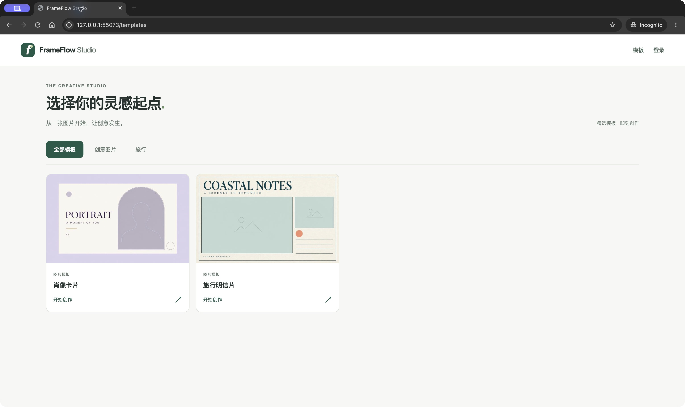
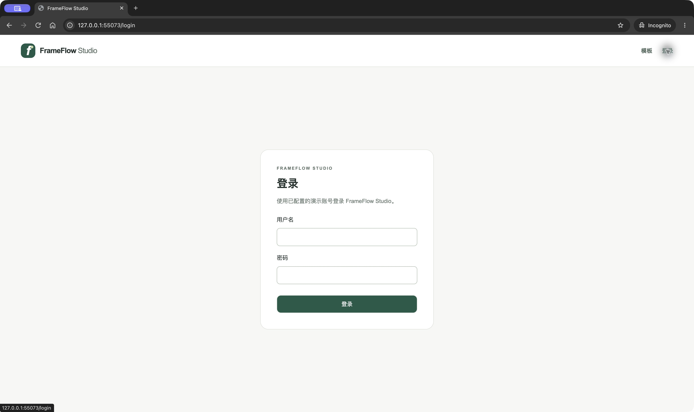
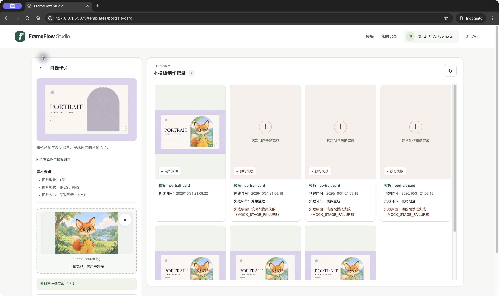
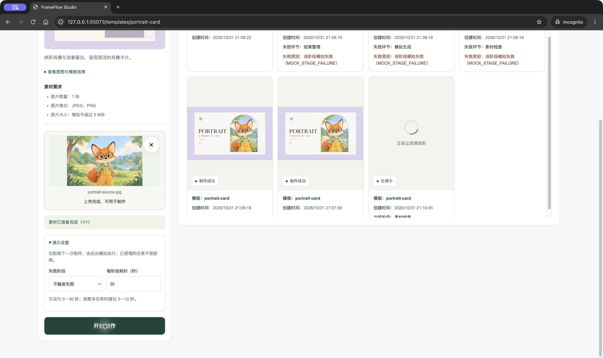
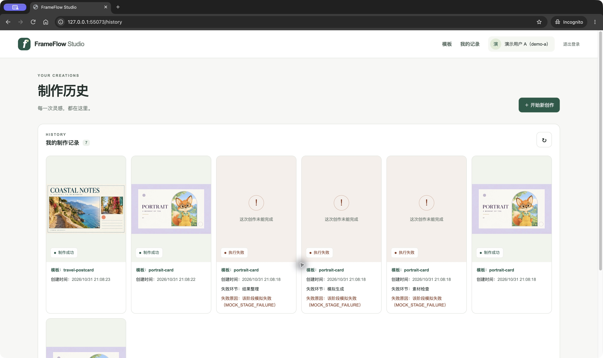

# FrameFlow Studio

一个可以独立运行的图片素材制作网站。用户选择模板、上传图片并提交任务，Java 后台依次完成素材检查、模拟生成和结果整理；等待期间可以继续制作其他任务，也可以离开页面，之后从个人记录查看结果。

本项目用于全栈开发 Assessment。重点放在多步骤异步执行、任务持久化和前端异步状态管理。**生成器返回按模板预置的效果图，不会根据本次上传的内容生成图片，也不调用真实 AI 服务。**



## 阅读指引

- [快速运行](#快速运行)：使用 Docker Compose 启动网站，无须在宿主机安装 Java、Node.js 或 MySQL。
- [操作与验收演示](#操作与验收演示)：成功、阶段失败、多任务、刷新恢复和账号隔离。
- [技术与实现](#技术与实现)：版本、项目结构、后台执行和前端状态管理。
- [主要接口](#主要接口)：请求、响应、认证和错误语义。
- [测试与验证](#测试与验证)：容器内检查命令、已有证据和未验证事项。
- [部署与回滚](#部署与回滚)：配置更新、数据备份和版本恢复。
- [完成情况与限制](#完成情况与限制)、[AI 使用与投入](#ai-使用与投入)、[文档索引](#文档索引)。

## 快速运行

### 1. 准备环境与配置

需要 Docker Engine / Docker Desktop、Docker Compose v2，以及可访问镜像仓库、Maven Central 和 npm registry 的网络。首次启动会下载依赖并构建镜像。以下命令在项目根目录执行，使用 Bash / zsh 语法。

```bash
cp .env.example .env
```

编辑自己的 `.env`，至少填写这四项。密码由运行者设置，项目没有通用默认密码，也不需要 AI API Key。

```dotenv
DB_PASSWORD=CHANGE_ME_LOCAL_DB_PASSWORD
MYSQL_ROOT_PASSWORD=CHANGE_ME_LOCAL_ROOT_PASSWORD
DEMO_A_PASSWORD=
DEMO_B_PASSWORD=
```

把 `CHANGE_ME_*` 换成本地密码，并为两个演示账号填写不同的密码（各 8～72 个 UTF-8 字节）。`.env` 已被 Git 忽略，不要把真实配置放进源码包。需要演示指定阶段失败或长耗时时，同时设置：

```dotenv
MOCK_CONTROLS_ENABLED=true
```

此开关默认为 `false`。开启后，详情页会出现折叠的“演示设置”，后端也允许接收对应参数。它仅用于本地演示。

### 2. 构建并启动

```bash
docker compose --env-file .env.example config --quiet
docker compose up --build -d
docker compose ps --all
```

第一条命令只检查脱敏示例是否能解析；实际启动读取自己的 `.env`。`up -d` 返回后，服务可能仍在初始化，可查看：

```bash
docker compose logs --tail=100 mysql accounts-init backend frontend
```

首次空卷启动会依次完成：MySQL 建库和执行初始 SQL → `accounts-init` 创建缺失的演示账号 → Java 后端启动 → Next.js 前端启动。`accounts-init` 成功后退出（`Exited (0)`）是正常情况。

打开 **[http://localhost:3000/templates](http://localhost:3000/templates)**。能看到两个模板即说明前端已通过 Java 读取目录；随后登录并提交任务，才能进一步确认数据库和素材存储可用。

| 入口 | 默认地址 | 用途 |
| --- | --- | --- |
| 网站 | `http://localhost:3000` | 浏览、登录、上传、制作、个人记录 |
| Java API | `http://localhost:8080/api/v1` | 联调入口，浏览器正常使用时经 Next 同源转发 |
| MySQL | `127.0.0.1:3306` | 本地数据库连接 |

端口冲突时修改 `.env` 中的 `FRONTEND_PORT`、`SERVER_PORT`、`DB_PORT`，再运行 `docker compose up -d`。容器内部地址保持为 `backend:8080` 和 `mysql:3306`，不跟随宿主机端口变化。请在同一次演示中固定使用 `localhost` 或 `127.0.0.1`，两者的 Cookie 不共享。

### 3. 登录与准备素材

使用 `demo-a` 或 `demo-b`，密码为刚才配置的值。登录成功进入“我的记录”；新数据库的历史为空。



进入任一模板，展开“查看原图与模板效果”，可下载用于上传演示的原图。源码也已包含这些文件：

| 模板 | 要求 | 可直接使用的原图 |
| --- | --- | --- |
| 肖像卡片 `portrait-card` | 1 张 JPEG/PNG，每张 ≤ 5 MiB | [portrait-source.jpg](frontend/public/demo-examples/portrait-source.jpg) |
| 旅行明信片 `travel-postcard` | 2 张 JPEG/PNG，每张 ≤ 8 MiB | [海岸原图](frontend/public/demo-examples/travel-coast-source.jpg)、[小镇原图](frontend/public/demo-examples/travel-town-source.jpg) |

无需额外导入模板或下载外部素材。模板目录来自 Java 打包的 JSON，封面和 Mock 结果随后端打包；公开演示原图随前端打包。Mock 的固定结果仅用于验证业务流程，上传任意合规图片也会得到该模板对应的固定效果图。

### 停止与再次启动

```bash
docker compose down
docker compose up -d
```

`down` 保留数据库卷和上传素材卷。再次启动后重新登录同一账号，原有历史和素材仍可读取。**这不代表未完成的任务会恢复执行**，重启边界见[已知限制](#已知限制)。不要用 `down -v` 处理初始化问题，它会删除数据卷。

## 操作与验收演示

截图拍摄于 2026-10-31，来自本项目生产镜像、Java、MySQL 组成的专用本地容器环境。截图中的随机端口、任务时间和记录数量仅代表那次演示；所有内容均为演示账号和示例素材。

### 正常制作与上传交互

1. 在模板列表切换“创意图片”和“旅行”，进入对应详情。
2. 点击上传位选择原图。可以点击预览替换，也可以用移除按钮清空当前位置；观察上传中、失败或完成反馈。
3. 所有位置均显示上传完成后，“开始制作”才可点击。提交请求期间锁定本次素材和设置，受理后恢复操作。
4. 任务卡片显示等待或处理中及实际阶段，随后展示成功图片。“我的记录”可查看两个模板的全部本人任务。

前后端都会校验素材，Java 会检测真实图片类型和可解码性。修改扩展名不能绕过校验；空文件、损坏图片、类型或大小不符不会正常受理。替换/移除只改变当前选择，不删除已上传的服务器文件。



### 指定阶段失败与耗时调整

先将 `.env` 的 `MOCK_CONTROLS_ENABLED` 设为 `true`，运行 `docker compose up -d` 更新前后端环境，然后刷新详情页。

上传完成后展开“演示设置”。“每阶段耗时”是 **0～30 的整数秒数**，默认每阶段 1 秒；成功任务会经过三个阶段，设置为 10 秒时总耗时约 30 秒，另加排队和实际 I/O 时间。

| 场景 | 失败阶段 | 每阶段耗时建议 | 应观察到的结果 |
| --- | --- | --- | --- |
| 正常完成 | 不触发失败 | 5 秒 | 素材检查 → 模拟生成 → 结果整理 → 成功图片 |
| 第一步失败 | 素材检查失败 | 1 秒 | 停在素材检查，保存原因，不执行后两步 |
| 第二步失败 | 生成失败 | 1 秒 | 素材检查后在模拟生成失败，不执行结果整理 |
| 第三步失败 | 结果整理失败 | 1 秒 | 前两步完成，在结果整理失败，不产生成功结果 |

每个失败点分别提交一次，再刷新历史，失败环节和原因应保留。模拟参数在受理时按任务捕获，后续修改不会改变已受理任务。演示结束后可将开关改回 `false` 并运行 `docker compose up -d`。



### 多任务与刷新恢复

使用同一批已就绪素材，连续提交下面两项：

1. A：不触发失败，每阶段 10 秒。
2. 收到受理后，改为 B：生成失败，每阶段 1 秒，再次提交。

A 应继续执行并最终成功，B 应单独失败；等待、阶段、错误和结果各自更新。默认有两个工作线程，更多任务可排队，无须等前一项结束才能创建下一项。

在 A 处理中刷新页面，应从 Java 恢复记录并继续跟踪；关闭制作页，稍后重新进入“我的记录”，后台任务仍会完成。成功/失败后再次刷新，结论不应回退。已结束任务停止自动查询，没有未完成任务时也不继续轮询。



### 账号切换与个人记录

以 `demo-a` 创建任务后退出，再用 `demo-b` 登录。B 只能看到自己的任务和素材；切回 A 后恢复 A 的历史。可用 B 创建一项任务，进一步确认双向隔离。

Java 从会话取得稳定账号 ID，并在用例和查询中限定本人范围。客户端不能通过传入 `ownerId` 访问他人资源；他人的任务、输入和结果与不存在资源均返回 404。

同一浏览器的普通标签页共享 Cookie，不能用两个普通标签页同时维持 A/B 两套独立登录。可以用普通窗口和隐身窗口分别登录，或在共享 Cookie 的两个标签页观察切换后旧素材/记录被清除。刷新、退出再登录和后端重启都不会改变账号 ID；后端重启只使内存会话失效。

### 查询异常与任务失败的区别

提交一个每阶段 10 秒的成功任务，用 Chrome DevTools 的 Network 将当前页面切到 Offline，等待下一次查询失败。页面应保留已有任务信息，提示自动查询暂停；恢复网络后点击“重新查询状态”，读取实际结论。

断网、503 或查询超时属于请求异常，不能把任务改为执行失败。结果图片读取失败也有独立恢复入口，不改变已经成功的任务结论。提交超时则可能已经受理，应先查看个人记录，避免重复提交。

## 技术与实现

### 版本

精确依赖以 [backend/pom.xml](backend/pom.xml)、[frontend/package.json](frontend/package.json) 和 [package-lock.json](frontend/package-lock.json) 为准。

| 部分 | 版本 / 方案 |
| --- | --- |
| Java / Maven | Java 17；容器构建 Maven 3.9.11 |
| Spring Boot / MyBatis Starter | 4.0.9 / 4.0.1 |
| 数据库 | MySQL 8.4 LTS，InnoDB，UTC 时间 |
| Next.js / React | Next.js 16.4.3 App Router / React 19.3.0 |
| TypeScript / ESLint | 5.9.3 strict / 9.39.5 |
| Node.js / npm | Node 22 LTS（测试要求 ≥ 22.13.0、< 23）/ npm 10.x |
| 测试 | JUnit / Spring 测试、真实 MySQL IT、Vitest 5.0.5 / React Testing Library 16.3.3 |
| 运行与 CI | Docker Compose v2 / GitHub Actions |

前端使用 React hooks、reducer 和页面作用域 controller 管理状态，样式使用 CSS。后端为单 Maven 工程的模块化单体，采用轻量 DDD 与端口/适配器。当前规模使用本机有界线程池即可，没有引入 Redis、消息队列或工作流框架。

### 项目结构与连接方式

```text
.
├── frontend/
│   ├── src/app/                   # 路由、页面、同源 API 转发
│   ├── src/features/              # identity / template / asset / task
│   ├── public/demo-examples/      # 可下载的演示原图与效果图
│   ├── package.json
│   └── package-lock.json
├── backend/
│   ├── src/main/java/com/frameflow/studio/
│   │   ├── trigger/               # HTTP、账号初始化 CLI、Worker 入口
│   │   ├── api/                   # HTTP 请求与响应 DTO
│   │   ├── cases/                 # 用例编排、归属校验、短事务
│   │   ├── domain/                # task / template / asset / identity
│   │   ├── infrastructure/        # MyBatis、文件存储、Mock、执行器和装配
│   │   └── types/                 # 少量共用的纯类型
│   ├── src/main/resources/
│   │   ├── db/schema/             # V001 初始四表 SQL
│   │   ├── mybatis/mapper/        # XML Mapper
│   │   ├── templates/catalog.json
│   │   └── demo-media/            # 封面、固定结果、素材来源说明
│   └── src/test/
├── scripts/                       # 隔离容器 smoke 与联合回归
├── docs/                          # 需求、设计、任务证据和 README 截图
├── .github/workflows/ci.yml
├── .env.example
└── compose.yaml
```

```text
浏览器 → Next.js :3000 → Java :8080 → MySQL :3306
         /api/v1 同源转发    ├→ 上传素材卷
                            └→ 提交后派发 → 后台执行 Case → 分阶段保存
```

Next 按 14 项白名单端点转发 Cookie、CSRF、multipart、JSON 和图片，不访问数据库或执行业务阶段。Java 提供目录、上传、任务、个人记录和结果接口，MySQL 是任务结论的持久化来源。

### 任务状态、事务与前端跟踪

整体状态为 `PENDING → RUNNING → SUCCEEDED / FAILED`，终态没有更新出边。执行阶段固定为：

| 阶段 | 工作 |
| --- | --- |
| `CHECK_ASSETS` | 重新检查任务输入归属、可读性和模板要求 |
| `GENERATE` | 等待指定耗时，由 Mock 选择该模板对应的固定结果 |
| `FINALIZE` | 校验并整理结果引用，成功后持久化可预览信息 |

任务根与有序素材绑定在一个短事务内创建，提交成功后才派发。每个阶段使用独立短事务保存状态，等待、图片读取和生成调用在事务外执行。保存使用 `revision + 预期状态/阶段` 条件更新，旧执行者不能覆盖新状态或终态。查询只读取记录，不推进执行。

默认 2 个工作线程、64 个排队位置。队列明确拒绝时，尽力保存执行前失败 `DISPATCH_REJECTED`；如果该失败写入也异常，记录可能保持等待，不能声称一定落为失败。

前端按任务 ID 独立跟踪，每次请求结束后约 2 秒再查询，避免同任务请求重叠；终态和离页时清理计时器/请求。身份作用域、请求序号、任务 revision 分别阻止旧账号、旧请求和旧版本响应覆盖当前视图。上传、提交、查询和后台执行使用各自状态，查询失败不会转成任务失败。

### 数据与初始化

[V001__initial_schema.sql](backend/src/main/resources/db/schema/V001__initial_schema.sql) 创建四张表：

| 表 | 保存内容 |
| --- | --- |
| `user_account` | 稳定账号 ID、用户名、BCrypt 密码编码 |
| `uploaded_asset` | 本人上传素材的元数据与内部存储引用 |
| `production_task` | 模板、owner、状态、阶段、revision、结果或失败信息 |
| `task_input_asset` | 任务与输入素材的有序绑定 |

个人历史直接读取任务记录，没有额外复制历史表。模板目录只读、不建模板管理表。MySQL 数据位于 `mysql-data` 卷，上传原始文件位于 `asset-data` 卷的 `/data/frameflow/assets`；两者都需保留。

初始 SQL 只在 MySQL 空数据目录首次启动时执行。已有卷不会自动重放 SQL、升级表结构或重置账号密码，普通 Java Web 启动也不建表。若已有库中存在业务表，应先核对和备份，不能直接重跑 V001。

`accounts-init` 只创建缺失的 `demo-a` / `demo-b`，已有密码和 ID 保持不变。首次缺密码导致初始化失败时，补齐 `.env` 后重新运行 `docker compose up -d`；需要显式重跑初始化入口可用：

```bash
docker compose run --rm accounts-init
docker compose up -d
```

不要求预置历史任务，演示数据由正常上传/制作生成。所有公开示例图片已放入源码资源目录，正常构建不运行图片生成器。

### 配置项

| 配置 | 默认 / 要求 | 说明 |
| --- | --- | --- |
| `DB_NAME` / `DB_USERNAME` | `frameflow` / `frameflow` | 首次建库和应用数据库账号 |
| `DB_PASSWORD` / `MYSQL_ROOT_PASSWORD` | 必须自行设置 | 数据库应用密码 / 初始化 root 密码 |
| `DEMO_A_PASSWORD` / `DEMO_B_PASSWORD` | 创建缺失账号时必填 | 不会覆盖已有账号密码 |
| `FRONTEND_PORT` / `SERVER_PORT` / `DB_PORT` | `3000` / `8080` / `3306` | 宿主机端口，Compose 仅绑定 loopback |
| `DB_HOST` | 独立 Java 为 `localhost` | Compose 固定覆盖为 `mysql`，容器数据库端口为 3306 |
| `JAVA_API_ORIGIN` | 独立 Next 为 `http://127.0.0.1:8080` | 仅服务端运行时使用；Compose 固定为 `http://backend:8080` |
| `SESSION_COOKIE_SECURE` | 应用默认 `true`；样例本地为 `false` | 本地 HTTP 需 false；浏览器使用 HTTPS 时设 true |
| `ASSET_STORAGE_ROOT` | 独立 Java 为 `./data/assets` | Compose 固定为 `/data/frameflow/assets` 并挂载素材卷 |
| `TASK_WORKER_COUNT` / `TASK_QUEUE_CAPACITY` | `2` / `64` | 有界后台执行器 |
| `MOCK_CONTROLS_ENABLED` | `false` | 同时传给 Java 与 Next，允许演示设置 |
| `DB_POOL_SIZE` / `APP_LOG_LEVEL` | `5` / `INFO` | 连接池 / 项目日志级别 |

`JAVA_API_ORIGIN` 只允许纯 HTTP(S) origin，不带路径、查询、用户名或密码，不使用 `NEXT_PUBLIC_` 前缀。独立运行时根 `.env` 不会被 Spring Boot 或 `frontend/` 自动加载，应由可信本地配置显式导出；Compose 已负责变量注入。

## 主要接口

所有路径以 `/api/v1` 开头。完整字段、限额和错误契约见 [api-contract.md](docs/api-contract.md)。

| 方法 / 路径 | 请求 | 成功响应 |
| --- | --- | --- |
| `GET /auth/csrf` | 无 | `{token, headerName}`，必要时创建匿名 Cookie |
| `POST /auth/login` | form-urlencoded：`username`、`password` | 200 `{ownerId, username, displayName}` 与会话 Cookie |
| `GET /auth/session` | 会话 Cookie | 200 当前账号 |
| `POST /auth/logout` | 无请求体 | 204，清除会话 |
| `GET /templates/categories` | 无 | `{items: [{categoryId, name}]}` |
| `GET /templates` | 可选 `categoryId` | `{items: [{templateId, title, categoryId, coverUrl}]}` |
| `GET /templates/{templateId}` | 模板 ID | 摘要字段加 `description`、`requirements` |
| `GET /demo-media/{mediaKey}` | 两个已登记封面 key | JPEG 图片字节 |
| `POST /assets` | multipart：`templateId`、`file` | 201 `{assetId, ownerId, mediaType, sizeBytes, createdAt, previewUrl}` |
| `GET /assets/{assetId}/content` | 本人素材 ID | 本人输入图片字节 |
| `POST /tasks` | `templateId`、`assetIds`，可选 `simulation` | 202 `{taskId, ownerId, createdAt}`，含 Location |
| `GET /tasks` | 会话 Cookie | `{items: [TaskView]}`，本人历史按创建时间倒序 |
| `GET /tasks/{taskId}` | 本人任务 ID | 200 `TaskView`，失败任务也使用此状态码 |
| `GET /tasks/{taskId}/result` | 本人成功任务 ID | JPEG 图片；未成功为 409 |

除目录和公开示例封面外，素材/任务需要登录。全部 POST 包括登录都需要 `X-CSRF-TOKEN`。顺序为：取得 CSRF 并保存 Cookie → 登录 → 重新取得 CSRF → 上传/提交；退出后旧 token 不再复用。Cookie 为 HttpOnly、SameSite=Lax、Path=/api；前端只在内存中保留 CSRF，不保存密码或 Bearer 凭据。

创建任务的 JSON 示例（先用上传返回值替换 `assetIds`）：

```json
{
  "templateId": "portrait-card",
  "assetIds": ["82dd291e-4673-4500-8fe3-97a71a6cbe40"],
  "simulation": {"failAtStage": "GENERATE", "stageDelayMs": 5000}
}
```

`simulation` 省略时默认每阶段 1000ms、不触发失败。开启开关后，`failAtStage` 可为 `null`、`CHECK_ASSETS`、`GENERATE`、`FINALIZE`，`stageDelayMs` 为 0～30000 的整数毫秒。关闭开关时必须省略整个 `simulation`，携带它会返回 400。图片数量必须精确符合模板，允许同一本人素材重复占据不同位置。

查询到的 `TaskView` 示例：

```json
{
  "taskId": "283def77-032c-4e18-9d95-34b435a0f2f1",
  "ownerId": "b92661af-8e57-4ac4-9aac-56640e063407",
  "templateId": "portrait-card",
  "status": "RUNNING",
  "currentStage": "GENERATE",
  "revision": 2,
  "createdAt": "2026-10-31T10:00:00Z",
  "updatedAt": "2026-10-31T10:00:01Z",
  "result": null,
  "failure": null
}
```

成功时 `result` 为 `{previewUrl, mediaType}`；阶段失败时 `failure` 为 `{kind:"STAGE", stage, code, message}`。执行前派发失败使用 `kind:"DISPATCH"` 和空阶段。等待任务的阶段为 `null`，成功任务保留 `FINALIZE`；页面可以隐藏已成功任务的阶段行。

常见错误：400 参数不合法，401 未登录或登录失败，403 CSRF 失效，404 资源不存在或不属于本人，413 超出大小/解码预算，415 图片类型不支持，422 图片损坏或不满足模板要求，503 服务/资源不可用，504 上游超时。错误结构为：

```json
{
  "error": {"code": "RESOURCE_NOT_FOUND", "message": "资源不存在", "details": []},
  "requestId": "3a6026b7-968f-4980-bc4e-93fa6d5e46a7"
}
```

私有 JSON 和图片均 `no-store`。提交出现 `SUBMISSION_OUTCOME_UNKNOWN` 或响应丢失时，不能据此断言未创建；错误可能携带可追查 `taskId`，先核对历史。所有写请求都不自动重试。

### API 流程演示（可选）

需要直接验证接口时，可按[容器内 API 演示](docs/api-demo.md)完成登录、上传、连续创建成功/三个阶段失败任务及结果核对。网页操作步骤见前文“操作与验收演示”。

## 测试与验证

### 在容器内执行检查

按题面验收方式，安装、构建、测试和应用均可在容器中执行。以下命令在项目根目录运行，只将构建输出写入对应源码目录，不需要宿主机 Java 或 Node.js。

后端快速测试和打包：

```bash
docker run --rm \
  --mount type=bind,source="$PWD/backend",target=/workspace \
  --workdir /workspace maven:3.9.11-eclipse-temurin-17 \
  mvn --batch-mode --no-transfer-progress verify
```

前端安装、业务测试、静态检查和生产构建：

```bash
docker run --rm \
  --mount type=bind,source="$PWD/frontend",target=/workspace \
  --workdir /workspace node:22-bookworm-slim \
  sh -c 'npm ci && npm run test:ci && npm run lint && npm run typecheck && npm run build'
```

真实 MySQL 集成测试使用额外的 `integration-tests` profile，不能用普通 `verify` 替代。需准备**专用空 MySQL 8.4 测试库**，并向 Maven 容器注入：

| 变量 | 要求 |
| --- | --- |
| `IT_DB_HOST` / `IT_DB_PORT` | 测试实例在容器网络中的可达地址/端口 |
| `IT_DB_NAME` | `frameflow_it` 或以 `frameflow_it_` 开头的名称 |
| `IT_DB_USERNAME` / `IT_DB_PASSWORD` | 仅授权该测试库建表、读写和删表的测试账号 |

在上述 Maven 容器命令中加入相应 `--network` 和五个 `--env`，执行 `mvn --batch-mode --no-transfer-progress -Pintegration-tests verify`。[CI 的 mysql-integration job](.github/workflows/ci.yml) 提供了完整的隔离实例和变量配置。测试在空库检查后建表，各套件仅清理自身创建的表；不要指向业务库。缺配置、库不为空或数据库不可达均失败，不会按跳过处理。

Dockerfile 的后端镜像打包使用 `-DskipTests`，前端镜像构建运行 `npm run build`；**镜像构建成功不等于测试通过**，测试由上面的独立命令和 CI 执行。

开发者已有 Java 17 / Maven / Node 22 时，也可在 `backend/` 直接运行 Maven 命令，在 `frontend/` 运行同一组 npm 命令。独立开发启动为 `mvn spring-boot:run` 和 `JAVA_API_ORIGIN=http://127.0.0.1:8080 npm run dev`；须先完成数据库/账号初始化，并向 Java 导出 `.env`。生产 Next 本地启动使用 `npm run build` 后的 `npm start`，运行时同样注入 `JAVA_API_ORIGIN`。

### 核心行为覆盖与 CI

后端测试覆盖合法/非法状态转换、三阶段调用顺序、每个失败点后续零调用、受理后派发、写入失败与结果未知、权限和真实 SQL 并发条件更新。前端测试覆盖多任务隔离、旧响应拒绝、查询异常保留/暂停/恢复、终态停止轮询、离页/身份变化清理、上传与结果 Blob 生命周期。

[GitHub Actions](.github/workflows/ci.yml) 在 push / pull request 时运行四个 job：`backend`、`frontend`、`mysql-integration`、`compose`。compose job 检查配置、Python 脚本边界并运行真实隔离容器回归，包含空卷初始化、14 项 API、阶段失败、双账号隔离及 down/up 持久化。各 job 上传测试报告或脱敏日志，不自动部署。

开发者本地需要重复容器业务回归时，可以使用现有的宿主编排入口（需要 Python 3.10+ 和 Docker；评估者可直接采用前述 Compose 与容器内测试命令）：

```bash
python3 -m unittest discover -s scripts -p 'test_*.py' -v
python3 scripts/acceptance-regression.py
```

脚本不读取个人 `.env`，创建随机项目、临时密码和专用卷，完成后仅清理本次资源。它在宿主机编排 Docker 和发送 HTTP，请勿将其描述为所有脚本都在容器内执行。需要浏览器参与时可加 `--browser-review`；连接文件包含一次性凭据且被 Git 忽略，按[联合回归说明](docs/ip16-regression.md)结束检查，不能打包交付。

### 已有验证结果

以下为实际记录，详细命令、边界和失败修正保留在 [tasks.md](docs/tasks.md) 和 [IP-16 联合回归](docs/ip16-regression.md)。

| 日期 / 范围 | 结果 |
| --- | --- |
| 2026-10-31，IP-16 本地 | 后端 404 项快速测试、47 项真实 MySQL IT；前端 274 项测试、lint、类型检查、构建；Python 12 项脚本测试通过 |
| 2026-10-31，IP-16 真实 Chrome | 桌面/小屏、文件上传、连续提交、处理中刷新、断网恢复、共享 Cookie 切换和历史结果通过；完整 WCAG/屏幕阅读器审计未执行 |
| 2026-10-31，本次 README 干净副本 | 未复制 `.env`、node_modules、target 或 `.next`；生产镜像构建、空卷初始化、API/持久化回归通过，容器内后端 404 项快速测试、47 项真实 MySQL IT，以及前端 274 项测试、lint、类型检查、构建通过；截图来自该环境 |
| 远程 CI 历史证据 | [run 41195446245](https://github.com/ShengboYY/frameflow-studio/actions/runs/41195446245)，提交 `aa661ec973b379b6b3d9643c6f45b2c6b2861e72` 的四个 job 通过；该提交前端为 259 项测试，不能当作当前 274 项版本的远程结果 |
| 当前交付候选版本 | 本轮文档与截图按用户授权本地提交，实际版本可用 `git rev-parse HEAD` 查看；最终验收版本待确认，本次未触发新的远程 CI，也未完成最终用户验收或对外交付 |

依赖安装成功不代表依赖没有风险。本次 `npm ci` 报告 16 项中等级依赖漏洞，并提示 ESLint 9.39.5 已停止维护；未在文档任务中升级依赖或运行 `npm audit fix --force`。后续应逐项评估和验证兼容升级，不能沿用早期记录中的“0 vulnerabilities”。

## 部署与回滚

当前 Compose 适合单机本地演示，端口仅绑定本机。题面不要求公网地址或真实生产部署，本项目没有执行生产操作。

部署一个选定版本的基本步骤：

1. 记录实际 commit 和当前配置；已有数据时先备份数据库与素材卷。
2. 准备该版本的源码、`.env` 和匹配的数据结构。首次空卷由 Compose 初始化；已有卷需先确认兼容，不能重放 V001 作为升级。
3. 执行 `docker compose up --build -d`，检查初始化日志及服务状态，再通过网站完成登录→上传→提交→查询→结果验证。
4. 若另行部署到 HTTPS 环境，为浏览器入口配置反向代理，并设 `SESSION_COOKIE_SECURE=true`；数据库和 Java 保持私网，不直接把本地演示配置视作生产方案。

备份时要保持数据库记录和上传文件对应。先停止前后端，等待停止完成，再导出数据库并备份素材；以下命令的输出可能包含业务数据，应保存在源码目录外的受控位置：

```bash
docker compose stop frontend backend
# 把路径换成自己的备份目录。
docker compose exec -T mysql sh -c \
  'MYSQL_PWD="$MYSQL_PASSWORD" exec mysqldump --user="$MYSQL_USER" --single-transaction --no-tablespaces "$MYSQL_DATABASE"' \
  > /path/to/backup/database.sql
docker compose run --rm --no-deps --entrypoint tar backend \
  -C /data/frameflow/assets -czf - . > /path/to/backup/assets.tar.gz
```

同时记录源码 commit、数据库结构版本及备份时间；敏感配置另行安全保管。备份后用 `docker compose up -d` 恢复服务，并核对文件可读性。后端随版本打包的模板和固定结果也应与代码版本一起保留。

回滚时，先停止新版本应用，在独立目录取出上一个已验证版本，核对其 schema、模板/结果引用与现有数据兼容后再构建启动。若数据结构或素材引用不兼容，应在独立恢复环境中使用**同一备份点**的数据库和素材文件，核对后再切换；恢复备份会丢失备份后的写入。项目没有自动迁移/降级工具，不能承诺 schema 自动无损回滚，也不能只替换代码就认为数据已恢复。

## 完成情况与限制

### 当前已实现

- 模板分类、列表、详情、单图/双图上传，预览、替换、移除和前后端校验。
- Java 异步受理、固定三阶段、每阶段确定性失败、耗时调整与多任务独立执行。
- MySQL 任务/素材元数据持久化、条件更新、本人历史及成功图片预览。
- Cookie 登录/退出、CSRF、双账号资源隔离及前端身份作用域清理。
- 每任务轮询、查询异常恢复、刷新恢复、桌面和小屏基本交互。
- Compose 初始化/持久卷、核心行为测试、真实 MySQL IT 和四类 CI job。

以上为实现与验证范围，最终验收仍由作者确认。完整 48 条 AC 的证据和部分通过/未验证项见 [IP-16 记录](docs/ip16-regression.md#6-ac-登记)；交付材料准备和最终交付分别对应 IP-17 / IP-18。

### 已知限制

- **没有重启续跑。** 受理提交后、派发前有崩溃窗口；执行中重启也可能留下 PENDING/RUNNING。查询不会触发恢复。数据库提交结果未知时停止后续副作用，不盲目重试。
- **没有创建幂等、自动重试、取消或重新执行。** 写请求超时应先核对历史，再决定是否再次提交，避免重复任务。
- **会话仅在单实例 Java 内存中。** 空闲 30 分钟或绝对 8 小时到期；后端重启需重新登录。未实现注册、改密、找回密码、第三方登录或角色系统。
- **上传文件与数据库不是原子提交。** 写库失败会尽力清理本次文件，但进程中断、提交结果未知或清理失败仍可能遗留未绑定文件；没有自动清理或删除 API。
- **目录和结果均为演示资源。** 不提供模板 CRUD、真实图片生成、视频、结果下载/删除接口。历史一次返回全部，尚无分页和长期数据保留策略。
- **上传有资源上限。** 全局单文件 8 MiB、multipart 9 MiB；模板可以更小。解码前还限制单边 8192、总像素 1600 万、估算工作内存 128 MiB；不承诺整个 JVM 的内存上限。
- **维护与交付尚有后续项。** 前端依赖审计提示需处理；当前候选版本远程 CI、投入总工时、最终验收 commit、约定日期和交付记录尚未补齐。完整可访问性审计、性能容量评估和生产运维不在本次验证范围。

## AI 使用与投入

项目使用 Codex 辅助需求整理、架构分析、代码/测试编写、审查和文档整理，演示图片使用 image_gen 制作。运行中的 Mock 不调用 AI。主要架构、范围和最终验收由作者决定。

实际工作方式是先将 Assessment 拆成可验证要求，再写明模块、API、数据库、事务与前端状态契约，按 [IP-01～18](docs/tasks.md) 分步执行。每次给 AI 提供当前任务、AGENTS.md、相关设计和现有代码，要求保留已有改动、限制修改范围；通过真实测试、diff 和容器/浏览器结果核对输出，再修正已复现的问题。生成代码和测试通过都不自动等于人工验收。

一个具体例子是制作历史的展示范围。最初模板详情页和“我的记录”复用同一套列表，两处都会显示当前账号的全部任务，肖像模板页面也会混入旅行明信片的记录。实际使用后，重新明确了两个入口的职责：模板详情用于围绕当前模板继续创作，只展示该模板的任务；“我的记录”用于回看个人作品，展示所有模板的任务。

确认这个区别后，让 AI 在共用任务列表中增加可选的模板筛选，并同步调整记录数量和空状态提示。对于本页刚提交、尚未取得完整任务信息的记录，保留受理反馈，取得快照后再按模板归类；原有的任务查询和轮询机制继续复用。修改前先用测试复现其他模板记录混入和空状态不正确的问题，修改后检查两种模板的筛选、刷新及完整历史页，再在浏览器确认：旅行详情 1 条、肖像详情 2 条，“我的记录”共 3 条，刷新后范围仍然正确。这个例子体现了从实际操作反馈中调整功能设计，再让 AI 落实到组件和测试的过程。相关实现见[制作页面](frontend/src/features/task/production-workspace.tsx)和[页面行为测试](frontend/src/features/task/production-ui.test.tsx)。

估计的时间分配如下，合计 100%。总工时未单独记录，这里按各阶段的投入比例估算。

| 工作 | 占比 |
| --- | --- |
| 需求分析 | 5% |
| 架构设计 | 15% |
| 实现计划 | 10% |
| 开发 | 50% |
| 验证 | 15% |
| 整理与交付材料 | 5% |

取舍主要是：用固定结果验证完整业务流程，以线程池满足当前单机异步需求，先实现条件写、归属和旧响应隔离；不扩展真实 AI、可靠队列、重启恢复或复杂账号后台。

### 脚手架、依赖与素材来源

- 前端基于官方 `create-next-app` 的 App Router / TypeScript / ESLint 脚手架，业务页面、状态管理和 Java 代理在此基础上实现；运行库及测试库见 npm lockfile。
- 后端使用 Spring Boot、Spring Security、MyBatis 和 Connector/J；版本由 POM 与 Boot BOM 管理。包结构参考 ddd-skill 2.2.4，并按本项目约束保留单 Maven 工程、纯 Java Domain 和短事务，适配原因见 [ADR-006](docs/architecture-decisions.md#adr-006基于-ddd-skill-改为分层优先的六边形包结构)。
- 当前封面、原创狐狸插画、虚构旅行场景和对应效果图于 2026-10-31 用 image_gen 制作，不使用真实人物照片或公司内部资源。旧几何 Mock fixture 由 Java2D 绘制，按 CC0-1.0 声明保留，供历史引用读取。文件用途、生成提示词及打包方法见 [SOURCES.md](backend/src/main/resources/demo-media/SOURCES.md) / [PROMPTS.md](backend/src/main/resources/demo-media/PROMPTS.md)。
- 本 README 的 JPEG 截图来自实际运行页面，未生成或拼接任务状态，只含仓库演示素材，不包含私人图片、密码、Cookie 或 CSRF。截图说明见 [docs/images/README.md](docs/images/README.md)。

## 文档索引

| 文档 | 内容 |
| --- | --- |
| [requirements.md](docs/requirements.md) | Assessment R-01～14、48 条验收展开和范围边界 |
| [domain-model.md](docs/domain-model.md) | 业务概念、不变量、聚合和状态机 |
| [architecture.md](docs/architecture.md) / [detailed-architecture.md](docs/detailed-architecture.md) | 分层、模块契约、异步和事务设计 |
| [architecture-decisions.md](docs/architecture-decisions.md) | 技术和架构取舍 |
| [database-design.md](docs/database-design.md) | 四表结构、索引、约束和并发持久化 |
| [api-contract.md](docs/api-contract.md) | v1 完整接口、字段、错误及媒体协议 |
| [frontend-state-design.md](docs/frontend-state-design.md) | 请求/任务双状态、身份隔离和跟踪生命周期 |
| [tasks.md](docs/tasks.md) | 实施任务、历史验证、远程 CI 和人工验收状态 |
| [ip16-regression.md](docs/ip16-regression.md) | 容器/浏览器联合回归、故障修正与 AC 证据 |
| [future-roadmap.md](docs/future-roadmap.md) | 未来方向，不作为本次 MVP 必做项 |

设计文档保留部分阶段性表述，判断当前实现和实际验证时请结合任务执行记录及本 README。最终提交需注明实际验收 commit 或源码包版本，通过收到任务时约定的沟通渠道交付，日期按双方约定；材料备妥不等于已完成交付。
