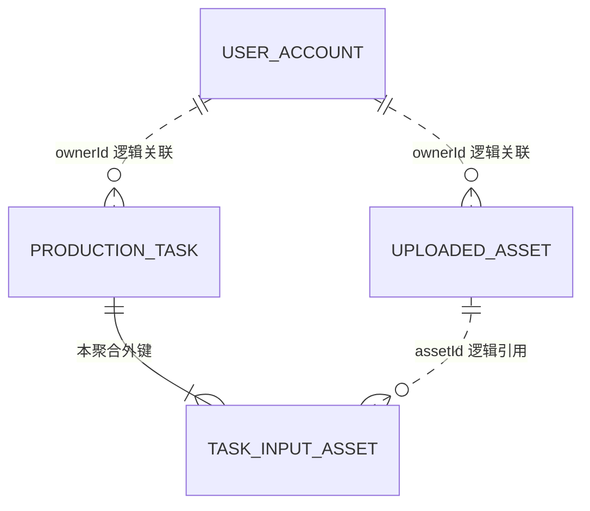

# Database and Media Storage Design（未执行）

日期：2026-10-30（Asia/Shanghai）。依据 [领域模型](domain-model.md)、[详细架构](detailed-architecture.md)
及 [HTTP 契约](api-contract.md)。这里只定义结构与约束，不创建表、DDL、Mapper、迁移或种子文件。

## 1. 总体方案与数据所有权

MySQL 8.4 / InnoDB，统一 utf8mb4；UUID、种子标识、状态等机器值使用区分大小写的 ASCII 表示，
输入统一规范化并校验。时间统一使用 UTC DATETIME(6)，Java Instant 在适配器中显式按 UTC 转换；
不依赖开发机默认时区。状态使用有约束的 VARCHAR，不用数据库 ENUM 锁死演进方式。

只设计四张表：user_account、uploaded_asset、production_task、task_input_asset。
Template/分类/封面与 Mock fixture 使用打包种子/文件，不建模板、结果、历史、步骤、尝试或事件表。
表是持久化表示，不等于四个新业务聚合；ProductionTask 与绑定行是一个聚合一致性单元。

只有 Task 根与绑定有物理外键。身份/素材跨模块关联由所属公开能力和创建 Case 检查，不建跨域级联关系；
图中逻辑引用不允许 Task DAO 联查或修改别域表。MySQL 中的共同 schema 不能成为绕过模块边界的理由。

## 2. 字段字典

### 2.1 user_account（Identity 所有）

| 字段 | 类型 | 可空 / 默认 | 语义与约束 |
| --- | --- | --- | --- |
| account_id | CHAR(36) ASCII | 非空，无默认，主键 | 稳定账号 UUID，映射为资源 ownerId |
| username | VARCHAR(32) ASCII | 非空，无默认，唯一 | 规范小写；预置 demo-a、demo-b，不允许公开创建 |
| display_name | VARCHAR(64) | 非空，无默认 | 演示用户 A/B，显示用，不作为授权依据 |
| password_hash | VARCHAR(255) ASCII | 非空，无默认 | 带算法标识与随机盐的 BCrypt 编码，初始 cost 12，不用普通 SHA-256 保存密码 |
| created_at | DATETIME(6) | 非空，由初始化写入 | UTC 创建时间 |

username 唯一索引用于登录查找，account_id 用于当前账号读取；两个普通账号均无角色/管理员字段。
认证依赖本域账号查询和密码校验能力，没有注册、改密/找回或 User 大聚合。
原访客方案的 token_hash 结构取消；当前无已实施业务表，因此不执行数据迁移。
Java HttpSession 在进程内保存会话，不建 session 表/Redis；过期或重启需重新登录，account_id 和任务历史不变。

### 2.2 uploaded_asset（Asset 所有）

| 字段 | 类型 | 可空 / 默认 | 语义与约束 |
| --- | --- | --- | --- |
| asset_id | CHAR(36) ASCII | 非空，无默认，主键 | 服务器分配的素材 UUID |
| owner_id | CHAR(36) ASCII | 非空，无默认 | 已登录账号的 account_id；不能从上传表单接受 |
| content_key | VARCHAR(128) ASCII | 非空，无默认，唯一 | 不透明稳定内容 key；不是绝对路径、HTTP URL 或用户文件名 |
| media_type | VARCHAR(32) ASCII | 非空，无默认 | image/jpeg 或 image/png，来自服务端检查 |
| size_bytes | BIGINT | 非空，无默认 | 实际大小，必须 >0 且 <=8388608；模板更小限制由业务校验 |
| created_at | DATETIME(6) | 非空，由应用写入 | 内容与元数据准备完成时间，UTC |

只保存已完成上传，无 UPLOADING/FAILED 记录和可变生命周期。主键查找后带 owner 谓词限制；
当前没有素材列表/清理查询，因此不增加 owner_created_at 或未使用状态索引。
content_key 唯一是存储定位约束，不是内容哈希去重；同一个文件可上传两次形成两个合法素材。
原始文件名、浏览器 blob、图片字节、MultipartFile、模板 ID 不入表；素材可被不同模板任务引用。

### 2.3 production_task（Task 所有）

| 字段 | 类型 | 可空 / 默认 | 语义与约束 |
| --- | --- | --- | --- |
| task_id | CHAR(36) ASCII | 非空，无默认，主键 | 唯一制作身份 |
| owner_id | CHAR(36) ASCII | 非空，无默认 | 受理主体，之后不可修改 |
| template_id | VARCHAR(64) ASCII | 非空，无默认 | 打包只读模板 ID，无模板表外键 |
| status | VARCHAR(16) ASCII | 非空，无默认 | PENDING、RUNNING、SUCCEEDED、FAILED |
| current_stage | VARCHAR(16) ASCII | 可空，默认 NULL | CHECK_ASSETS、GENERATE、FINALIZE；无阶段必须 NULL |
| revision | BIGINT | 非空，初始 0 | 非负乐观并发标记，每次合法状态迁移 +1 |
| result_ref | VARCHAR(128) ASCII | 可空，默认 NULL | 仅成功时为已就绪打包 Mock fixture 的稳定引用 |
| failure_kind | VARCHAR(16) ASCII | 可空，默认 NULL | 仅失败时 STAGE 或 DISPATCH |
| failure_code | VARCHAR(64) ASCII | 可空，默认 NULL | 脱敏业务失败分类，与 HTTP 请求错误不同 |
| failure_message | VARCHAR(512) | 可空，默认 NULL | 可理解原因；非空串，不含堆栈、凭证、素材内容 |
| created_at | DATETIME(6) | 非空，由应用写入 | 受理时间，之后不变 |
| updated_at | DATETIME(6) | 非空，由应用写入 | 最近合法迁移保存时间，初始与创建时间相同 |

不再保存 failure_stage：阶段内失败即 current_stage；API failure.stage 从同一字段派生，避免两列不一致。
result.previewUrl 由 task_id 派生；不在 DB 保存环境相关 URL、短期签名或浏览器地址。
没有“历史表”、步骤行、模板全快照、模拟参数、百分比、线程 ID、供应商响应或执行尝试字段。

主键服务 taskId 条件查/写；一个组合索引 `(owner_id, created_at DESC, task_id DESC)` 服务本人历史。
单条读取携带 owner 谓词，主键已足够，不加重复的 owner/task 索引；无状态扫描/恢复任务，暂不建 status 索引。
全量历史用于小规模 Assessment 演示；不暗中截断，也不以分页为当前验收前提。真实长期增长时另设计分页和增量跟踪。

### 2.4 task_input_asset（Task 聚合内部）

| 字段 | 类型 | 可空 / 默认 | 语义与约束 |
| --- | --- | --- | --- |
| task_id | CHAR(36) ASCII | 非空，无默认 | 外键引用 production_task.task_id |
| position | SMALLINT | 非空，无默认 | 从 0 连续递增的输入位置，>=0 |
| asset_id | CHAR(36) ASCII | 非空，无默认 | 受理时固定的素材 ID，跨模块逻辑引用 |

主键 `(task_id, position)`；无额外自增 ID，无 `(task_id, asset_id)` 唯一约束，所以允许同一素材用于多个位置。
物理外键限制根与绑定完整性，删除行为为 RESTRICT；当前不实现任务删除，不增加级联清理语义。
不建 asset_id 反向索引，因为没有素材删除/使用情况查询用例；公开校验由 Asset 模块自己的主键读取完成。
根与全部输入行同事务插入，位置必须连续且数量与本次模板一致；失败回滚全部行。
这些跨行/跨模块规则不伪装成单行 CHECK，也不以数据库外键替代 owner 检查。

## 3. 状态组合与数据库约束

采用显式 CHECK 和 NOT NULL；状态不在允许集合内立即拒绝。对应领域模型的 9 个合法组合：

| status | current_stage | result_ref | failure_kind/code/message | 当前流程可出现的 revision |
| --- | --- | --- | --- | --- |
| PENDING | NULL | NULL | 全 NULL | 0 |
| RUNNING | CHECK_ASSETS | NULL | 全 NULL | 1 |
| RUNNING | GENERATE | NULL | 全 NULL | 2 |
| RUNNING | FINALIZE | NULL | 全 NULL | 3 |
| SUCCEEDED | FINALIZE | 非 NULL、非空 | 全 NULL | 4 |
| FAILED | CHECK_ASSETS | NULL | STAGE + 非空 code/message | 2 |
| FAILED | GENERATE | NULL | STAGE + 非空 code/message | 3 |
| FAILED | FINALIZE | NULL | STAGE + 非空 code/message | 4 |
| FAILED | NULL | NULL | DISPATCH + 非空 code/message | 1 |

revision 列只作 >=0 检查，不在 CHECK 中冻结流程步数；最后一列用于当前实现/测试解释，状态规则仍以领域模型为准。
updated_at >= created_at；owner/template/输入不可修改由用例与 Repository 的写集合保证；不新增触发器。
失败 code/message 长度由错误映射控制，过长异常不能直接写入；未知技术异常映射为固定脱敏文案。

CHECK 必须显式判断各可空列的 IS NULL / IS NOT NULL，不能仅写“等于某值”并任由 NULL 产生 UNKNOWN：
MySQL 将 TRUE 或 UNKNOWN 视为通过，因此 NULL 漏洞必须在实现时用真实 MySQL 负向验证。
参见 [MySQL 8.4 CHECK Constraints](https://dev.mysql.com/doc/refman/8.4/en/create-table-check-constraints.html)。
跨表素材数量、归属与文件可读性由 Case/所属模块保证，CHECK 不做其他表查询或访问文件。

## 4. 并发、查询与事务映射

具体原子谓词与时序见详细架构第 6～7 节。本设计不提供可执行 SQL，后续 MyBatis 保存必须包含：

1. 按 task_id、预期 revision、预期 status/current_stage 同时匹配；空阶段使用真正的 NULL 语义。
2. 一次更新保存目标状态/阶段、结果或失败、updated_at 和 revision+1；不更新 owner、template、createdAt 或输入绑定。
3. 影响行数必须为 1。0 表示失去资格，不能继续执行；DB 异常或 commit 未知表示基础设施故障，不盲目重试。
4. 不提供无条件 saveAllFields 更新；不写读取推进状态的 Mapper；客户端 revision 不作为授权/写入参数。

创建事务与每次迁移事务使用 REQUIRES_NEW + READ_COMMITTED，单 DataSource、独立短事务，
不长时间持有素材记录/任务锁等生成完成。乐观条件写负责实际竞争，不把隔离级别当作唯一保护。
只读历史一条查询返回 TaskView 所需根字段，形成逐行自洽记录；不逐项调用聚合写服务。
详情需恢复输入时可在短只读事务加载根及有序绑定；HTTP TaskView 不要求返回整张 PO 或上传内容。

不同查询时刻可以读到不同 revision；前端按版本合并。UTC updated_at 用于展示/诊断，不能替代 revision。
revision 对外为 JavaScript 安全整数；当前固定流程最大为 4，不存在大整数精度问题；将来新增高频更新前再审视序列化约定。

## 5. 种子、文件布局与一致性

模板数据按 API 文档的两项种子规格，后端打包只读 JSON；分类可由目录派生，无表。
应用启动验证模板 ID 唯一、要求有效、封面 key 已登记、示例文件可读；错误时明确启动失败，不能正常提供伪造制作目录。
运行期间不热修改目录，更新种子必须保持已有 ID 的业务含义；允许模板编辑前另行选择版本/快照与迁移策略。

上传内容位于 ASSET_STORAGE_ROOT 下由服务器 assetId 派生的内部位置，临时文件与稳定文件使用同一文件系统。
content_key 是不透明映射键，路径拼接/规范化/禁止越界由本地适配器负责；不跟随客户端文件名或任意 URL。
本阶段不设计面向用户的素材删除/保留期，不因替换上传位而删除其他任务仍可能引用的文件。

| 时刻 | 一致性要求 | 失败处理 |
| --- | --- | --- |
| 输入文件写入/校验失败 | 不公开素材 ID，不插入可用元数据 | 清理本次临时内容，返回上传错误 |
| 稳定文件成功、元数据失败 | 不能返回正常 AssetView | 尽力清理本次文件；失败时留下未引用文件并记录，不建清理调度器 |
| 元数据成功、响应丢失 | DB 和内容仍有效，用户未必获得 ID | 不自动重传/去重；未引用素材可存在，不改 Task |
| 任务根与绑定插入失败 | 必须全有或全无 | 同一事务回滚；没有“受理成功但输入只存一半” |
| FINALIZE 资源就绪、成功状态保存失败 | 不宣称成功已提交，不继续外部步骤 | 资源可为复用 fixture；无文件/DB XA，记录已知窗口 |
| 成功后磁盘/打包资源异常 | 任务终态不回退，预览验收尚未通过 | 503 资源异常；修复资源，不用再次生成作为查询副作用 |

MySQL 卷保留账号/密码散列、任务和素材元数据；Java 会话不在卷中持久化；backend 素材命名卷保留上传内容，Mock/封面随镜像打包。
部署/备份/回滚必须把数据库与上传内容视为关联数据，不能只重建 DB 后宣称原素材可用。
Compose down 应保留两个卷；不要用删卷作为初始化、升级或重置密码手段。

## 6. 初始化与迁移选择

首次业务实现采用一份有版本标识的初始 schema 脚本和 README 手工/容器初始化说明；本轮不引入 Flyway/Liquibase。
现有 `spring.sql.init.mode=never` 保留，不让每次 Java 启动隐式改库。Compose 首次空 MySQL 卷可以挂载初始化脚本；
已有卷不会重跑初始化，需按说明显式执行一次经过检查的初始脚本，不能声称改配置就完成迁移。
脚本位置、校验和及实际初始化命令随实施材料提供，完整源码交付包含结构；模板与媒体初始数据以打包文件提供。
账号采用显式初始化用例预置 demo-a / demo-b：首次缺失时读取 DEMO_A_PASSWORD / DEMO_B_PASSWORD 环境变量，
在事务外生成带盐密码散列，再短事务插入缺失账号；用户名/显示名可随种子说明，真实密码不写入 SQL、源码或日志。
已存在账号不重置密码或生成新 account_id，重复启动保持历史归属；修改环境变量不自动修改已有密码。
初始密码配置要求 8～72 个 UTF-8 字节；缺失必需配置时明确初始化失败，不提供默认通用密码。
初始化不是注册 API，不建立管理员账号/账号管理后台；任务初始为空，无造假的“已制作历史”。

当前骨架没有业务表和已有业务数据，因此没有本轮数据迁移；将来改变状态/身份/模板语义时，
新增迁移与兼容性分析，不用修改初始脚本覆盖既有数据。本方案不承诺无损自动降级。

## 7. 实施验证要求与本轮证明范围

后续用真实 MySQL 检查：四表/索引/约束、根/输入原子创建、两个抢占者、过期版本、成功/失败竞争、
所有 NULL 非法组合、账号初始化重复执行、密码匹配、本人历史与素材范围、UTC/字节边界，以及卷保留后的图片读取。
重复素材绑定、空历史和不同分类/数量的种子同样验证；外键存在不代表授权正确。
Context 装配、SQL 文本审查或 Compose config 均不能代替这些证据。

本轮仅检查设计的一致性，没有 MySQL 连接、建表或文件存储运行结果；这些测试仍待业务实施。
