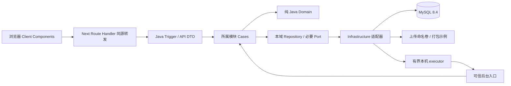
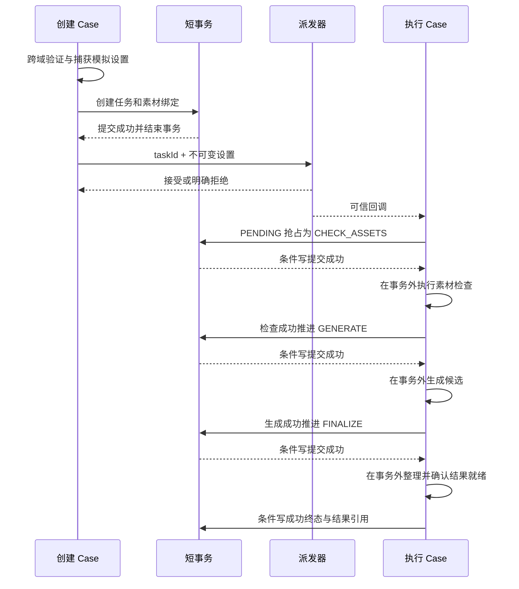

# Detailed Architecture Design（Track A）

设计日期：2026-10-30（Asia/Shanghai）。下文保留设计阶段基线；IP-02～05 的相关实现已落地，实际验证与验收状态以 tasks.md 的 V-02～05 为准。

## 1. 基线、范围与阅读顺序

依据 [requirements.md](requirements.md) 的 R-01～R-14 / AC、[domain-model.md](domain-model.md)、
[architecture.md](architecture.md)、[ADR-006](architecture-decisions.md#adr-006基于-ddd-skill-改为分层优先的六边形包结构)
及 `ddd-skill` 2.2.4。Assessment 正文已在领域建模阶段复核，本阶段不改变需求或领域状态机。
已阅读 README、任务/API 占位文档、未来规划、包说明、POM、前端配置、Compose 和 frontend/AGENTS.md。

交付关系：本文负责运行架构、模块契约、身份与异步/并发；[api-contract.md](api-contract.md) 为 HTTP 契约唯一来源；
[database-design.md](database-design.md) 为字段、索引与存储约束来源；
[frontend-state-design.md](frontend-state-design.md) 为浏览器状态、轮询及响应隔离来源。
主要选择记录于 ADR-007～ADR-010。历史文档中的“待设计”是当时状态，后续细化以本组文档为准。

设计阶段仅编写 Markdown，未新增接口源码、Controller、DAO、DDL/迁移文件、测试或依赖，未执行容器、部署或提交。
该阶段代码仍是 scaffolding；后续实现按任务记录更新，设计覆盖不能当作业务验收通过。

## 2. 本阶段选定的方案

| 主题 | 当前选择 | 取舍与范围 |
| --- | --- | --- |
| 模块 | Task / Template / Asset / Identity，最小 Types | 单 Maven 模块化单体；不拆 Generation、Result 或 History 域 |
| 身份 | 两个预置演示账号，用户名/密码登录，HttpOnly Cookie + Java HttpSession | 用户确认暂不注册；提供登录/退出及本人数据范围，不建账号管理后台 |
| 模板 | Java 读取随应用打包的只读种子 | 无模板表/版本系统；模板 ID 与语义在本轮演示数据生命周期内稳定 |
| 媒体 | 上传内容保存在后端命名卷，元数据存 MySQL；Mock 复用打包图片 | 不依赖 AI/云服务；输入、任务、访问地址各有边界 |
| 通信 | 浏览器访问同源 `/api/v1`，Next Route Handler 转发至 Java | 不启用跨域凭据；Next 不执行制作或访问 MySQL |
| 受理/执行 | 短事务提交后直接派发；独立执行 Case；固定三阶段 | 不使用事件总线/工作流/MQ，不保证进程重启续跑 |
| 事务 | Cases 显式使用 TransactionTemplate，每次状态写入独立短事务 | 避免同类 @Transactional 自调用及事务穿过文件/生成等待 |
| 并发 | 条件更新包含 ID、revision、预期状态/阶段；影响行数必须为 1 | 抢占失败不执行；旧写不覆盖；不实现重试/租约/执行尝试 |
| 前端 | React reducer + scoped hooks；每任务递归定时查询 | 无新增状态库；请求状态与业务状态分离，清理与旧响应隔离分别实现 |

这些是当前实现方案选择，不把实现参数、Cookie 会话、revision 或轮询方式提升为题面强制需求。

## 3. 运行结构与配置

图示为运行调用；源码依赖仍遵守 ADR-006。Infrastructure 的派发器接收由外层装配的执行回调，
不 import 执行 Case 的实现。回调进入 Case 契约，不将业务流程写入线程池适配器。

Next 规划位置为 `src/app/api/v1/[...path]/route.ts`，使用 Node runtime，按 API 表白名单匹配方法和路径；
只支持实际需要的 GET/POST，不允许客户端提供目标主机。Java 源地址读取服务端运行时 `JAVA_API_ORIGIN`：
本地为 Java 的 loopback 地址，Compose 为 `http://backend:8080`；不使用 NEXT_PUBLIC 配置暴露内部拓扑。
选择 Route Handler 而非构建期拼接 rewrite，使同一个 standalone 产物能使用运行时目标配置。

转发保留路径/查询、Cookie、X-CSRF-TOKEN、Accept、Content-Type（含 multipart boundary）和请求体；不把整个上传解析成另一种业务 DTO。
不透传旧的 Bearer 认证，不能把客户端 ownerId/用户名当作当前主体。
响应透传状态、内容、Content-Type、Cache-Control、Location、X-Content-Type-Options、请求 ID 和每条 Set-Cookie；
Set-Cookie 必须逐条保留，不能折叠成逗号字符串或丢失登录/退出的 Cookie 更新。
忽略外部重定向，目标固定 Java，不成为开放代理。上游不可用/超时按 API 契约产生请求异常，绝不伪造任务失败。
私有响应全部 no-store；转发 fetch 也显式 no-store，不使用 Next Data Cache 或静态化私有 Route Handler。
代理等待上游响应头的预算为 60 秒；客户端单次请求预算为 30 秒，均属当前工程选择，不是题面 SLA。
响应头发送前可规范化代理错误；图片/JSON 响应开始传输后若断流，不能改写已发送的 HTTP 状态，前端按请求/解析异常处理。

App Router 的交互/浏览器 API 放 Client Components，页面布局壳可为 Server Components；不在构建或 RSC 中读取账号密码或会话凭证。
已核对安装版本的 [Route Handlers 指引](../frontend/node_modules/next/dist/docs/01-app/01-getting-started/15-route-handlers.md)
和 [Server / Client Components 指引](../frontend/node_modules/next/dist/docs/01-app/01-getting-started/05-server-and-client-components.md)。

| 后续实施配置 | 选定值或默认值 | 说明 |
| --- | --- | --- |
| JAVA_API_ORIGIN | 必须提供，服务端运行时配置 | Compose/local 分别设置，不能接受请求覆盖 |
| ASSET_STORAGE_ROOT | 容器 `/data/frameflow/assets`；本地明确指定目录 | 只挂载 backend；不放 frontend/public；与 MySQL 卷共同保留 |
| TASK_WORKER_COUNT | 2，允许 1 | 固定 worker 数，允许串行演示，无业务并发 SLA |
| TASK_QUEUE_CAPACITY | 64 | 有界队列；满时拒绝，不能在 HTTP 线程执行长任务 |
| MOCK_CONTROLS_ENABLED | Assessment 环境 true | false 时拒绝请求中的 simulation；不是正式产品设置 |
| MOCK_STAGE_DELAY_MS | 1000，范围 0～30000 | 每阶段延迟；在受理时捕获，修改配置不影响已有任务 |

这些配置尚未加入 .env、Compose 或代码。现有端口、版本和构建方式保持；后续实施时补配置说明和素材卷。
鉴权、上传、媒体、受理 JSON 与状态查询必须分别测试经过 Next 转发和直接 Java 的一致行为。

## 4. 模块公开 Application Contracts

### 4.1 契约与类型所有权

以下为接口设计清单；Identity 已在 IP-04 实现，ITemplateCatalogCase 及 IMediaResourceCase 的打包媒体部分已在 IP-05 实现，其余按对应任务落地。名称遵守 `I<Xxx>Case` / `<Xxx>CaseImpl`。
Case 契约位于 `cases.<feature>`，不可变输入/结果位于同域 `cases.<feature>.model`。
契约不出现 MultipartFile、HttpServletRequest、ResponseEntity、PO、具体适配器或其他域聚合。
调用者采用已解析的 UUID ownerId 值；HTTP 请求里的 ownerId 不是授权依据。

| 契约 | 输入 → 输出 | 授权、失败及事务语义 |
| --- | --- | --- |
| IAuthenticateAccountCase（identity） | 用户名/密码 → 已核验账号的 ownerId、username、displayName | 只验证预置账号；失败不区分账号不存在/密码错误；不返回密码散列，不创建账号 |
| IQueryAccountCase（identity） | 已认证的账号 ID → 当前账号资料 | 供当前会话查询；Session、Cookie 和 CSRF 属于 Trigger/安全适配，不造领域会话聚合 |
| ITemplateCatalogCase（template） | 分类/列表/详情查询；单张素材规则校验；模板 ID + 完整有序素材描述 → 可制作信息或违规项 | 单张校验只检查类型/大小，完整提交再检查总数；同一次校验使用同一份种子规则；无模板则失败，不访问 Task |
| IUploadAssetCase（asset） | owner、templateId、有限大小的图片内容 → 素材描述 | 通过 Template 契约检查该图片的类型/大小；文件准备后短事务保存元数据；不检查本次任务总图片数 |
| IResolveTaskAssetsCase（asset） | owner、有序素材 ID → 同序的可信素材描述和不透明内容引用 | 每个 ID 都需属于 owner 且已就绪；不存在与其他 owner 统一为未找到；不消耗素材 |
| ICheckTaskAssetsCase（asset） | 已受理任务的 owner、素材 ID → 可用或检查失败 | 后台 CHECK_ASSETS 的独立 I/O 检查；无长期 DB 事务，不创建/推进 Task |
| IMediaResourceCase（asset） | owner/输入素材 ID，或打包示例引用 → 内容及 MIME；结果准备 → 已就绪稳定引用 | 输入内容检查 Asset 归属；公开封面仅白名单；Mock 结果引用只从可信调用方取得，不从任意路径读取 |
| ICreateProductionTaskCase（task） | owner、templateId、有序素材 ID、可选应用模拟设置 → 受理 ID/归属/时间 | 跨域验证后保存整个 Task；提交后派发；保存失败不宣称受理 |
| IQueryProductionTaskCase（task） | owner、可选 taskId → 本人历史或单条 TaskView | 读取不派发、不推进；同一业务事实，不维护第二套 History 状态 |
| IReadTaskResultCase（task） | owner、taskId → 已成功任务的图片内容 | 先查本域任务归属及成功结论，再经 Asset 媒体能力解析结果；不暴露裸结果路径 |
| IExecuteProductionTaskCase（task，内部） | taskId、不可变 ExecutionOptions → 后台执行 | 仅可信后台入口调用；从 DB 取 owner/输入，先抢占；不得从浏览器调用或接受任意状态补丁 |

跨模块依赖方向为 Task Cases → Asset / Template Cases；Asset 上传 Case → Template Case；
Identity 无回调依赖，Template 无下游业务依赖。该图无环；Asset 不能为访问结果去调用 Task，
所以结果的授权入口必须归 Task，由 Task 调用 Asset，避免 Task ↔ Asset 环。

素材描述的共享使用边界映射：Asset Case 返回 Asset 自己的不可变结果，调用方转换为 Template Case 所需输入。
不在 Types 中放 TaskStatus、UploadedAsset、模板规则或公共业务 DTO。
最小边界结果明确为：可制作信息含 templateId 与约束描述；素材描述含 assetId、ownerId、mediaType、sizeBytes、稳定内容引用；
生成候选含待整理的 demo 资源引用，尚不是 TaskResult；TaskAccepted/TaskView 字段以 HTTP 契约的语义为准，
但 Case 结果不依赖 HTTP DTO，URL 在传输边界由资源 ID 派生。
素材解析必须保留输入顺序和重复位置，不能把 Repository 的去重查询结果误当成提交数量。
跨模块失败统一为未找到/不可访问、规则违规项、内容不可用等用例语义，由 Trigger 映射 HTTP；
不让目标模块返回 ResponseEntity、HTTP 状态码或数据库异常来充当公开契约。
入口有界读取单张图片内容，应用用例及存储端口可传递字节内容；流/图片内容不进入聚合或日志。
8 MiB 的当前限额允许这种简单传递方式；未来大文件/视频需重新评估流式传递，不承诺原契约无需改变。

### 4.2 输出契约与包位置

| 能力 | 定义位置 | 责任与实现 |
| --- | --- | --- |
| ProductionTask repository / 本人查询 | `domain.task.adapter.repository` | 加载聚合与并发标记、创建、合法条件保存、纯查询投影；adapter.repository.task → dao.task / dao.po.task |
| Asset metadata repository | `domain.asset.adapter.repository` | 已完成素材描述保存/读取；只访问本域表，不调用生成器 |
| Account query repository / PasswordVerifier | `domain.identity.adapter.repository` / `domain.identity.adapter.port` | 读取预置账号，校验自适应密码散列；本域适配器实现，Spring Security 类型不进入 Domain |
| Template catalog read | `domain.template.adapter.repository` | 从打包种子读取，公开 Case 包装，不需要 MyBatis DAO |
| MediaGenerator | `domain.task.adapter.port` | 输入制作描述，返回 Mock 候选；不持有 Task，不保存状态 |
| AssetStorage | `domain.asset.adapter.port` | 内容保存/读取/可用性和稳定引用；本地 I/O，绝对路径只在实现内部 |
| TaskDispatcher | `cases.task.port` | 接受 taskId + ExecutionOptions 并异步派发，明确接受或拒绝，不推进领域状态 |

用户已确认需要登录，Identity 因而具有读取预置账号及核验密码的真实需求；采用轻量 Account 只读模型，
不机械引入 User 聚合、注册/账号修改用例或角色体系。登录安全过滤器作为 Trigger 调用账号认证 Case，
装配位于 infrastructure.config，密码编码器位于适配层；Session、SecurityContext 和 CSRF 不进入 Domain。
Repository 的并发标记是纯技术预期值，放在恢复/保存包络中，不成为 Task 的业务行为属性或公开 setter。
按需建类；本设计不要求每个表都有 Repository、每个 Case 都有 Domain Service，或复制技能的 Node/责任链框架。

## 5. 预置账号登录与资源访问

### 5.1 用户确认范围与界面

2026-10-30 用户确认“先不用注册，能够用登录表示就行”，取代此前访客创建/切换器方案。
本阶段提供用户名/密码登录、当前账号查询和退出；不提供注册、公开账号创建、改密、找回密码或第三方登录。
预置 demo-a / demo-b 两个普通演示账号，显示名“演示用户 A/B”，均无管理员权限或模板管理功能。
真实密码由环境变量配置，README 只写配置与操作方式，不提交可用明文密码。

未登录时可浏览模板，制作/查看个人记录时进入 `/login`；登录后显示用户名、“我的记录”和“退出登录”。
切换通过“退出 A → 登录 B”，没有“创建访客”按钮或其他账号下拉框。
刷新/重新进入先查询 Java 会话；有效时恢复本人记录，过期或后端重启后重新登录同一账号，历史仍按稳定 ownerId 读取。

### 5.2 密码验证与会话

实施时引入 Boot BOM 管理的 spring-boot-starter-security，不独立升级安全库，不自行实现密码加密/会话协议。
Spring Security 表单认证过滤器作为 Trigger，认证 Provider 调用 IAuthenticateAccountCase；
Case 使用本域账号查询和 PasswordVerifier，过滤器负责认证上下文保存、Session ID 更新及 JSON 成功/失败响应。
不以设置 ThreadLocal 代替完整登录持久化；参见 [Spring Security 7.0 form login](https://docs.spring.io/spring-security/reference/7.0/servlet/authentication/passwords/form.html)。

密码使用带盐 BCrypt（初始 cost 12，编码带算法标识）；数据库保存编码值，不用普通 SHA-256 保存密码。
初始化密码为 8～72 个 UTF-8 字节；登录保留原样、不 trim，超过 72 字节明确拒绝，避免静默截断。
编码/匹配由框架 PasswordEncoder 处理，实施时验证耗时，见 [Spring Security password storage](https://docs.spring.io/spring-security/reference/features/authentication/password-storage.html)。

Java HttpSession 保存在单实例内存，不建 session 表、Redis 或 Spring Session。
Cookie 名 FF_SESSION，Path=/api，不设 Domain，HttpOnly、SameSite=Lax；HTTPS 时 Secure=true，本地 loopback HTTP 显式关闭 Secure。
Secure 根据浏览器对外访问协议配置，不因 Next 到 Java 的内部 HTTP 转发而关闭；清除 Cookie 使用相同名称、Path 和 Domain 范围。
Cookie 最长 8 小时，服务端同时限制绝对 8 小时和空闲 30 分钟；登录成功更换 Session ID，退出使服务器会话失效并清 Cookie。
这些是可调整默认值，不是 Assessment SLA。浏览器脚本不读取 Session ID，不在 localStorage/sessionStorage 保存密码或凭证。
后端重启会话丢失，需重新登录；账号、任务及素材仍持久化，owner 不变。任务仍不保证重启续跑。

### 5.3 CSRF、代理与跨标签页

所有 POST（含登录、退出、上传、受理）保留 CSRF 校验。
前端先 GET `/api/v1/auth/csrf`，仅在内存保存 token，POST 放 X-CSRF-TOKEN，不放 URL。
采用 HttpSessionCsrfTokenRepository 和框架匹配的请求处理器；响应给前端的 token 必须可由该处理器校验，不能混用原始/掩码值。
登录/退出后重新获取；失配为 403 CSRF_INVALID，不自动重放 POST。
CSRF 端点可以创建匿名会话，但不创建账号；参见 [Spring Security 7.0 CSRF](https://docs.spring.io/spring-security/reference/7.0/servlet/exploits/csrf.html)。

Next 保留 Cookie、CSRF header 和每条 Set-Cookie；私有 API 未登录返回 JSON 401，无默认 HTML 登录页或认证跳转。
同一浏览器配置下标签页共享会话，不能沿用旧方案的“每标签页独立账号”。
登录/退出立即使当前 identityEpoch 失效，并通过不含凭证的 auth-change 通知让其他页面重新查询会话；
可使用 localStorage 随机事件标记触发 storage 事件，不保存账号凭证。存储不可用/漏收事件时，重新聚焦先核对会话再恢复私有请求。
旧页面的 CSRF token 必须被新会话拒绝，不能自动换 token 重放旧表单。
不同浏览器配置可同时演示两个账号；同一配置通过退出/登录切换。

### 5.4 资源范围

资源用例从已认证 Session 提取账号 ID，作为 ownerId；任务历史、详情、输入素材及图片分别检查本人范围。
当前会话查询若发现账号已不存在，则使会话失效并返回 401；数据库不可用仍为 503，不能混同未登录。
客户端 ownerId/用户名不能授权；跨 owner 与不存在统一 404，模板/公开封面按白名单读取。
Worker 从任务记录读取 owner，不要求浏览器仍登录；退出、过期、关页均不取消已受理任务。
私有图片继续使用同源 Cookie fetch + 临时 blob URL，保留上下文检查与资源回收，不把任何凭证放图片 URL。
本轮不提供注册、账号删除/合并、角色/多租户或找回密码，未来按真实产品需求设计。

## 6. 受理、异步执行与事务边界

### 6.1 受理时序

1. Trigger 从已认证会话提取 owner，在 CSRF 校验后调用创建 Case，校验请求形状与模拟配置，不接受 owner/status/result 注入。
2. Case 从 Template/Asset 公开契约获取同一规则和可信素材描述，校验数量、类型、大小、归属、内容就绪。
3. 在应用层捕获本任务不可变 ExecutionOptions；默认无失败、每阶段 1000ms。配置格式非法则 400，尚未创建任务。
4. 一个短事务原子创建 Task 根记录与全部有序素材绑定，revision=0，PENDING/无阶段，结果/失败均空。
5. TransactionTemplate 成功返回后，才调用 TaskDispatcher；此时没有活动业务事务。
6. 明确派发接受后返回 202 和 taskId/ownerId/createdAt，不等待制作完成。Worker 可以在响应送达前开始。

受理返回仅表示持久化创建成功，不承诺客户端一定先看到 PENDING。前端收到 ID 后查询真实 TaskView，不伪造状态。
任务创建失败/回滚没有已受理任务；响应丢失或提交结果未知时，不自动重试 POST。
若 commit 抛错而实际结果未知，返回可能包含 taskId 的 SUBMISSION_OUTCOME_UNKNOWN；用户读取历史/该 ID 再判断。

### 6.2 执行事务单元

执行 Case 本身不包一个大 @Transactional。每次加载并合法变更聚合、条件保存，使用独立 TransactionTemplate 短事务；
明确采用 REQUIRES_NEW，使已有调用者事务不能意外包住执行段。创建 Case 也不允许被外层未提交事务包住派发步骤。
创建/执行顶层入口若检测到已有事务，应在任何副作用前报应用编程错误；不能仅悬挂外层事务、完成内层后又在恢复的外层事务中派发。
事务超时初值 5 秒（不含素材/生成/延迟）；不是 API 响应 SLA。使用同一 DataSource 的 Spring 事务管理与 MyBatis。
Programmatic 事务属于 Cases，Domain 不依赖 Spring；这细化 ADR-006 的“真实事务边界”，不依赖同类注解自调用。
参见 [Spring TransactionTemplate](https://docs.spring.io/spring-framework/reference/data-access/transaction/programmatic.html)
及 [MyBatis-Spring transactions](https://mybatis.org/spring/transactions.html)。

每个阶段先把进入该阶段的状态提交，再执行该阶段；只有它成功且下一状态条件保存成功，才可开始下一阶段。
模拟延迟和失败注入发生于相应阶段之内：等待指定时长后若命中 failAtStage，就在该阶段产生明确失败并停止。
素材检查失败不调用 Generator；生成失败不执行整理；整理失败不记录成功结果。
三处各有独立执行/测试证据，不把 CHECK_ASSETS/FINALIZE 藏进 MediaGenerator。

GENERATE 的候选与 ExecutionOptions 保存在该 worker 的不可变/局部上下文中，不保存全局“当前任务”，
不要求模拟设置或候选持久化。进程中断后没有恢复承诺，不能重新读全局新设置来续跑旧任务。
FINALIZE 当前只确认打包 Mock 图片的可读性并选择稳定 demo 结果引用，无需生成新的文件或 GeneratedAsset 表。

### 6.3 派发器与故障边界

线程池固定 2 worker / 队列 64；可配为 1。使用明确拒绝策略，不用 CallerRunsPolicy 或静默丢弃。
HTTP 受理线程不执行生成；排队只是本机内存机制，不声称持久消息。
拒绝策略与队列机制依据 [Java 17 ThreadPoolExecutor](https://docs.oracle.com/en/java/javase/17/docs/api/java.base/java/util/concurrent/ThreadPoolExecutor.html)。

| 故障点 | 选定行为 | 可持久观察的状态 / 限制 |
| --- | --- | --- |
| 参数、模板、素材或模拟设置非法 | 拒绝受理，不派发 | 无新任务，HTTP 4xx；上传/提交错误不是 Task FAILED |
| 受理 DB 事务明确回滚 | 返回请求错误，不派发 | 无任务或回滚完整根/绑定；不能返回正常受理 |
| 受理 commit 结果未知 | 不派发、不重试创建；返回提交结果未知 | 可能已存在 PENDING；通过已知 ID/历史恢复判断 |
| 已提交，executor 明确拒绝且保证未开始 | 短事务将仍为 PENDING/revision=0 的记录改为 FAILED/无阶段、DISPATCH_REJECTED | 返回 202 和已存在 ID，查询展示执行前失败；不伪记素材检查失败 |
| 拒绝处理时任务已被其他执行者抢占 | 条件写 0 行，读取现状并停止拒绝写 | 不覆盖 RUNNING/终态；此路径不继续执行任何阶段 |
| 派发拒绝后失败结论写 DB 也失败 | 记录任务 ID/故障类别，仍返回已受理 ID，不重派 | 原记录可能仍 PENDING；如实保留异常窗口，不假称 FAILED 已保存 |
| 某阶段明确失败 | 根据当前持久预期组合，原子写 FAILED/当前阶段/原因 | 保存成功后可查失败；后续不执行，TaskResult 空 |
| 阶段成功但推进/终态 DB 写失败或结果未知 | 停止该执行路径，不将异常当另一阶段失败，不重调生成 | 最后一次确定持久状态保留；可能实际已提交，读取可用于诊断，不触发续跑 |
| 请求查询或图片预览异常 | 返回请求/资源错误，保留 Task 结论 | 不将成功回退或推断执行失败 |
| 提交后派发前崩溃、执行中进程退出 | 不恢复、不由查询扫描执行 | 已保存记录保留，可能长期 PENDING/RUNNING；README 说明 |

正常停机先停止接收新派发，最多等待 30 秒；剩余任务可能被中断。已知阶段中断可尽力保存当前阶段失败，
硬终止或数据库不可用时无保证；不新增恢复扫描。页面离开/HTTP 取消不调用 executor 取消任务。

## 7. 聚合并发保护

### 7.1 条件保存协议

选择持久化 revision 乐观并发控制，并同时带预期 status/currentStage。恢复结果用纯包络携带聚合与 revision，
聚合仍只维护业务规则。首次创建 revision=0，每次成功迁移恰好 +1；查询/文件读取不更新 revision。
API 暴露同一 revision 供客户端比较，无第二个独立“前端版本”。

每次保存的前提必须同时成立：taskId 相同、revision 等于加载值、status/currentStage 等于预期组合（空阶段明确按空判断）。
待写的新组合先通过 ProductionTask 行为，再由 Repository 在一个更新里保存状态、阶段、结果/失败、updatedAt 和 revision。
影响行数 1 才能视为获准；0 是竞争失效，不能继续外部副作用；大于 1 是实现错误。不得按主键无条件覆盖整条 PO。

| 目的 | 预期组合 | 目标组合 | 获准后的动作 |
| --- | --- | --- | --- |
| 首次抢占 | PENDING/空，revision 0 | RUNNING/CHECK_ASSETS，revision 1 | 唯一获准者开始素材检查 |
| 检查完成 | RUNNING/CHECK_ASSETS，revision 1 | RUNNING/GENERATE，revision 2 | 开始生成 |
| 生成完成 | RUNNING/GENERATE，revision 2 | RUNNING/FINALIZE，revision 3 | 开始整理 |
| 整理完成 | RUNNING/FINALIZE，revision 3 | SUCCEEDED/FINALIZE，revision 4 | 停止执行 |
| 阶段失败 | 当前 RUNNING/S、当前 revision | FAILED/S、revision +1 | 保存原因后停止，无结果 |
| 明确派发拒绝 | PENDING/空，revision 0 | FAILED/空，revision 1 | 保存派发失败原因后停止 |

具体 SQL 将在实现阶段编写；本轮只定义谓词、原子字段与影响行数协议。
内存状态机、条件更新与 DB 组合约束三者各自有用，不能互相替代。

### 7.2 竞争情形与保证级别

- 同一 taskId 重复派发：都必须从 PENDING 抢占，只有一人成功；任何后来看到 RUNNING 的入口直接退出，不从阶段中途恢复。
- 在成功、失败或旧完成写之间竞争：只能接受仍匹配预期组合的一个合法结论，失败者丢弃候选并停止。
- 晚到失败不能覆盖成功；终态没有任何可更新出边，不能用终态重执行实现“重试”。
- 不同 taskId 无共享可变 worker 状态；同一素材可被多个本人任务引用，不锁定/消费它，也不建立全用户大聚合。
- DB 异常/commit 未知不同于条件更新 0 行：两者均停止外部后续，前者记录基础设施故障，后者记录竞争失效；不自动重试生成。

当前单入口、不可恢复的连续执行由首次抢占排除重复执行者，后续每步条件写阻止过期结论。
这不是通用 exactly-once 保证；未来 MQ、回调、重试、外部计费或租约引入时，需要执行身份/幂等及恢复的新设计。
不为未来预建 attemptId、分布式锁或执行尝试表。

## 8. 文件、模板与数据一致性

上传前端先做反馈校验，Java 按模板检查服务端实际类型/大小，不能信任文件名或声明 MIME。
当前只接受种子模板声明的 JPEG/PNG；拒绝不能识别/解码的文件，使用 JDK 图像读取能力，不引入图片处理平台。
文件存放名由服务器 ID 派生；客户端原文件名不参与路径，不接受外部 URL 拉取输入。

内容先写临时位置，校验通过后移动为稳定引用指向的文件，再短事务保存 UploadedAsset 元数据；成功后才返回 assetId。
DB 失败时尽力清理本次文件；清理失败留孤立文件，记录脱敏错误，不返回可用素材。无 XA 或自动清理系统。
上传响应丢失可能留下未使用素材；前端替换/移除只解除未提交绑定，不删除已保存文件，不影响已受理任务。

Task 创建短事务保存根与全部绑定，不复制 Template/Asset 完整模型。当前模板只读、素材不可原地替换且没有删除用例，
允许跨模块校验在事务外完成；不需要跨域长事务。未来出现删除/模板修改前必须重审这个校验到使用前提。

稳定结果引用保存于 Task；API 从该引用派生 `/api/v1/tasks/{id}/result`，不把内部路径或浏览器 blob 保存进数据库。
成功后图片访问故障不会重写 TaskStatus；实际可预览仍是 AC-R-05-03 / AC-R-09-01 的独立验收点。
具体 schema、初始化及卷关系见数据库设计。

## 9. 验证设计与交付边界

| 验证组 | 后续有意义的证据 | 覆盖 |
| --- | --- | --- |
| 领域规则 | 正常链、三阶段失败、跳步/终态拒绝、合法组合 | R-05、R-06，INV-02～05 |
| Case 时序 | 受理提交后才派发；阶段事务外 I/O；指定失败后无下游调用；无查询也运行 | R-04～R-06、R-12 |
| 真实 MySQL | 根/绑定事务回滚；两个执行者同时抢占仅一人成功；旧 revision 0 行；CHECK 拒绝非法 NULL 组合 | R-01、R-05、R-08 |
| 身份/API | 预置账号登录/退出及 A/B 隔离；会话过期、CSRF、Session ID 更新及 Cookie 代理透传；上传与参数边界；202 的受理语义 | R-03、R-04、R-09、R-10 |
| 前端 | 独立任务、查询异常、清理与晚到成功/错误/收尾回调隔离、刷新、上传替换竞态 | R-07～R-10、R-12 |
| 故障与资源 | executor 拒绝；文件成功/DB 失败；响应丢失；无效/失效图片；停机限制 | R-03～R-06、R-09、R-13 |
| 交付 | 关键行为测试进入现有 CI；种子/文件/DB 初始化可用；Compose 完整闭环单列 | R-02、R-11～R-14 |

后端先沿用 JUnit/现有 Spring 测试基础；真实 MySQL 验证使用隔离测试库/容器，不能用 Context 测试或 H2 替代。
前端实现阶段选择 Vitest + React Testing Library，以 fake timers/受控 Promise 验证竞争和生命周期，届时再固定兼容版本及 lockfile；
本轮不安装依赖，不规定覆盖率/用例数量，不要求额外 E2E 或自动部署。
实施检查沿用 Maven verify、npm ci/lint/typecheck/build 与 Compose config；后续补核心行为测试命令进入 CI。

## 10. 开放问题关闭与审查

| 领域建模待定项 | 当前设计去向 | 剩余工作 |
| --- | --- | --- |
| OD-01 原文复核 | 领域建模阶段已关闭 | 来源变化时复核，无新阻塞 |
| OD-02 身份 | 用户确认预置账号登录；本文第 5 节 + auth API + user_account 表 | 实施会话/CSRF、登录/退出及 A/B 验证，注册不在范围内 |
| OD-03 模板规则 | API 种子规格与数据库设计只读目录 | 准备合法素材、说明来源并验证 |
| OD-04 上传/访问 | 本文第 8 节、Asset 契约及 API 媒体端点 | 实施边界与卷/文件测试 |
| OD-05 状态与竞争 | 第 7 节与数据库组合约束；前端 revision 合并 | 真 MySQL 竞争测试，不能以文档检查替代 |
| OD-06 派发与 DB 故障 | 第 6 节故障表 | 实施拒绝/commit 未知等检查 |
| OD-07 Mock 控制 | POST tasks 的 simulation、受理捕获、worker 局部设置 | README 成功/三阶段失败/耗时演示 |
| OD-08 结果 | Mock fixture 引用、先资源就绪后成功 | 实际图片预览/缺失资源验证 |
| OD-09 前端契约 | 前端状态设计和 API TaskView | 生命周期及乱序核心行为测试 |
| OD-10 只读模板 | 打包种子，无模板更新 API；稳定 ID/规则不原地变更 | 未来首次可编辑时另作版本/快照 ADR |

审查结果：未增加未来平台前置依赖；Task 聚合没有扩张；跨模块交互不访问别域 DAO/Repository；
存储/认证/调度不进入领域模型；版本比较、异步受理与 UI 生命周期具有可测试协议。
已接受的代价是账号预置、无注册/密码找回、重启需重新登录、全量小规模历史、单实例内存派发及无自动恢复。
这些不是已实现能力，README 后续必须按真实实现与故障验证结果填写限制。

**可以进入 Implementation Planning，尚未进入业务编码。** 没有当前必须等待用户补充的需求问题；
新增真实 AI、注册/完整账号管理、可变模板或可靠恢复时重新分析语义和兼容性，不借“换适配器”承诺零改动。
