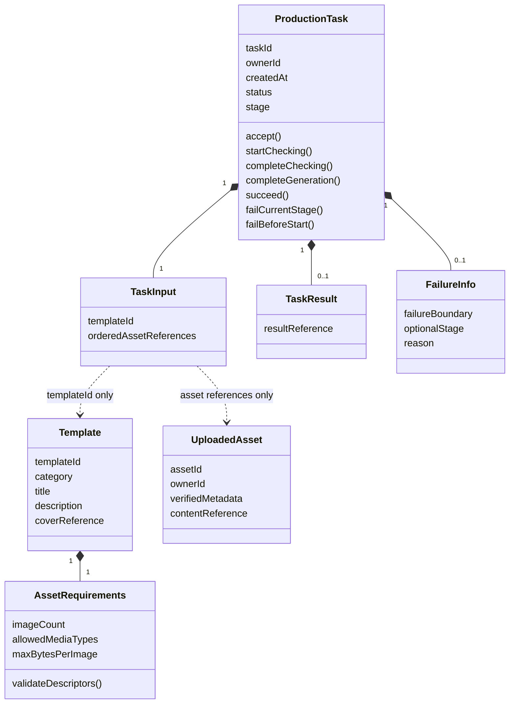
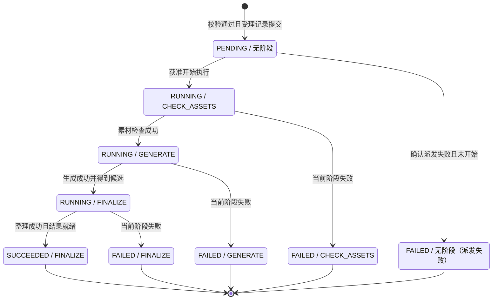

# DDD Domain Model（Assessment / Track A）

设计日期：2026-10-30；状态同步日期：2026-10-31（Asia/Shanghai；Task 状态机不变）。本文保留领域设计依据；IP-02 的 Task 聚合、值对象与状态机已由用户验收。Identity、Template、Asset 以及任务 API、执行、前端和容器能力已在后续 IP 任务实现，验证与各项用户验收状态见 [tasks.md](tasks.md)。IP-14 已由用户验收；整体最终验收与交付仍待 IP-18。

## 1. Domain Overview

### 1.1 依据、核对范围与设计地位

当前业务依据为 [requirements.md](requirements.md) 中已分析的 Assessment R-01～R-14 与 AC，
工程依据为 [AGENTS.md](../AGENTS.md)、[README.md](../README.md)、[architecture.md](architecture.md)
及 [ADR-006](architecture-decisions.md#adr-006基于-ddd-skill-改为分层优先的六边形包结构)。
同时阅读了 [api-contract.md](api-contract.md)、[tasks.md](tasks.md)、
[future-roadmap.md](future-roadmap.md) 与现有源码结构。

Assessment 原文定位沿用 requirements.md 的 SRC-ASMT：`hire-exam.quvideo.com` 中
“小影科技2027校招-全栈开发笔试题 · 卷面”，按 R 编号定位，不复制个人卷面 URL。
本轮首次读取曾受 Mac 锁屏阻挡；用户要求继续后，已于同日通过 Chrome 重新读取项目目标、
R-01～R-14、验收方式和范围排除项正文，并与 requirements.md 的需求/AC 及本文设计核对。
**未发现上述正文与当前需求分析或领域设计的实质冲突，OD-01 原文复核已关闭。**
本次复核针对文字要求；参考图像沿用需求分析阶段的读取记录，不宣称本次重新检查了独立附件或图像。
未据此修改需求文档；若后续题面发生变化或发现冲突，仍应报告并重审受影响设计，不能自行改写已确认需求。

关键复核结论如下：

| 原文范围 | 与现有需求及领域设计的核对结果 |
| --- | --- |
| R-01～R-03 | Java 提供业务数据、MySQL 保存任务/历史；模板为自造只读数据；数量/类型/大小需校验，输入必须服务端可用。未将示例字段或限制固定为全局规则 |
| R-04～R-06 | 检查与创建记录后返回任务 ID；Java 独立后台执行固定三阶段；阶段可观察；失败保留阶段/原因并停止后续；耗时及指定阶段失败可控。状态/阶段枚举和执行前派发失败表示仍是本文设计建议 |
| R-07、R-08 | 请求异常不能等同执行失败；未完成任务自动跟踪，终态/空闲停止；离页或切换身份需清理旧请求，并避免旧响应覆盖数据。现有 AC-R-08-03 与 AC-R-08-04 分别覆盖清理和隔离，没有用二选一弱化要求 |
| R-09、R-10 | 刷新从 Java 恢复本人记录、继续跟踪；结果只需图片预览；身份管理方式自行设计。本文的素材归属与访问策略不冒充原文指定的认证方案 |
| R-11～R-14、验收及排除项 | 主要布局与基本可用性、核心测试/CI、完整交付说明保留；Compose 为推荐。真实 AI、重启自动恢复不要求；后端受理幂等/自动重试等扩展不变成当前前置条件 |

本文采用 `ddd-skill` 2.2.4 的聚合一致性、值对象、依赖倒置和适度领域建模原则，遵循 ADR-006 的显式适配：
单 Maven 工程；纯 Java Domain；业务入口经过 Cases；不机械引入策略、责任链、领域服务或空 Port。
领域建模阶段不生成工程、不编写 Java/TypeScript，不创建表、SQL、REST API 或具体 Java 接口；
后续实施状态以 tasks.md 的逐任务记录为准。

下文区分三类结论：

- **需求规则**：已确认的 Assessment/AC 语义，标注 R/AC 来源，不因实现选择而减免。
- **当前设计建议**：本阶段推荐的对象、状态表示和协作方式；不是原文新增的验收条件，也不表示已采纳新 ADR。
- **未来候选**：仅用于检查扩展障碍，不成为当前功能或预留字段清单。

### 1.2 业务闭环与核心领域

当前业务是一次模板驱动的图片制作：浏览模板 → 准备图片 → 提交并获得任务 ID → Java 后台三阶段执行 →
个人记录展示阶段、成功图片或失败原因 → 刷新后恢复并跟踪未完成任务。

**Task 是当前核心领域**：竞争复杂度集中在受理、顺序执行、失败中断、终态保护、任务隔离与持久化结论。
Template、Asset 是支撑能力，Identity 是轻量通用能力；这是当前建模投入的划分，不预判未来商业核心。
生成器目前是可控 Mock，不因“AI 平台”的未来定位而成为独立核心领域。

领域建模开始时，后端只有启动类与分层/业务包说明，前端只有 App Router 占位页面；这是历史基线。
当前 task/template/asset/identity 已有实际模型、Case 和适配器，前端已接入模板、上传、制作与历史。
这些仍是项目内部的业务边界，不据包名宣称存在四个成熟的独立限界上下文。

## 2. Module / Context Boundaries

| 边界 | 当前职责与所有权 | 建模深度 | 公开协作能力（概念） | 不承担的职责 |
| --- | --- | --- | --- | --- |
| Task | 受理后的任务身份、固定输入、生命周期、阶段、成功/失败结论；个人任务读取 | 唯一需要完整行为模型的核心聚合；Case 编排执行 | 创建制作、读取本人任务/历史；内部执行入口 | 模板管理、素材文件 I/O、认证、供应商协议 |
| Template | 分类、标题、描述、示例封面与模板素材要求；判断输入是否适配模板 | 只读 Template 模型 + 素材要求值对象；薄查询/校验 Case | 分类/列表/详情、取得可制作信息、验证素材描述 | 任务状态机、上传存储、模板编辑/发布/版本系统 |
| Asset | 已上传素材的身份、所有者、已保存内容的元数据和稳定引用；内容可用性与定位 | 轻量单实体持久化边界，不引入复杂素材生命周期 | 上传完成后的素材引用、本人素材解析/可用性检查、结果访问定位 | 模板特定数量限制、任务执行结论、生成服务调度 |
| Identity | 稳定主体标识、预置账号核验与调用者语义；会话由外层适配 | 轻量 Account 只读模型与薄 Case，无 User 大聚合 | 登录核验/当前账号资料；会话由 Trigger 安全适配维护 | 注册、账号管理、角色/租户；替资源域集中决定权限 |
| Shared | 没有独立业务职责；只容纳确实共用的纯基础类型 | 沿用 `types`，不是新 Domain 或 Shared Kernel | 仅有真实复用时提供无框架类型 | 共享可变 Task/Asset、公共业务服务、配置和工具杂物箱 |

推荐保留四个业务模块和最小 Types，不拆 Maven 子模块或微服务。Task 关联素材而不拥有素材内容；
Template 拥有“模板需要什么”，Asset 拥有“实际保存了什么”，Task 拥有“本次制作采用了什么”。
这一区分消除上传校验、模板匹配与后台素材检查之间的职责重叠。

模板列表、分类/详情、任务历史、素材元数据读取和身份上下文属于薄应用服务：
统一经 Case，但无需每次加载聚合或创建领域服务。历史是 Task 的查询投影，不是新的 History 聚合。

### 2.1 Generation 的评估

**当前推荐 MediaGenerator 作为 Task 消费的外部业务能力端口，概念归属 `domain.task.adapter.port`。**
这里“外部”指在任务模型之外，Mock 可以完全在进程内；不要求远程服务或独立部署。

目前生成没有独立用户操作、独立业务身份、计费、供应商选择规则或脱离任务的生命周期。
独立 Generation 模块会重复维护任务状态，并增加跨模块一致性成本。生成器只接收执行所需的输入，
返回生成候选或失败事实；它不持有 ProductionTask，不推进阶段，也不更新任务表。
Task Case 决定何时调用，聚合决定何时允许推进及完成。

未来若出现跨任务复用的生成作业、模型能力选择/费用策略、独立取消/重试等真实规则，再评估 Generation 边界。
仅新增一个供应商或 HTTP 客户端不足以证明需要新领域。

## 3. Ubiquitous Language

| 术语 | 精确定义 | 与邻近概念的区别 |
| --- | --- | --- |
| ProductionTask / 制作任务 | 一次已受理制作的业务记录，具有唯一任务身份和一个不可回退的结论 | 不是 HTTP 请求、线程、生成供应商作业或前端卡片 |
| Accepted / 受理 | 必要校验通过且任务记录已成功提交，可返回任务 ID | 响应丢失不证明未受理；生成返回不等于受理 |
| TaskStatus / 整体状态 | PENDING、RUNNING、SUCCEEDED、FAILED | 上传中、提交中、查询异常不是 TaskStatus |
| TaskStage / 执行阶段 | CHECK_ASSETS、GENERATE、FINALIZE | 当前固定执行边界，不是可配置工作流节点 |
| Current stage / 当前阶段 | 执行中是当前正在处理的阶段；终态保留最后完成或失败所在阶段 | PENDING 没有已开始阶段，不把下一阶段冒充已执行阶段 |
| Template / 模板 | Java 提供的只读制作目录项，含素材要求 | 分类和封面用于展示，不自动拥有独立聚合 |
| AssetRequirements / 素材要求 | 某模板接受的图片数量、类型、单文件大小等约束值 | 具体值来自演示数据，不将示例 2 张/5 MiB 固化为全局规则 |
| UploadedAsset / 已上传素材 | 已由服务端保存且可被后台引用的输入素材 | 浏览器 File/blob 和未完成上传不属于已上传素材 |
| TaskInput / 任务输入 | 受理时选定模板标识与素材绑定的不可变集合 | 页面后续替换/移除不修改已提交任务 |
| Owner / 归属主体 | Task 或 Asset 记录的稳定主体标识 | 不是令牌、Cookie、显示名或整个 User 对象 |
| ResultReference / 结果引用 | 整理完成后可解析为预览图片的稳定逻辑资源引用 | 访问 URL 可派生/失效，不能用临时 URL 充当唯一资源身份 |
| FailureInfo / 失败信息 | 可理解原因及实际失败边界；阶段内失败含精确阶段 | 查询超时不是执行失败；派发前失败不是素材检查失败 |
| Personal history / 个人历史 | 从持久化任务读取的本人记录视图 | 不需要第二套历史状态或独立历史数据库 |
| Generation candidate / 生成候选 | GENERATE 产出的待整理结果，尚未成为对用户承诺的成功结果 | 不是最终 TaskResult，不得提前标 SUCCEEDED |

这些是概念名，不要求为每个术语分别创建 Java 类、ID 包装器或数据库字段。

## 4. Aggregate Design

### 4.1 ProductionTask：核心聚合根

**一致性边界：一项任务的输入身份与执行结论。** 聚合本身是有身份的实体，不再复制一个同内容 TaskEntity。

| 维度 | 推荐设计 |
| --- | --- |
| 业务职责 | 保证固定输入在合法生命周期内执行；状态、阶段、失败与最终结果始终自洽 |
| 核心身份 | taskId、ownerId、创建时间；受理后不变 |
| 输入属性 | TaskInput：templateId 与有序素材引用/位置绑定；受理后固定，不含模板/素材完整对象 |
| 执行属性 | 整体状态、当前阶段；状态组合见第 8 节 |
| 结论属性 | 成功时 TaskResult；失败时 FailureInfo；二者互斥，活动任务两者皆无 |
| 领域行为 | 受理构造、开始素材检查、完成检查并进入生成、完成生成并进入整理、整理成功完成、当前阶段失败、执行前派发失败 |
| 不变量 | 顺序推进；不能跳步；失败后停止；终态不回退；只有整理完成且有有效结果引用才能成功 |
| 对外关系 | 只关联主体、模板与素材标识/不可变值；不包含 User、Template、UploadedAsset 聚合对象图 |
| 生命周期 | 受理后 PENDING；开始后 RUNNING；最终 SUCCEEDED 或 FAILED；当前没有取消、重试或重新制作行为 |
| 未来变化 | 执行尝试、取消、部分成功、多输出、远程不确定结果等需要重新建模；不能直接允许终态重新运行 |

TaskInput 的位置表达使用最小有序集合即可；只有实际模板出现不同角色的上传位时才引入稳定槽位键。
不因 UI 有多个上传框就为每个绑定建立 Entity。相同素材能否在多个位置重复使用，原文未规定，
当前不额外禁止，也不将素材设为一次性消耗品。

聚合构造负责本地结构与初始组合合法性；模板是否存在、素材是否属于调用者、实际内容是否可用，
由创建 Case 通过所属模块公开能力验证。聚合不为重查这些事实而依赖其他模块仓储。
从持久化数据恢复时仍需检查组合一致性，但不重新执行素材上传、生成或受理行为。

### 4.2 聚合关系



虚线表示业务标识关联，不是 Domain 源码依赖、聚合嵌套或外键设计。
TaskResult 与 FailureInfo 的互斥依赖状态约束，图中的可选关联不能代替该约束。

### 4.3 其他候选聚合的取舍

- **Template**：当前没有修改不变量或写用例，推荐只读模型，不建立完整聚合/通用 CRUD 仓储。
- **UploadedAsset**：有独立身份，先上传再绑定任务，不能作为 Task 的子实体。推荐轻量单实体持久化根；
  若实现采用聚合术语，它就是 Asset 边界的最小聚合根，无需再包一层 AssetAggregate。
- **Account / Identity**：用户已确认预置账号登录。增加最小账号查询与密码核验，不建立注册/账号管理生命周期或 User 大聚合；Session/Cookie/CSRF 留在外层，详见详细架构。
- **TaskStage / ExecutionAttempt**：阶段无独立业务身份，作为任务内部值；当前不建立步骤实体、尝试聚合或步骤日志表。
- **Result / History / Category**：分别为结果值、查询投影、分类值，不建立独立聚合。

## 5. Entities and Value Objects

### 5.1 重要对象的职责、规则与变化点

| 对象 / 角色 | 核心属性与行为 | 不变量与关联 | 生命周期与未来变化 |
| --- | --- | --- | --- |
| TaskInput / Task 内值对象 | 模板标识、有序素材引用；校验绑定结构完整 | 受理后不变；不保存浏览器对象、流、文件路径；跨域事实经 Case 确认 | 随 Task 保存；未来可能增加已确认的制作参数或模板版本引用 |
| TaskStatus、TaskStage / 枚举值 | 表达整体结论和阶段次序 | 只允许第 8 节组合；不允许客户端任意指定状态 | 随 Task 变化；未来增加状态需重新分析兼容性 |
| TaskResult、ResultReference / 值对象 | 稳定图片资源引用；表达最终可展示结果 | 仅 SUCCEEDED 有结果；引用有效性由资源能力验证；不含签名凭据/SDK 对象 | 随终态保留；未来多图、视频、独立作品生命周期再设计 |
| FailureInfo / 值对象 | 实际边界、可选阶段、可理解原因 | 阶段失败必须有阶段；执行前失败没有阶段；仅 FAILED 存在，不含敏感内容或堆栈 | 随失败终态保留；未来错误分类、恢复策略另行设计 |
| Template / 只读身份模型 | 标识、分类、标题、描述、封面引用、AssetRequirements；提供制作说明 | 素材要求有效且同一次验证使用一致规则；目录来自 Java | 当前只有读取；模板编辑、下线、版本化出现后再评估聚合 |
| AssetRequirements / Template 内值对象 | 数量、允许类型、单文件大小；比较素材描述并给出违规项 | 所选模板规则为准；大小为字节且边界含义明确；无效配置不能被用于正常受理 | 当前随只读模板稳定；未来逐槽规则/范围需求再扩展 |
| UploadedAsset / 轻量实体根 | 标识、ownerId、服务端确认的类型/大小、稳定内容引用；判断归属与是否具备可用输入条件 | 只有保存成功才公开可引用身份；不接受客户端伪造的元数据作为事实 | 先上传，随后可被多个任务引用；无删除/消费状态；未来保留期、共享、清理再设计 |
| Asset descriptor / 边界不可变值 | 对调用者可见的素材身份和已核实元数据 | 不返回 Asset 实体/PO；模板只得到匹配规则所需数据，不获取内容路径 | 用于校验/执行协作；不要求独立持久化 |
| Caller / 主体值概念 | 稳定主体标识；不承载资源权限全集 | 刷新可识别同一主体；每个资源域维护自己的 owner 规则 | 当前使用预置账号登录，Session 失效不改变主体；未来注册及账号治理另行设计 |

当前建议用实际演示模板声明明确的所需图片数、允许类型和单文件大小上限；没有证据时不扩展为复杂约束 DSL。
前端展示、上传检查和制作受理应使用一致规则。素材实际类型/大小来自 Java 验证的事实，
不能只信任文件扩展名、客户端 MIME 声明或提交的大小；具体文件检测方式属于详细设计。

存储身份、存储定位与访问地址分离：Domain 只理解稳定、不透明的内容/结果引用；本地绝对路径、
bucket/key 映射、流和签名过程留给适配器。API 可以给可访问地址，持久化仍应保留可重新解析的稳定引用。
Mock 可复用合法示例图片，不要求每次生成新的二进制文件或建立 GeneratedAsset 实体。

### 5.2 Domain Model、PO 与 API DTO

| 类型 | 表达什么 | 示例含义 | 边界限制 |
| --- | --- | --- | --- |
| Domain Model | 业务身份、值、合法行为及不变量 | ProductionTask 能拒绝跳步与终态修改 | 纯 Java；无 Spring/MyBatis/HTTP；不靠公开 setter 拼合法状态 |
| Persistence Object / PO | 具体持久化映射与技术表示 | Task 状态/阶段的存储编码、素材记录映射 | 仅 Infrastructure；一个聚合不等于一张表；此处不决定字段、表数或 SQL |
| API DTO | 外部请求响应与传输校验 | 提交的模板/素材标识、查询展示的状态及预览地址 | 仅 API/Trigger；不接受任意 owner/status；不直接序列化聚合或 PO |
| Case input/result | 用例编排所需的纯输入与输出 | 调用者上下文、经权限限制的任务视图 | 无 HTTP 类型；命令不自动成为 Domain Entity |
| Gateway DTO | 供应商协议数据 | 远程生成响应、供应商作业 ID | 仅远程适配边界；不作为 TaskStatus 或领域失败码 |

允许只读查询直接得到纯投影，不必重建聚合；不能将 PO 直接返回给上层。
映射按语义边界产生，不为每一层机械复制完全相同的对象。

## 6. Domain Behaviors

### 6.1 聚合与用例的行为分工

| 行为 | 规则所有者 | Case 的协调责任 |
| --- | --- | --- |
| 验证模板与素材是否匹配 | Template 的 AssetRequirements | 获取同一模板规则与可信素材描述；转交纯数据作比较 |
| 验证素材归属/可用性 | Asset 的归属语义与公开能力；技术可读事实由适配器提供 | 使用当前主体解析本人素材，拒绝未完成、无效或越权引用 |
| 受理制作 | ProductionTask 固定身份、输入并建立 PENDING 初态 | 校验外部事实、生成标识/时间、短事务保存；提交后派发 |
| 开始与推进阶段 | ProductionTask 的前置条件与顺序约束 | 先确认持久化获准推进，再执行对应阶段；外部调用不占长期事务 |
| 成功或失败 | ProductionTask 的结论完整性与终态保护 | 提供真实阶段执行结果/资源就绪事实并保存合法变化 |
| 读取个人任务/历史 | Task 的归属语义 | 按主体限制查询与结果定位；读取不推进任务 |

“开始/完成阶段”等是领域行为名称，不是 Java 方法签名。Case 选择何时执行和保存，
不能使用任意状态赋值重写状态机。聚合验证业务状态，不负责线程、延迟、HTTP、文件或事务。

### 6.2 Domain Service、Repository、Domain Event 的选择

- **Domain Service**：当前无需独立跨域领域服务。素材匹配自然属于 AssetRequirements 的纯行为，
  归属属于资源规则，阶段变化属于 Task；跨模块获取事实、事务与异步编排属于 Cases。
  若逐槽/组合素材规则以后确实超出值对象职责，可提取 Template 内纯规则服务，仍不读取其他域仓储。
- **Repository**：Task 需要自身聚合的保存/恢复契约；Task 个人查询可用同域只读契约。
  Asset 需要最小元数据保存/读取能力。Template 只需目录读取契约，可从种子或数据库读取，
  不要求通用 CRUD Repository。Identity 因用户确认的预置账号登录需要最小账号查询，不能仅因 ownerId 扩展成完整用户管理。
- **Domain Event**：当前不创建。没有跨模块业务订阅者或独立后续反应；提交后派发是 Case 时序，
  不足以要求 TaskAccepted 事件总线。状态可观察来自持久化记录，测试步骤执行来自执行边界证据，
  不要求事件日志。未来真实消费者出现后再选择事件语义、交付可靠性和幂等规则。

## 7. Business Invariants

以下延续 requirements.md 的 INV-01～INV-10，不重编号或扩大其需求含义。

| 标识 / 来源 | 必须保持的语义 | 推荐责任与验证观察 |
| --- | --- | --- |
| INV-01 / R-03、R-04 | 正常受理的素材和参数满足所选模板；输入已准备好 | Template/Asset 规则 + 创建 Case；绕过前端的非法数量/类型/大小/引用同样被拒绝 |
| INV-02 / R-05 | CHECK_ASSETS → GENERATE → FINALIZE，三个独立执行边界 | 聚合控制顺序，执行 Case 调用；不靠查询或前端定时文案推进 |
| INV-03 / R-06 | 当前阶段失败后无后续执行；保存阶段与可理解原因 | 聚合失败结论 + Case 中断；三阶段分别确定性失败 |
| INV-04 / R-05、R-09 | 整理成功且有可预览结果才可成功 | Task 完成规则 + 资源就绪检查；生成候选不等于最终结果 |
| INV-05 / R-05、R-06 | 终态不回退；失败不能被后续完成覆盖 | 聚合规则 + 持久化竞争保护；晚到更新不得覆盖终态 |
| INV-06 / R-04、R-05 | 查询不执行、不派发；没有查询也能推进 | Case 职责分离；关闭页面后 Java 持续执行 |
| INV-07 / R-08 | 状态、阶段、错误、结果归属同一任务，任务间互不污染 | 每次执行/结果关联 taskId；禁止共享可变当前任务上下文 |
| INV-08 / R-07 | 查询失败不改变任务执行结论 | 前端请求状态独立于 Domain；服务恢复后读取真实记录 |
| INV-09 / R-08～R-10 | 个人数据范围与当前身份一致，旧身份响应无效 | Task Case 按主体限制读取；前端上下文失效规则，不塞进聚合 |
| INV-10 / R-01、R-08、R-09 | 刷新读取 Java/MySQL；未完成继续跟踪；终态停止自动跟踪 | 持久化查询 + 前端生命周期；不是进程重启续跑承诺 |

本阶段建议补充以下**设计约束**，用于兑现上述语义；它们不是新的题面条目：

1. Task 的 ownerId、templateId、素材绑定与创建时间在受理后固定；当前没有归属转移/修改输入用例。
2. 状态、阶段、FailureInfo、TaskResult 作为一个一致结论保存；不能分别暴露“成功但无结果”或“运行中但有终态失败”的组合。
3. 上传素材采用所属主体可引用的规则；默认不消费素材，多个本人任务可引用同一素材，互不修改其内容。
4. 模板当前为所有演示身份共享的只读目录，运行中的已受理任务不因页面模板选择改变输入。
5. 成功记录暂时无法获取图片时，表现为资源访问异常，不倒改为任务 FAILED；成功预览要求仍需单独验证，不能以此掩盖坏引用。

第 3、4 项是原文留有选择空间的访问/共享设计建议，若详细设计选择不同策略，必须显式说明并重新检查隔离与资源可用性。

## 8. Task State Machine

### 8.1 整体状态与阶段的关系

推荐使用两个业务维度，并以受约束的合法组合表达；不采用 4 × 3 的自由笛卡尔积。
`—` 表示没有已开始阶段，不增加 NONE/WAITING 等新的执行阶段。

| 整体状态 | 合法阶段 | 失败信息 | 最终结果 | 语义 |
| --- | --- | --- | --- | --- |
| PENDING | — | 无 | 无 | 已受理，尚未开始执行 |
| RUNNING | CHECK_ASSETS | 无 | 无 | 正在执行独立素材检查 |
| RUNNING | GENERATE | 无 | 无 | 检查已成功，正在模拟生成 |
| RUNNING | FINALIZE | 无 | 无 | 生成已成功，正在整理结果 |
| SUCCEEDED | FINALIZE | 无 | 必有 | 整理完成，持久化可解析的预览结果引用 |
| FAILED | CHECK_ASSETS / GENERATE / FINALIZE 之一 | 必有，且失败阶段等于保留阶段 | 无 | 对应执行阶段失败并停止 |
| FAILED | — | 必有，明确为执行前派发失败 | 无 | 已受理但确认无法开始执行；当前设计建议，非 R-06 阶段失败 |

因此有 9 种有效组合：1 个等待、3 个运行、1 个成功、4 个失败。
FAILED 无阶段只适用于已知的执行前失败；不能据“长期没有更新”或一次查询超时推断失败。
SUCCEEDED 保留 FINALIZE 表示最后完成阶段，不表示仍在执行。

### 8.2 状态转换图



图中终止节点表示停止执行，不表示删除记录。受理校验不通过或记录创建失败时不创建失败任务，
也不把请求失败写成上述状态迁移。受理响应返回时 Worker 可能已经开始，
不承诺每个客户端都一定先观察到 PENDING；服务端仍必须有独立三步边界及可观察的长耗时演示。

### 8.3 合法状态转换表

| 当前组合 | 触发事实 / 领域行为 | 必要前提 | 新组合及原子变化 |
| --- | --- | --- | --- |
| 尚无任务 | 受理构造并提交 | 主体明确；模板有效；素材归属/可用性/匹配通过；记录创建成功 | PENDING/—；固定身份、创建时间和输入；无结果/失败 |
| PENDING/— | 开始素材检查 | 获得该任务本次执行资格；输入来自受理记录 | RUNNING/CHECK_ASSETS；无结果/失败 |
| RUNNING/CHECK_ASSETS | 检查完成 | 本次检查成功，且获准保存推进 | RUNNING/GENERATE |
| RUNNING/GENERATE | 生成完成 | 本次生成成功，得到可供整理的候选，且获准保存推进 | RUNNING/FINALIZE；候选仍不公开为成功结果 |
| RUNNING/FINALIZE | 整理完成 | 整理成功；结果内容/引用就绪，具备预览访问条件 | SUCCEEDED/FINALIZE；一次记录完整 TaskResult；无失败 |
| RUNNING/任一阶段 S | 当前阶段失败 | 失败来自正在执行的同一任务、同一阶段 | FAILED/S；记录原因与阶段，无最终结果；停止后续 |
| PENDING/— | 执行前派发失败 | 确认未开始且派发不能执行；保存时 PENDING 仍成立 | FAILED/—；原因明确为执行前失败，不伪造阶段 |

阶段完成只允许邻接推进；进入下一阶段意味着前一步已成功。当前不需要另设“某阶段已完成”状态或三个步骤实体。
执行 Case 应在阶段开始记录可见后调用该阶段，并在合法推进成功后才执行下一阶段。

### 8.4 非法转换与终态规则

- PENDING 不能直接进入 GENERATE、FINALIZE 或 SUCCEEDED；也不能带一个已经开始的阶段。
- RUNNING 不能退回 PENDING，不能跳过前置阶段，不能回到更早阶段；GENERATE 成功不能直接标记任务成功。
- 不能把 GENERATE 的失败记为 CHECK_ASSETS；不能用结果整理失败覆盖已保存的成功结论。
- SUCCEEDED、FAILED 没有出边；禁止清空失败重跑、改写结果、变更归属或输入来复用原任务。
- 相同完成通知的重复到达不产生新的领域迁移；可在 Case 边界识别为已处理，但不得重复执行外部副作用。
  这是状态保护，不承诺提交幂等、消息恰好一次或外部生成恰好一次。
- 读取/刷新、上传失败、提交请求失败、查询异常、前端身份切换/离页均不能驱动 TaskStatus。
- 无合法前提、竞争已失效或终态已存在时，拒绝该写入并停止其后续编排；不能用“最后写入覆盖”修正冲突。

### 8.5 各阶段前置与完成条件

| 阶段 | 开始前 | 本阶段职责 | 完成条件 | 失败中断 |
| --- | --- | --- | --- | --- |
| CHECK_ASSETS | 已受理，输入固定；先持久化 RUNNING/CHECK_ASSETS | 独立检查后台所需素材是否可解析/读取；可确定性模拟本阶段失败 | 检查成功；输入仍满足既定执行条件，才允许进入 GENERATE | 保存 CHECK_ASSETS 和原因；GENERATE、FINALIZE 均不执行 |
| GENERATE | CHECK_ASSETS 已成功；当前为 RUNNING/GENERATE | 调用 Mock 生成能力；耗时可控，可指定本阶段失败 | 生成成功并提供有效候选，才允许进入 FINALIZE | 保存 GENERATE 和原因；不执行 FINALIZE，不公布候选 |
| FINALIZE | GENERATE 已成功；当前为 RUNNING/FINALIZE；存在生成候选 | 整理或选择合法示例结果；准备稳定引用及可预览访问 | 整理成功且结果资源就绪，才能保存 SUCCEEDED 与 TaskResult | 保存 FINALIZE 和原因；保留失败终态，不暴露为成功结果 |

受理前输入合法性与 CHECK_ASSETS 是不同边界：前者防止非法请求被正常受理，后者是必须真实存在的后台步骤。
两者可复用所属模块校验能力；不能删除其中一个，也不能为了模拟检查失败而接受本已知道不合法的素材。
后台阶段可以使用延迟与预置结果，不要求真实图像转换，但必须支持三处可重复失败且后续不执行（AC-R-05-01、AC-R-06-*）。

### 8.6 已知失败、持久化失败与进程中断

推荐已受理任务遭遇明确派发拒绝时记录 FAILED/—，在界面显示“未能开始执行”原因；
该选择补齐已有架构待定的派发错误语义，不增加调度重试系统。
若 Worker 已经开始，执行前失败更新不再合法，应以已持久化的新状态为准，不能覆盖它。

当前阶段产生已知执行异常时，由 Case 转为对应阶段失败并尝试短事务保存。
如果数据库不可写，失败结论本身可能未能保存：持久记录仍停留于最后一次成功保存的组合，
不能声称已经持久化 FAILED，也不能继续后续步骤。外部生成成功但本地保存失败同样不能继续整理或盲目重调生成。

进程崩溃、受理提交后派发前崩溃或阶段执行中断，可能留下 PENDING/RUNNING。
当前明确接受“记录持久化，但不保证重启自动续跑”的限制；读取这些记录不触发恢复，也不因等待时间自动改成失败。
详细设计需说明此窗口和实际演示边界，不在此设计 MQ、Outbox、恢复扫描或超时任务体系。

### 8.7 任务归属、并发与多任务不变量

1. taskId 唯一区分任务，ownerId 在受理时从服务器认可的调用者上下文确定；请求中的 owner 字段不能替代身份上下文。
2. 单任务读取、个人历史与结果定位都执行资源归属检查；不能只在历史列表筛选而让单任务读取绕过范围限制。
3. Worker 从已持久化任务取得输入和归属，不继承 HTTP 线程的 ThreadLocal；页面/身份变化不改变执行中的 owner。
4. 同一任务的阶段变化与终态写入只能基于仍有效的预期状态；竞争开始只能有一个执行者获准继续，失败者不执行该阶段。
5. 只有相应阶段结果可被当前任务接受；晚到、重复或其他任务的完成事实不得覆盖其状态/结果。
6. 不同任务的输入、模拟设置、候选结果、失败信息和执行上下文相互独立；不使用全局可变“当前任务”。
7. 对不同任务没有完成顺序、公平性、同时运行或用户并发数量上限的要求；允许串行排队。也没有用户级“大任务集合”聚合。
8. 前端以身份上下文与 taskId 关联响应，忽略已失效上下文和会覆盖较新结论的旧响应；不能把浏览器响应排序规则塞进 Domain。

以上定义必须维护的结果，不指定 version 字段、SQL、锁或线程池。内存聚合校验不能独自防止并发覆盖；
Detailed Architecture Design 需要选择并验证实际竞争保护方式。

## 9. Module Collaboration

### 9.1 公开 Application Contract 与内部行为

以下为语义能力，不创建 Java 接口，不确定 REST 路径、请求字段或错误码。
模块间通过所属模块的公开 Case 契约交换不可变描述/用例结果，不返回聚合、仓储、DAO 或 PO。

| 所属模块 | 适合公开的应用能力 | 使用者 | 留在模块内部 |
| --- | --- | --- | --- |
| Template | 列表/分类/详情；取得可制作规则；依据规则验证素材描述 | 前端入口、Task 创建 Case | 种子读取/仓储、模板模型实现、规则存储结构 |
| Asset | 保存上传并返回可引用身份；按主体解析输入；检查内容可用性；解析预览访问 | 上传入口、Task 创建/执行/查询 Case | 文件路径与流、元数据仓储、存储适配器、技术访问签名 |
| Identity | 核验预置账号并提供稳定调用者上下文，不开放注册 | 入站边界及应用用例 | Cookie/令牌解析与认证适配；不提供越权绕过通道 |
| Task | 创建制作、本人任务查询、本人历史 | 用户入口 | 聚合与仓储；开始/推进/完成/失败不是用户可任意调用的公共状态修改能力 |
| Task 执行入口 | 根据已受理 taskId 执行后台用例 | 可信后台触发器/派发适配器 | 不接收客户端任意 owner、阶段或成功结论；不作为用户公开 API |

模块内部可直接调用本域模型和本域 Repository 契约；跨域由 Case 调用对方公开能力。
Task Domain 不引用 Template/Asset 内部实体；Task Repository 也不能为方便而读取或修改所有域的数据。
Case 间协作保持单向：Task 消费 Template/Asset 能力，后两者不回调 Task 来改变状态。
Caller 标识跨边界传递不意味着共享 User 聚合或建立业务模型依赖环。

### 9.2 提交验证与上传关联

推荐当前访问假设：模板目录及其示例封面对所有演示身份共享；上传输入和任务结果按所属主体使用。
这比原文更具体，是待详细设计落实的方案建议，不能描述为题面要求生产级私有存储。

1. 上传 Case 从认可的调用者上下文取得 owner，验证并保存内容；只有服务端内容和必要元数据可用后才返回素材引用。
2. 页面可在提交前替换/移除选择；这只影响尚未提交的绑定，不要求删除素材，不修改已有任务。
3. Task 创建 Case 获取有效模板和本次统一的素材要求；不存在模板则拒绝受理。
4. 通过 Asset 公开能力解析调用者可使用的素材，取得服务端核实的描述；拒绝无效、未就绪或其他主体的输入引用。
5. 通过 Template 的规则能力比较数量、类型、大小。Asset 不复制模板数量规则，Task 不复制 Template 内部实现。
6. 全部通过后创建并保存 ProductionTask，固定 templateId 和素材引用；受理提交后再派发。

默认不消耗素材，也不要求上传绑定某个尚不存在的任务 ID。素材与任务是先后建立的引用关系，
不需要“上传任务草稿”聚合。当前只读模板、已完成后不可替换的素材内容和无删除用例，使跨模块验证无需分布式事务。
未来出现模板可变、删除或保留期时，必须重新分析校验到使用之间的有效性，不能沿用这一前提。

### 9.3 后台执行与生成解耦

```mermaid
sequenceDiagram
    participant Entry as Trigger
    participant Create as Task 创建 Case
    participant Template as Template 公开能力
    participant Asset as Asset 公开能力
    participant Store as Task 持久化契约
    participant Dispatch as 应用派发能力
    participant Execute as Task 执行 Case
    participant Generator as MediaGenerator
    Entry->>Create: 调用者、模板与素材引用
    Create->>Template: 取得模板规则
    Create->>Asset: 验证归属、就绪并取得描述
    Create->>Template: 验证素材与规则匹配
    Create->>Store: 保存并提交 PENDING 任务
    Create->>Dispatch: 提交后派发 taskId
    Create-->>Entry: 返回已受理 taskId
    Dispatch-->>Execute: 后台执行 taskId
    Execute->>Store: 取得执行资格并记录 CHECK_ASSETS
    Execute->>Asset: 独立素材检查
    Execute->>Store: 检查成功，记录 GENERATE
    Execute->>Generator: 生成候选
    Generator-->>Execute: 候选或失败事实
    Execute->>Store: 生成成功，记录 FINALIZE
    Execute->>Asset: 准备或确认结果资源与访问
    Execute->>Store: 整理成功，保存 SUCCEEDED 和结果引用
```

该图仅示成功路径；每一步失败按第 8 节中断。每次状态更新均先由聚合验证。
后台调用与响应返回可能并行交错，图不要求 Worker 必须等 HTTP 响应送达后才启动。
任务状态持久化与内容存储是不同边界，图也不代表一次覆盖全部步骤的大事务。

MediaGenerator 只负责 GENERATE 能力；三阶段的独立延迟、失败注入与编排属于执行用例/测试适配边界，
不能把全部流程藏进“生成器”导致阶段无法观察。模拟配置应在受理时为每项任务捕获不可变执行设置，
队列等待期间或其他任务修改设置不影响本任务；这是当前推荐方案。
这些设置不是模板业务规则或 ProductionTask 的领域属性；不要求持久化模拟配置、开放正式 UI 或设计通用 Pipeline。
若采用进程内派发，可随 taskId 传递应用层不可变设置；只读回 taskId 的 Worker 不能改读全局可变配置来替代这份设置。
配置入口、有效范围、非法值反馈在详细设计中明确，正常成功路径必须可重复。

既有位置规划继续适用：MediaGenerator 为 `domain.task.adapter.port`，AssetStorage 为
`domain.asset.adapter.port`，TaskDispatcher 为 `cases.task.port`；Infrastructure 实现相应输出契约。
Mock、本地 I/O 和 executor 不制造假 HTTP Gateway；真实 HTTP/RPC 才需要 Gateway DTO。

### 9.4 查询、身份与结果一致性

Task 查询 Case 使用调用者限制数据范围，读取 Java/MySQL 持久记录；历史与单任务读取来自同一业务事实，
不维护两套独立终态。查询可以返回纯投影，并协调 Asset 能力派生预览访问，不加载完整素材聚合。

任务和素材的 owner 检查由各自模块负责；Identity 只提供主体。结果访问也不得接受任意本地路径或让其他主体
仅凭 taskId 取得本人结果。具体文件服务机制和轻量身份可信程度在详细设计说明，不能声称已提供生产级认证。
公共示例图片可以复用；对本来公开的示例资源不虚构私密性保证。

前端仍需区分上传、提交、查询请求状态和业务状态，处理失效身份上下文、乱序响应、自动跟踪清理与刷新恢复。
这些是必要协作约束（R-07～R-10），不产生新的 TaskStatus 或 Domain Entity。

### 9.5 文件与数据库的最小一致性边界

- 输入内容先准备好，再对外声明素材可引用；写入元数据失败不能返回正常可用素材。是否清理未引用文件是详细设计问题，不引入清理领域。
- FINALIZE 先完成资源准备/就绪确认，再提交成功结论与稳定引用。数据库成功提交前不对外宣称任务已成功。
- 文件已存在而终态提交失败，可能留未引用文件；当前不承诺文件系统与 MySQL 原子提交，后续步骤停止，说明真实限制。
- 同一 Mock 示例可被多个任务引用，不代表任务共享可变结果对象；一个任务失败不得修改其他任务或删除公共示例。
- 已保存结果后若资源暂时不可访问，Task 结论不回退，但预览能力的故障须如实显示。不能把有字符串地址当成结果预览已验证。

## 10. Future Evolution Considerations

### A. 现在必须确定的领域规则

R-03～R-10 已确定：模板驱动的合法输入；受理后固定任务身份；服务端独立三阶段顺序；失败中断；
整理成功才成功；阶段/结论可持久查询；终态不回退；多任务互不污染；个人记录归属；刷新恢复。
当前还必须落实身份上下文和正常/失败可重复演示，不等待未来账号或真实 AI 项目。

### B. 现在保留合理边界的设计

| 未来方向 / 来源 | 当前保护的边界 | 触发后需要重新分析的内容 |
| --- | --- | --- |
| 真实 AI 图片/视频 / FP-01、02 | Task 不持有供应商 DTO，生成能力与任务状态分离 | 远程作业、超时未知结果、回调、计费和输出数量可能改变 Case/领域契约；不能保证只换适配器 |
| 云对象存储 / FP-03 | 素材身份、稳定内容引用与访问地址分离 | 直传、访问过期、保留/删除及跨系统失败处理；不预建 bucket/CDN/SDK 类型 |
| MQ 与 Worker / FP-06 | 执行 Case 独立于派发机制，Task 持久事实与合法写入前提清晰 | 投递重复、执行资格、可靠派发、外部幂等和恢复窗口；MQ 本身不解决全部一致性 |
| 用户认证 / FP-04 | 当前已选预置账号登录/退出；稳定 owner 与会话凭据分离，资源域决定归属 | 注册、账号治理和迁移/删除另行设计，不把基础登录推迟到未来 |
| 模板版本化 / FP-05 | 当前 Task 保存 templateId 和固定素材输入，不嵌入可变模板图 | 首次引入编辑/下线前选择版本引用或必要快照，并分析历史解释/执行一致性 |
| 可配置工作流 / FP-07 | Task 状态规则不依赖线程池；执行顺序由明确 Case 编排 | 多流程出现后重新设计阶段模型、版本与失败语义；固定三个枚举不会天然覆盖任意 DAG |
| 结果管理 / FP-08 | TaskResult 只是执行结论，资源访问独立 | 作品拥有发布、分享、删除生命周期后再判断独立聚合，当前不建 Result 域 |

当前不保存完整模板快照，也不创建模板版本模型：MVP 模板为只读演示目录，执行期间不修改其语义。
只读前提不等于永久稳定的生产保证；首次允许模板变化前必须解决已有任务如何解释和执行，
模板版本也不能保证外部模型输出可精确重现。

### C. 推迟到未来的设计

真实 AI 协议、多 Provider 选择/回退、视频专项参数；云直传/多存储和自动清理；完整账号/团队/租户；
模板编辑发布与版本仓库；MQ/Outbox/执行尝试/自动重试/重启恢复；取消和部分成功；
可配置工作流 DSL/DAG；结果分享/下载/删除和作品集。

推迟的是这些增强，不是当前素材可用性、输入校验、异步执行、个人记录、结果预览和必要并发保护。
保持边界不等于创建空接口、备用字段或未使用依赖。

## 11. Open Design Decisions

### 11.1 进入详细设计时需要关闭的问题

保留原编号便于追踪；下表记录进入详细设计时的问题，不是当前未完成清单。OD-01 已完成，OD-02～10 的当前方案见详细架构第 10 节；MVP 所需机制已实施并验证，任务验收和未来模板可编辑性等边界分别保留。

| 编号 | 待确定事项 | 本文推荐 / 不变前提 | 关闭时机 |
| --- | --- | --- | --- |
| OD-01 | 本轮 Assessment 原文复核（已关闭） | 已通过 Chrome 核对 R-01～R-14、验收方式及排除项正文；未发现实质冲突，见第 1.1 节 | 已完成，2026-10-29；后续题面变化再复核 |
| OD-02 | 身份产生、传递、存续和可信程度（方案已确认） | 预置账号登录/退出＋HttpOnly Cookie/Session；服务器维护本人范围；无注册，见详细架构第 5 节 | 用户确认，2026-10-30；实施与验证待完成 |
| OD-03 | 模板实际数据与文件规则 | 不同分类/图片数；明确类型、单文件大小和边界；同一模板规则一致 | API 与示例数据设计前 |
| OD-04 | 上传、内容检测、稳定资源引用和访问方式 | 已完成后可引用；输入不原地替换；owner 访问建议；禁止路径/客户端元数据越界 | 存储/API 详细设计前 |
| OD-05 | 状态组合、竞争保护与事务映射 | 采用第 8 节 9 个有效组合和终态保护；具体持久化表示与更新冲突处理待选 | 首次异步写入前 |
| OD-06 | 派发失败、数据库写入失败的实际处理 | 推荐已知未启动派发失败为 FAILED/无阶段；崩溃窗口不自动恢复；数据库失败不能假称终态已落库 | 执行与错误契约设计前 |
| OD-07 | 模拟控制入口与执行设置传递 | 每项任务受理时固定，非领域属性；逐阶段可重复失败/耗时可调，配置错误明确反馈 | 执行用例/演示设计前 |
| OD-08 | 生成候选到最终结果的资源准备及失败处理 | 整理成功后才提交成功；允许复用合法示例，说明文件与 DB 非原子窗口 | 执行/存储详细设计前 |
| OD-09 | 前端任务读取与跟踪契约 | 状态/阶段、时间、结果/原因及本人范围齐全；选择轮询/推送，处理上下文失效和旧响应 | 前后端契约与交互设计前 |
| OD-10 | 模板只读的运行与部署约束 | 当前不建版本/全快照；改变只读假设前重新审查，不要求现在新增迁移系统 | 示例配置确定时；未来首次可变模板设计前 |

本文不冻结 HTTP 状态码、JSON 结构、表字段、锁、轮询间隔或文件路径。这些是下一阶段的工作，
不是继续等待需求确认的理由；只有真正改变已确认需求含义的选择才需要进一步澄清。

### 11.2 ADR 建议（未修改既有 ADR）

建议在详细设计关闭相关问题后记录：

- **任务状态与阶段一致性**：有效组合、阶段失败/派发失败区别、终态与并发写入规则，以及接受的崩溃窗口。
- **轻量身份与资源访问**：演示身份的信任边界、owner 传递方式、本人任务/素材/结果访问策略。

模块和端口位置继续沿用 ADR-006，无需因本轮建模另立一套架构。
模板版本/工作流/真实 AI 仅在对应需求得到验证后再作 ADR，不提前采纳。

## 12. Senior DDD Design Review

### 12.1 审查发现、取舍与修正建议

| 检查点 | 发现的风险或问题 | 本文处理 / 修改建议 | 结论 |
| --- | --- | --- | --- |
| 过度设计 | 候选模块容易被机械变成四套聚合/Service/Repository；阶段容易被当作工作流节点 | 只有 Task 采用完整行为聚合；Asset 为单实体，Template 为只读；不建步骤实体、事件总线或独立 Generation | 当前设计可保持轻量 |
| 聚合边界 | 将用户、模板和素材嵌入 Task 会扩大一致性与加载边界 | Task 只持固定标识/输入值和自己的结论；不拥有全用户任务集合 | 边界足够小 |
| 规则封装 | Case 直接设置状态会使聚合失去意义 | 聚合拒绝跳步和非法组合；Case 提供外部事实，调度/事务留在 Case | 必须在首次业务实现用行为测试验证 |
| 跨模块内部依赖 | Task 为了校验直接注入 Asset/Template Repository；或把依赖藏到 Task Repository | 跨域使用公开 Case 能力与不可变描述；Domain 不依赖其他域内部对象；只读查询也经过本域 Case | 首次业务落地补有实际对象的依赖检查 |
| 技术污染 | 将线程池、模拟开关、供应商状态、文件路径、SQL version 放进领域 | 将这些留在 Case/适配边界；领域只规定合法执行与竞争结论 | 当前无需框架依赖 |
| 失败表达缺口 | 仅有三阶段失败会把派发拒绝伪造成素材检查失败 | 建议 FAILED/无阶段仅用于明确的执行前失败；数据库不可写与进程中断不伪造终态 | 详细设计需落实，不能只写说明 |
| 输入与后台检查 | 为演示失败放松受理校验，或删除 CHECK_ASSETS | 保留两个独立边界；后台检查有自己的执行证据和确定性失败入口 | 对齐 R-03～R-06 |
| 终态与并发 | 只在内存检查状态仍可能被旧写覆盖；旧响应也会污染 UI | 规定获准写入才继续执行、终态不可覆盖；持久化竞争机制和客户端失效机制分别设计 | 已实现 revision 条件写与前端作用域/版本保护，真库和乱序验证见 V-07/13/16 |
| 素材/结果范围 | 把 owner 访问假设当题面强制要求；将公共 Mock 图片描述为私密 | 显式标注为当前设计建议；身份强度和文件访问实际保证需说明 | 无新增生产级认证要求 |
| 模板历史语义 | 不保存版本可能在模板编辑后改变历史解释 | 当前接受只读假设；引入编辑前选择最小版本/快照方案，不现在同时建设两套 | 有演进成本，但非当前阻碍 |
| 文件与 DB 一致性 | 资源写完而终态写失败；成功引用指向坏资源 | 先资源就绪后成功；故障时停止后续，不声称原子提交；详细设计处理失败与说明窗口 | 不引入分布式事务，预览仍必须验证 |
| 未来兼容 | 固定阶段、单图与无执行尝试不能覆盖任意 AI 流程 | 明确真实远程作业、视频、重试/取消/工作流可能修改领域/API；届时重审语义和迁移 | 不承诺零修改演进 |
| 原文核对 | 首次读取曾受锁屏阻挡，继续后已取得卷面正文 | 对照 R-01～R-14、验收方式及排除项复核，未发现实质冲突；图像复核范围单独说明 | OD-01 已关闭，未修改需求文档 |

### 12.2 Assessment 覆盖与验证边界

| 需求范围 | 本模型提供的设计覆盖 | 必须具备的验证证据（当前结果见 tasks.md） |
| --- | --- | --- |
| R-01 | Case/Domain/Infrastructure 职责，Java/MySQL 任务持久事实 | 实际 Java 执行与 MySQL 读写，非 Context 装配 |
| R-02、R-03 | 只读目录、模板规则、素材引用和受理校验 | 分类/不同数量数据、上传交互、前后端非法输入边界与服务端内容可用 |
| R-04～R-06 | 异步受理、固定三步、成功/失败结论、阶段中断与 Mock 控制边界 | 后端顺序与三阶段指定失败核心测试；耗时、离页继续、多任务演示 |
| R-07、R-08 | 请求状态不属于 TaskStatus；任务/上下文隔离、终态规则 | 前端查询异常与真实失败分离、多任务/乱序/清理测试与人工检查 |
| R-09、R-10 | 本人查询、持久历史、结果引用、owner 一致性 | A/B 身份、刷新恢复、实际图片预览；旧上下文响应失效 |
| R-11 | 视图使用领域语言，不新增 UI 领域对象 | 参考布局、反馈、小屏、键盘与语义可用性 |
| R-12 | 明确聚合/Case 与前端各自的行为验证责任 | 核心行为测试、触发式 CI 及真实运行报告，不能用 Context 测试代替 |
| R-13 | 提供后续状态、阶段、模拟、身份及已知限制说明的设计依据 | 完整材料、数据库初始化及 README 按实际实现填写，不将本文当作已实现证据 |
| R-14 | 不扩大容器交付的推荐等级 | Compose 配置、构建、初始化及运行证据分别验证 |

实现已针对 Task 测试正常链路、三阶段失败、跳步/终态非法操作、重复/竞争更新，以及不同任务结果隔离，见 V-02/07/08/16；
另以 Case/集成检查归属、受理/执行时序、持久化记录与资源可预览。前端行为测试覆盖它自己负责的请求与跟踪规则。
领域建模原轮次只检查文档、引用、状态机和修改范围；后续实际运行结果见对应 V 记录，设计检查本身不视为业务验收。

### 12.3 设计落实与后续边界

聚合范围、核心语言、状态机、不变量和跨模块协作已由详细架构与实际代码落实。
OD-01 原文复核已完成，OD-02～09 的 MVP 机制及契约已实施，OD-10 继续保持只读模板前提。
公共 API、四表、身份与本机派发已有实现与验证，但不提供可靠队列或重启续跑保证；用户最终验收另记。
后续题面或业务语义变化时，仍须评估并调整依赖该规则的设计。
