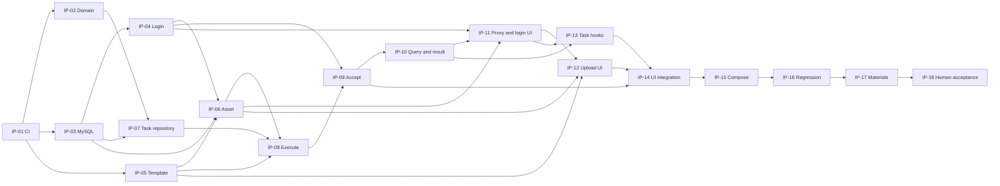

# 任务追踪与 Implementation Plan（Assessment / Track A）

日期：2026-10-30（Asia/Shanghai）。实施规划已完成；用户随后授权执行第一个任务 IP-01。
**IP-01 的 CI 与测试入口已实现，本地及独立分支远程验证通过，已按用户明确授权完成自助验收；业务代码、DDL 和容器配置未修改。**
IP-02 领域模型、状态机及本地验证已完成，用户于 2026-10-30 明确验收通过并授权 commit / push，见 V-02。
IP-03 初始结构、真库测试及 CI 配置已实施，本地与远程 CI 验证通过，PR #2 待用户审查/验收，见 V-03；PR #2 现已合入 main。
IP-04/05 已实现并完成本地验证，待用户审查/验收，见 V-04/05；IP-06 已实现上传、素材公开能力和本地存储，验证见 V-06，待用户验收；IP-07 已实现任务仓储、本人查询投影和条件更新，本地验证通过，待用户审查/验收，见 V-07；IP-08～18 尚未开始。
历史编号、结果与未验证事项保留在第 10 节。

## 1. Implementation Overview

### 1.1 基线与范围

依据 [requirements.md](requirements.md) 的 ASMT-R-01～14、48 条 AC 与 VT-01～14，
[domain-model.md](domain-model.md)、[detailed-architecture.md](detailed-architecture.md)、
[api-contract.md](api-contract.md)、[database-design.md](database-design.md)、
[frontend-state-design.md](frontend-state-design.md)、[architecture.md](architecture.md)、
[architecture-decisions.md](architecture-decisions.md) 及根目录/前端 AGENTS。
已检查现有源码、POM、npm scripts、Dockerfile/Compose 和 CI。

按用户指定参考 ddd-skill 2.2.4 的 SKILL.md、Case/Domain/命名指引，并服从 ADR-006 的项目适配：
单 Maven 工程，trigger/api/cases/domain/infrastructure/types；Domain 纯 Java；所有入口经过 Case；
Task 聚合维护规则，Cases 编排事务/跨模块/后台执行，Infrastructure 实现输出契约。
不运行 archetype，不复制技能中的 Redis/MQ、默认密码、跳过测试的部署命令或模式框架。

本轮没有发现需要修改已确认需求的冲突。需求文档保留其分析阶段的“待设计”表述，实施选择以详细设计和 ADR-007～010 为准；
现行实现遵循详细设计，不因为早期文档的历史表述而重新选择已确认的契约。

| 规划时基线（实施更新见 V-01 / V-02） | 实施安排 / 完成证据要求 |
| --- | --- |
| 代码只有 scaffolding；后端仅 1 个不连接 JDBC 的上下文测试 | 业务、SQL、身份、多任务行为全部仍待实现和验证 |
| 现有 CI 有 push/PR、Maven verify、npm ci/lint/typecheck/build、Compose config | IP-01 优先补强测试入口及失败门禁，沿用现有工作流，不重新生成工程 |
| 前端尚无测试脚本/依赖 | IP-01 配置 Vitest + React Testing Library，锁定与现有栈兼容的版本；IP-12～14 补实际业务测试 |
| 当前无业务表、Mapper、账号/模板种子或上传卷 | IP-03 尽早启用真实 MySQL 验证；IP-04/05/06 分别提供真实初始化与资源 |
| Docker 和远程 CI 只有历史“未运行”记录 | 未来执行时重新检查环境；本轮没有重跑，不能当作当前故障或通过证据 |
| 用户确认预置账号登录/退出，不注册 | 保持 demo-a/demo-b、Cookie/Session/CSRF；不恢复访客选择器或 Bearer 提案 |

### 1.2 当前范围与未来边界

当前覆盖 R-01～R-13 强制要求，并继续采用现有 Compose 方向落实 R-14 推荐交付。
预置账号登录是用户确认的 MVP 方案；“完整身份认证系统”延期不包含这项登录/退出和本人数据隔离。

不排入真实 AI Provider、视频、对象存储、MQ/独立 Worker、Outbox、自动续跑/重试、注册/改密/角色、模板编辑/版本平台、
工作流引擎、独立 Generation/Result/History 模块、结果下载/删除/重新制作、分页或自动发布。
保留 MediaGenerator、AssetStorage、TaskDispatcher 的已选最小边界，不为未来增加空接口/表/字段。

任务编号使用 IP-01～IP-18，避免与历史 S/R/T 及 Assessment 的 R 编号混淆。
Verification 使用 V-01～V-18，细化并对应原 VT；这些都是**待执行验证**，不是测试已通过的声明。

## 2. Development Milestones

| 里程碑 | 任务 | 可观察退出条件 |
| --- | --- | --- |
| M0 工程验证入口 | IP-01 | 既有构建门禁保留，前端测试能真实运行并在断言失败时使 CI 失败；远程结果单列 |
| M1 规则与数据基础 | IP-02～05、IP-07 | 状态机受约束；真实 MySQL schema/条件写可验证；登录和只读目录可用 |
| M2 核心后台纵切 | IP-06、IP-08～10 | 合法素材受理后异步完成三阶段；三个失败点均中断；个人持久记录与图片可读 |
| M3 浏览器多任务闭环 | IP-11～14 | 登录、上传、连续制作、独立跟踪、异常恢复、刷新及 A/B 隔离有实际 UI 和行为测试 |
| M4 可复现交付 | IP-15～18 | 容器初始化/业务闭环及材料可复核，用户最终验收；未验证与已接受限制单列 |

M1 不要求先做完整界面；核心异步模型在 IP-02 开始、真实执行在 IP-08 落地。
各任务同步写测试；IP-16 是联合复核，不是把核心测试拖到最后。

## 3. Vertical Slices

| 纵切 | 端到端行为与组成任务 | 验收观察 |
| --- | --- | --- |
| VS-01 登录与只读浏览 | IP-03/04/05/11，加 IP-12 的目录页面 | Java 数据和合法图片可浏览；A 登录/退出后 B 登录；无注册入口 |
| VS-02 制作与成功结果 | IP-02/03/05/06/07/08/09/10，再 IP-11～14 接入浏览器 | 上传 → 202 ID → 三阶段 → MySQL 成功记录 → 可预览图片；不依赖页面持续打开 |
| VS-03 指定失败和请求故障 | IP-08/09/10/13/14 | 三个阶段分别失败且中断；查询断网仅暂停查询，恢复后读真实状态 |
| VS-04 多任务与个人恢复 | IP-04/07/08/10/11/13/14 | 多项独立执行/跟踪，终态停止；刷新恢复；退出/登录及晚到回调不会串用户 |
| VS-05 隔离环境交付 | IP-01/03/15/16/17/18 | 测试门禁、空库初始化、三服务/上传卷、操作说明及最终验收材料一致 |

这些纵切共享必要的工程基础，并非五套平行实现。后端先通过 API/集成测试证明 VS-02，再接入 UI。

## 4. Detailed Task Breakdown

每项仅创建当前实际需要的类/文件；具体 Java 签名从现有契约落实，不在计划中再定义另一套接口。
任务下的范围、验收和 V 项均属于完成条件；当前状态见各项 checklist 与第 10 节。

后续持久化实现按用户确认统一使用 **MyBatis XML Mapper** 编写 SQL，不在 DAO 注解中内嵌 SQL。
XML 位于 `backend/src/main/resources/mybatis/mapper/<业务>/`，namespace 与对应 DAO 接口全限定名一致，
statement id 与 DAO 方法对应；值参数使用 `#{...}` 绑定。首个实际 Mapper 在 IP-04 配置 XML 资源加载，
后续任务复用该配置；每项真库集成测试必须通过实际 DAO 调用验证 XML 加载、参数绑定及结果映射。

### IP-01：优先补强 CI 与测试工程入口

- [x] IP-01 工程搭建完成并有验证记录；用户授权自助验收通过，2026-10-30。

**依赖**：已完成的 S-02/03/06；无需业务代码。**来源**：R-01、R-12，工程基线。

**范围**：审查并增量完善 .github/workflows/ci.yml、frontend 测试配置/scripts/lockfile、必要测试说明；保留 Java 17/Node 22、现有版本与构建方式。
配置 Vitest + React Testing Library，建立 test:ci 命令；以当前实际占位页面的最小可渲染检查验证测试环境，明确这不是 R-12 的业务测试。
不创建假业务模块或为满足测试数量写空断言。后端沿用已有 JUnit/Spring 测试入口。

**验收 / V-01**：

- push/PR 工作流包含 Maven verify、npm ci、test:ci、lint、typecheck、build、Compose config；任何失败均非零退出，没有 continue-on-error 或空测试通过开关。
- 本地与 CI 命令一致；临时制造一条测试失败，确认测试命令及工作流步骤不会吞掉错误，随后恢复，不提交故意失败的测试。
- 实际运行现有后端测试和至少一个前端测试，产出可定位的测试报告；不能仅检查 YAML 或声称 runner 已通过。
- 若有权限且已有授权的远程运行可记录其 run/commit；本任务不包含推送或部署授权。远程不可运行时标为未验证，不以本地结果冒充；最终由 IP-17/18复核。
- MySQL CI 门禁明确在 IP-03 引入真实 schema 测试；容器业务门禁在 IP-15 引入。此时不得把尚未存在的业务测试标为完成。

**边界**：不新增业务端点、DDL、认证或任务逻辑；不为了搭建 CI 升级框架、禁用 ESLint 规则或跳过测试。

#### IP-01 实际执行记录（V-01）

2026-10-30，Asia/Shanghai；状态：**ACCEPTED，按用户明确授权完成自助验收**。
关联 R-01 工程版本约束、AC-R-12-01 的本地命令/CI 配置；不将本项计为 AC-R-12-02/03 的业务覆盖。
执行前工作区干净，使用 Command Line Tools Git 检查（默认 Git 受 Xcode 许可证阻挡）。

修改 `.github/workflows/ci.yml`、`frontend/package.json` / lockfile、新增
`frontend/vitest.config.mts`、`frontend/vitest.setup.ts`、`frontend/src/app/page.test.tsx`，
同步根/前端 README 和本任务记录。沿用现有后端测试，无业务源码或后端配置改动。
直接新增开发依赖精确锁定为 Vitest 5.0.5、Vite 8.3.5、@vitejs/plugin-react 6.1.2、jsdom 29.1.1、
@testing-library/react 16.3.3、@testing-library/dom 10.4.2、@testing-library/jest-dom 7.0.1。
安装前检查 npm 官方元数据的 engines/peerDependencies；本机 Node 22.21.1、npm 10.9.4 兼容。
jsdom 30 要求更高的 Node 补丁版本，因此保留兼容的 29.1.1；现有框架/工具包版本均未改变。
package engines 同步测试依赖的 Node 22.13.0 最低要求，保留 22 LTS 版本线和 `.nvmrc`。
Vite 自带 tsconfigPaths，未保留额外路径解析插件。没有强制安装或忽略 peer 约束。

| V-01 检查 / 工作目录 | 实际命令或步骤 | 状态与证据 |
| --- | --- | --- |
| Java 17 / `backend/` | `mvn -Dmaven.repo.local=/private/tmp/frameflow-m2 --batch-mode --no-transfer-progress verify`；JAVA_HOME 指向本机 JDK 17.0.12 | PASS；1 test，0 failures/errors/skips，JAR 打包成功；`backend/target/surefire-reports/TEST-com.frameflow.studio.FrameflowStudioApplicationTests.xml` |
| 依赖重装 / `frontend/` | `npm ci --offline --cache /private/tmp/frameflow-npm-cache`；PATH 优先 Node 22 | PASS；从已下载缓存重装 432 packages，审计 0 vulnerabilities；lockfile 可重复安装 |
| 最小可渲染检查 / `frontend/` | `npm run test:ci` | PASS；1 test，0 failures/skips；`src/app/page.test.tsx` 渲染真实 Home，断言 main 中可见的一级标题和占位说明；`frontend/test-results/junit.xml` |
| 失败传播 / `frontend/` | 临时将标题断言替换为不存在的名称，通过 `bash --noprofile --norc -e -o pipefail -c 'npm run test:ci'` 执行；finally 恢复文件，再运行正常测试 | PASS；实际断言失败，npm 与步骤 shell 退出码 1；恢复后 1 test 通过；负向日志 `/private/tmp/frameflow-ip01-assertion-failure.log`、失败报告 `/private/tmp/frameflow-ip01-failed-junit.xml` |
| 空测试保护 / `frontend/` | `npm run test:ci -- ip01-no-matching-test` | PASS；No test files found、退出码 1；日志 `/private/tmp/frameflow-ip01-no-tests.log`；随后正常测试已重跑并恢复通过报告 |
| 静态与构建 / `frontend/` | `npm run lint`、`NEXT_TELEMETRY_DISABLED=1 npm run typecheck`、`NEXT_TELEMETRY_DISABLED=1 npm run build` | PASS；ESLint 0 warnings，strict 类型检查、生产构建及 standalone postbuild 成功；构建日志 `/private/tmp/frameflow-ip01-frontend-build.log` |
| Compose / 根目录 | `docker compose --env-file .env.example config --quiet` | PASS；仅配置解析，未启动容器 |
| 工作流与自审 / 根目录 | 解析 YAML，核对 push/PR、所有必需命令、失败传播和报告路径；检查 Git diff 与锁文件 | PASS；无 continue-on-error、空测试放行或跳过测试；报告在未取消的成功/失败 job 后上传、缺失报错；已有包版本无变化；无故意失败测试残留 |
| 远程 Actions / artifact 上传 | 用户随后授权远程验证；以远程 main 为基线创建独立验证分支，只提交 6 个 CI/测试文件并触发 push 工作流 | PASS；run `41052413658`，backend/frontend/compose 及两份报告上传均成功；下载 JUnit 确认前后端各 1 test、0 failures/errors/skips；版本与链接见下文 |

远程补充验证（2026-10-30 20:02～20:03，Asia/Shanghai）：

- 分支 `ci/ip-01-validation-20261030`；提交 `9975f8bc89d27a9633637de45ebb47be6f10c574`，
  父提交为远程 main 的 `9d514cb686c99ff774d9543a4bbe35416d2fe76f`。
  本地另有设计文档提交 `665ba80` 尚未推送，因此只上传 workflow、package.json / lockfile、Vitest 配置/setup 和页面测试共 6 个文件；
  这些运行文件与本地一致，未包含设计提交，也未合并或改写 main。
- [CI run 41052413658](https://github.com/ShengboYY/frameflow-studio/actions/runs/41052413658)：
  push 触发，Ubuntu 24.04，Temurin 17.0.21、Node 22.23.4、npm 10.9.9；三个 job 和全部检查步骤均 success。
- `backend-test-reports` artifact `12975995093`（4124 bytes）、`frontend-test-reports` artifact `12975670723`（372 bytes）
  均成功上传且未过期；经 GitHub 连接下载 ZIP 并解析 XML，分别确认 1 test、0 failures/errors/skips。
  下载的 ZIP 在 `/private/tmp/frameflow-ip01-remote/`；摘要 `/private/tmp/frameflow-ip01-remote-summary.json`，
  job 日志 `/private/tmp/frameflow-ip01-remote-backend.log` / `/private/tmp/frameflow-ip01-remote-frontend.log`。
- 分支保护检查：main 摘要 `protected=false`、required_status_checks 的 enforcement_level 为 `off`、contexts/checks 为空，
  仓库 rulesets 列表为空。当前没有强制要求 CI 通过的合并门禁。
  详细 `/branches/main/protection` 接口返回 403 `Resource not accessible by integration`，该细节读取受连接权限限制；
  本次未修改分支保护、未验证失败 PR 的实际合并操作。

环境说明：普通沙箱首次禁止 npm DNS 与后端随机端口 bind；分别允许联网安装、允许本机监听后成功，
未修改测试来绕过限制。后端日志 `/private/tmp/frameflow-ip01-backend-verify.log`；上下文测试不调用 JDBC。
本地生成报告/日志不提交；远程已实际上传并下载核对报告。临时路径可能被系统清理，远程 artifact 按保留策略到期。
自审由本次实现者完成；无独立审查结论。当前没有阻塞 IP-01 本地验收的缺陷。
ESLint 9 的既有 EOL 限制保持，见 ADR-002；MySQL schema 测试由 IP-03 引入，容器业务测试由 IP-15 引入。
后端三阶段和前端多任务/查询故障行为仍未实现或验证，不据此宣称 R-12 已全部满足。

自助验收与发布授权（2026-10-30）：用户明确要求“对于 CI 请自助验收，可以 commit push”。
执行者复核 V-01 的工作流、失败注入、前后端报告和远程成功记录，确认 6 个 CI/测试运行文件的
Git blob 与已验证远程提交完全一致，全部 IP-01 条件满足，按该授权勾选本任务。
本次新提交仅包含 9 个 CI/测试/说明文件；当前 main 中既有设计文档提交保持原样随分支快进推送。
此验收由实现者自行完成，不表述为独立人工审查；不扩大为业务验收、分支保护变更或部署授权。

### IP-02：ProductionTask 领域模型及状态机

- [x] IP-02 领域行为与测试完成，用户明确验收通过，2026-10-30。

**依赖**：IP-01。**范围**：domain.task 内聚合、必要值对象/枚举及纯恢复检查；只按 domain-model.md 建模。

**验收 / V-02**：初始输入/owner 固定；9 种合法组合；正常链、三阶段失败、执行前派发失败；跳步、回退、错误阶段失败、缺结果成功及终态修改均被拒绝。
重复素材位置保持；恢复对象不产生副作用。无公开状态 setter、Spring/MyBatis/HTTP 或其他域仓储依赖。
采用参数化 Domain Unit Tests 检查合法边和非法组合，并对已有真实类补依赖规则检查；无需引入架构框架即可完成时使用现有工具。

#### IP-02 实际执行记录（V-02）

2026-10-30，Asia/Shanghai；状态：**ACCEPTED，用户明确验收通过并授权 commit / push**。
执行前工作区干净；分支 `feat/ip-02-production-task-domain`，基于 main `d4edff3`。
验收前未提交、推送或自动勾选完成；用户现已明确接受本任务并授权提交及推送当前任务分支。未启动下一任务。

参考 task-development-workflow、ddd-skill 2.2.4 的聚合/值对象/领域设计/命名指引，遵循 ADR-006 的项目适配。
新增源码仅在 `backend/src/main/java/com/frameflow/studio/domain/task/model/`：

| 对象 | 建模结果 |
| --- | --- |
| `aggregate.ProductionTask` | 唯一聚合根；固定 UUID taskId/ownerId、Instant createdAt、TaskInput；私有可变结论，仅通过领域行为推进 |
| `valobj.TaskInput` | 不可变 record：templateId、有序 UUID assetIds；防御性复制、不去重、不可外部修改；数量匹配/归属等外部事实由 Case 校验 |
| `valobj.TaskStatus` / `TaskStage` | 四种整体状态、固定三阶段；无阶段用 null，不增加伪阶段 |
| `valobj.TaskResult` | 不可变 record：非空白稳定结果引用；资源就绪由 Case 确认，不保存 URL/文件内容 |
| `valobj.FailureInfo` / `FailureKind` | 不可变 kind/stage/code/message；STAGE 必须有阶段，DISPATCH 必须无阶段；原因/分类不得空白 |

`accept` 建立 PENDING；`restore` 检查九种合法结论并原样重建，不读取时钟、文件、数据库或派发。
行为为 startChecking、completeChecking、completeGeneration、succeed、failCurrentStage、failBeforeStart。
阶段失败显式提供失败阶段，拒绝将旧阶段失败记到新阶段。失败数据校验完成后才修改状态；被拒绝操作保留原对象。
身份/输入无 setter，聚合不嵌套其他域对象；revision、updatedAt 和生成候选不进入聚合。
恢复入口是可信持久化边界，不能作为外部任意状态修改 API。

新增测试：`TaskDomainBoundaryTest`、`model/aggregate/ProductionTaskTest`、`model/valobj/TaskValuesTest`，
均在 `backend/src/test/java/com/frameflow/studio/domain/task/` 下；首轮未新增依赖或修改 POM/CI，后续按用户 review 引入编译期 Lombok，见下文。
领域测试不启动 Spring，沿用现有 JUnit 参数化测试和 AssertJ；依赖规则用 JDK 自带 jdeps 检查真实编译产物，禁止空匹配通过。

| V-02 条件 / 检查 | 实际证据 | 状态 |
| --- | --- | --- |
| 初始身份/输入固定，重复素材位置保持 | 正常链、各阶段失败和完整操作矩阵均检查固定字段；输入原列表修改、返回列表修改及值相等性测试 | PASS |
| 九种合法组合与纯恢复 | 9 种恢复保留全部传入事实，恢复后行为仍受约束；构造入口必需字段测试；源码自审确认无 I/O/时钟/执行调用 | PASS |
| 正常链、三个阶段失败、派发失败 | 从 accept 实际推进各路径并断言阶段、结果/原因；9 种组合 × 8 个操作覆盖 8 条合法边和 64 个拒绝操作 | PASS |
| 非法组合、缺结果成功、错误阶段、终态保护 | 状态 × 可空阶段 × 有/无结果 × 五种失败信息共 160 种组合，9 合法、151 拒绝；无结果成功/无效失败详情拒绝后无部分修改 | PASS |
| 无 setter、无框架/跨域依赖 | 反射检查无公开构造器/setter、固定字段 private final；jdeps 检查 Task 编译类仅依赖 Java 和本域 | PASS |
| 领域定向测试 / backend | JDK 17.0.12：`mvn -o -Dmaven.repo.local=/private/tmp/frameflow-m2 --batch-mode --no-transfer-progress -Dtest=ProductionTaskTest,TaskValuesTest,TaskDomainBoundaryTest test`；259 tests，0 failures/errors/skips | PASS |
| 后端完整检查 / backend | 同一 JDK：`mvn -o -Dmaven.repo.local=/private/tmp/frameflow-m2 --batch-mode --no-transfer-progress verify`；260 tests，0 failures/errors/skips，JAR 打包成功 | PASS |
| 前端回归 / frontend | Node 22.21.1 / npm 10.9.4：`npm ci --offline --cache /private/tmp/frameflow-npm-cache`、`npm run test:ci`（1 test）、`npm run lint`、`npm run typecheck`、`npm run build`（含 postbuild）；后两项设置 NEXT_TELEMETRY_DISABLED=1 | PASS |
| Compose / 根目录 | `docker compose --env-file .env.example config --quiet`；只证明配置解析 | PASS |
| 首轮自审 / 根目录 | 检查全部新增源码/测试和实际文档 diff，`git diff --check`；未发现阻塞缺陷，当时未修改前端源码、DDL、应用配置或依赖；后续 Lombok 调整另行记录 | PASS |
| 本分支远程 CI / 数据库 / 后台执行 | 本次未推送，无远程运行；MySQL/CAS 为 IP-03/07，真实后台调用与失败中断为 IP-08，不能由领域单测代替 | NOT VERIFIED，后续任务范围 |

后端完整检查首次在普通沙箱失败：既有随机端口上下文测试遭遇 `java.net.SocketException: Operation not permitted`，
同时 259 个领域用例通过；允许本机监听后全量 260 个测试通过，没有跳过/弱化测试。
失败日志 `/private/tmp/frameflow-ip02-backend-verify.log`，成功日志 `/private/tmp/frameflow-ip02-backend-verify-unrestricted.log`；
JUnit 在 `backend/target/surefire-reports/`。前端日志 `/private/tmp/frameflow-ip02-npm-ci.log`、
`frameflow-ip02-frontend-{test,lint,typecheck,build}.log`，JUnit 在 `frontend/test-results/junit.xml`。
这些生成文件不提交，临时路径可能被清理。ESLint 既有 EOL 提示保持，见 ADR-002。
实现者已完成自审；用户随后审查建模、要求以 Lombok 简化 getter、了解 FailureInfo 细节，并明确接受本任务。
本记录不将实现者自审表述为独立代码审查，也不将本任务验收扩展为整体业务验收或合并 main 的授权。

IP-02 review 补充（2026-10-30）：用户允许配置依赖并用构造器/getter/setter 等注解简化代码。
采用 Lombok（不是 Spring 注解）提供的 `@Getter`，替代 ProductionTask 的八个手写 getter，读取签名与领域行为不变。
保留包含组合校验的私有构造器；不生成绕过状态机的 setter。现有不可变 record 已由 Java 自动提供值访问器和构造器，无需额外注解。
Java 的类型 import 不由 POM 依赖代替，继续使用明确导入。
`backend/pom.xml` 引入 Boot 4.0.9 BOM 管理的 Lombok 1.18.48（provided），显式配置 annotationProcessorPaths，
并从 Boot JAR 排除；`backend/lombok.config` 停止继承上级配置并关闭生成的 Lombok 字节码注解。
`backend/Dockerfile` 同步复制该配置；ADR-002/006 和 architecture.md 记录这一获用户授权的编译期适配。
补充验证：同一 Java 17 / Maven 缓存下运行前述领域定向 test（首次去掉 -o 下载依赖）和完整 verify，
分别 259 / 260 tests 通过，0 failures/errors/skips；现有 jdeps 与无 setter 检查保持通过，没有放宽断言。
检查最终可执行 JAR 无任何 Lombok 条目；自审配置和 Dockerfile 的 COPY，`git diff --check` 通过。
日志 `/private/tmp/frameflow-ip02-lombok-test.log`、`/private/tmp/frameflow-ip02-lombok-verify.log`；
前端未改动，沿用本轮此前通过的回归证据；未构建 Docker 镜像或运行远程 CI。

### IP-03：初始数据库结构与真实 MySQL 测试门禁

- [ ] IP-03 schema、初始化说明和 MySQL CI 测试完成。

当前实施状态：初始结构、集成测试与 CI 配置已实现，本地及远程四个 job 均通过，PR #2 待用户审查/验收，见 V-03。

**依赖**：IP-01。**范围**：四表有版本标识的初始 schema、索引/CHECK/聚合内外键、隔离测试库配置、Maven 集成测试入口、CI MySQL 8.4 service。
本任务只准备账号表，实际账号初始化归 IP-04；模板/媒体不进 SQL。不启用启动自动建表，不新增迁移框架。

**验收 / V-03**：全新隔离库可按脚本初始化；实际 JDBC 检查四表、索引、唯一性及 FK；非法状态和 NULL/结果/失败组合被拒绝，UTC/字节边界明确。
使用真实 MySQL，不以 H2/上下文测试替代；以 *IT 和 Maven Failsafe 接入 integration-tests profile：
CI 执行 mvn --batch-mode --no-transfer-progress -Pintegration-tests verify，必须发现并执行真实集成测试，测试库不可用时失败。
普通 Maven verify 保留不要求数据库的快速测试；两种证明范围分开。CI 临时测试凭据不复用用户数据/密码；输出不泄漏凭据。
初始化脚本仅用于初始结构；已有卷显式初始化方式与“首次空卷脚本不会重跑”均说明，不删除用户卷。

#### IP-03 实际执行记录（V-03）

2026-10-30，Asia/Shanghai；状态：**IMPLEMENTED / LOCAL & REMOTE VERIFIED，待用户验收**。
用户授权按 docs、task-development-workflow 和 ddd-skill 执行第三个任务。执行前工作区干净，
依赖 IP-01 已验收；采用 ADR-006/008 的单 Maven 工程及现有四表设计，没有改变领域模型或公共 API。
首次实施与自审阶段未提交、推送或运行远程工作流；用户随后授权在 `codex/ip-03-database` 分支提交、推送并创建 PR。
发布包含用户确认的后续 XML Mapper 任务约定；远程 CI 结果另行记录，不自动开始 IP-04，正式验收状态保持待用户确认。

新增 `backend/src/main/resources/db/schema/V001__initial_schema.sql` 和
`backend/src/test/java/com/frameflow/studio/infrastructure/dao/SchemaIT.java`；
修改 `backend/pom.xml`、`.github/workflows/ci.yml`、README、database-design.md、ADR-008 和本记录。
Failsafe 3.5.6 沿用 Boot 父 POM 管理，仅在 `integration-tests` profile 启用并要求实际发现测试。
CI 增加独立 MySQL 8.4 service job、SQL 健康检查、动态端口、每 run 的临时凭据及测试报告上传，保留所有原有 job。

V001 的 SHA-256：`11aee8420548d195a912b5e348d472262cc23be4a0a54143b9f529822b793f12`。
四表使用 InnoDB/utf8mb4，机器值 ascii_bin、UTC DATETIME(6)；只有任务根/输入有 RESTRICT 外键。
显式保护可空列的 CHECK 防止 UNKNOWN 放过非法结论；状态/阶段/失败类型/MIME 采用二进制比较，拒绝尾部空格；
revision 仅要求非负，不将流程步数写死。
没有账号种子、模板/媒体 SQL、Mapper、迁移框架、启动自动建表或新的业务类。

本机原 Docker 未启动，现有 conda MySQL 5.7 不符合验证要求。随后启动 Docker Desktop，
使用已有 mysql:8.4 镜像启动专用临时实例（实际 8.4.10、随机测试密码、loopback 动态端口、tmpfs 数据目录）。
未连接业务库、未读取真实 .env、未删除用户数据卷；另一个临时容器用于原样核对 CI service 的健康检查参数。

| V-03 条件 / 检查 | 实际证据 | 状态 |
| --- | --- | --- |
| 空库初始化、四表/字段/索引/唯一性/FK | SchemaIT 元数据及真实插入检查；主键、用户名、content_key 唯一；历史组合索引含两个 DESC 列；仅聚合内 FK，拒绝孤儿输入及删除/修改有输入的任务根 | PASS |
| 九种合法结论与非法 NULL/结果/失败组合 | 遍历 3240 种状态/阶段/结果/失败字段组合，恰好 9 种接受；3231 种以 CHECK/NOT NULL 错误拒绝；另查非法更新、大小写、空白值及机器枚举尾部空格 | PASS |
| 数值、字符和 UTC 边界 | 素材 1/8388608 字节接受，0/负数/8388609 拒绝；position/revision 负数拒绝，revision 99 可存；倒退时间拒绝；UTF-8 中文/emoji 字符数与字节数分开、超长/非 ASCII 拒绝；UTC 微秒在 +08/+00 会话间明确转换与回读 | PASS |
| 输入及事务能力 | 相同素材可以占两个位置；输入主键冲突后显式回滚，根和输入全部消失；这是 JDBC/InnoDB 能力验证，真实 Repository/Case 原子创建仍归 IP-07 | PASS |
| Maven 完整集成入口 | Java 17.0.12：`mvn -Dmaven.repo.local=/private/tmp/frameflow-m2 --batch-mode --no-transfer-progress -Pintegration-tests verify`；260 个快速测试 + 13 个真实 MySQL 测试通过，0 failures/errors/skips，JAR 打包成功 | PASS |
| 快速入口不依赖数据库 | 同一 JDK/缓存：`mvn -Dmaven.repo.local=/private/tmp/frameflow-m2 --batch-mode --no-transfer-progress verify`；260 tests 通过，未执行 Failsafe | PASS |
| 门禁拒绝假通过 | 使用 `-Pintegration-tests -Dit.test=SchemaIT failsafe:integration-test failsafe:verify`，分别缺密码、端口不可达、业务库名、非空测试库，全部 BUILD FAILURE/exit 1；哨兵 id=7 保留且未创建额外表 | PASS |
| 没发现 IT 必须失败 | 指定不存在的 IT 时 exit 1；另临时移走再恢复 target 中 SchemaIT 编译产物，默认发现零个 IT 时也 exit 1（No tests were executed），源码不改、不关闭门禁 | PASS |
| README 初始化路径及首次/已有卷说明 | 按容器 mysql 客户端重定向执行 V001，SHOW TABLES 为四表、总行数 0；SchemaIT 验证重放报 1050；README 明确当前 Compose 未挂载、首次空目录规则、已有卷显式执行、DDL 非原子与禁止删用户卷 | PASS |
| CI service 健康检查配置 | 首次远程运行发现 runner 参数解析与 shell 不同；改为双引号分组后，run 41066158015 的 MySQL 8.4 服务初始化、JDBC 测试和报告上传全部成功 | PASS（远程） |
| 前端与 Compose 回归 | Node 22.21.1：`npm ci --offline --cache /private/tmp/frameflow-npm-cache`、`npm run test:ci`（1 test）、lint、typecheck、build/postbuild 全通过；后两项设置 NEXT_TELEMETRY_DISABLED=1；根 Compose config --quiet 通过 | PASS |
| 实现者自审 | 审查新增脚本/测试及全部实际 diff；发现并定向复现 ascii_bin 的 PAD SPACE 使 `PENDING ` 通过，改用二进制比较并加入状态/阶段/失败类型/MIME 回归；修复后无阻塞缺陷，没有独立审查者 | PASS |
| 远程 CI | 修复提交 5d1097a 的 PR run 41066158015：backend、frontend、compose、mysql-integration 四个 job 全部成功；日志核对 260 个快速测试、13 个真库测试和 1 个前端测试，报告均上传 | PASS；首次失败与修复证据保留在下文 |
| 应用容器/登录/媒体/Repository 条件更新 | 未构建/启动三服务业务环境；这些不能由 schema 测试证明 | NOT VERIFIED，IP-04～15 范围 |

日志为 `/private/tmp/frameflow-ip03-{schema-it,integration-verify,backend-verify}.log`、
`frameflow-ip03-negative-{unavailable,missing-config,unsafe-name,no-tests,nonempty,empty-discovery}.log`，
以及 `frameflow-ip03-npm-ci.log` / `frameflow-ip03-frontend-{test,lint,typecheck,build}.log`。
测试报告在 `backend/target/{surefire-reports,failsafe-reports}/` 及 `frontend/test-results/junit.xml`，
这些生成文件不提交，临时路径可被清理。ESLint 9 既有 EOL 提示保持，未更改依赖版本。
失败门禁检查后恢复编译产物与空测试库，并再次运行完整集成入口，使最终报告保留成功回归结果。
尾部空格缺陷的失败复现日志为 `/private/tmp/frameflow-ip03-padding-reproduction.log`（1 test，预期失败），
修复后的全量结果使用最终 `integration-verify` 日志；不将失败复现当作仍未解决的门禁失败。
初始化仅对临时实例执行，未替用户的业务库建表；账号与媒体初始化尚未实现。
结束时已删除本次两个临时容器及其匿名卷，并移除临时密码环境文件；校验源码/本次日志未包含这些随机密码。

发布记录：实现提交 `eb8acc72610a8dd6ba9c46447f01d283baaf7f9a`，分支 `codex/ip-03-database`，
[PR #2](https://github.com/ShengboYY/frameflow-studio/pull/2)，目标 main。首次
[远程 CI 41065816700](https://github.com/ShengboYY/frameflow-studio/actions/runs/41065816700)
暴露 `--health-cmd` 外层单引号在 runner 参数解析中未正确分组，Docker 误将命令中的 mysql 作为镜像名，
后续环境变量未作用于服务。将外层改为 runner 支持的双引号，内部 SELECT 使用单引号保留 SQL 参数，
仍以真实 SQL 校验服务就绪，不跳过测试或降低报告门禁。

修复提交 `5d1097a865e9844bffa5cc48e55ab2c7898c95c1` 的
[远程 CI 41066158015](https://github.com/ShengboYY/frameflow-studio/actions/runs/41066158015) 全部成功，
实际 runner 为 Ubuntu 24.04 / Java 17 / MySQL 8.4.13；核对三个测试 job 的执行日志，
backend 为 260 tests，mysql-integration 为 260 个快速测试 + 13 个 SchemaIT，前端为 1 test，均无失败/错误/跳过。
三份报告均成功上传：backend-test-reports（12983410817）、mysql-integration-test-reports（12983170075）、
frontend-test-reports（12982143863）。这些证据对应上述明确提交；随后仅补充本文和 README 的验证记录，
不将 schema 验证扩展为登录、业务 Mapper 或三服务业务闭环验收。PR 保持开放，不自动合并或勾选用户验收。

### IP-04：预置账号、Java 登录与会话保护

- [ ] IP-04 API-01/02/13/14 与账号初始化完成。

**依赖**：IP-03。**范围**：Identity 本域查询/PasswordVerifier、认证和当前账号 Case、显式账号初始化、安全过滤器/配置及 JSON 错误出口。
账号查询和初始化 SQL 使用 `mybatis/mapper/identity/user_account_mapper.xml`，配套 Identity DAO/PO；
首次加入 XML 时配置 `mybatis.mapper-locations`，覆盖各业务子目录，沿用 DAO 上的 `@Mapper` 注册方式。
使用 Boot 管理的 Security；从 DEMO_A_PASSWORD/DEMO_B_PASSWORD 初始化两个账号，无注册/API 创建/管理员。
公共错误映射在本任务建立最小基础，后续模块只增量补充对应错误。

**验收 / V-04**：真实 MySQL 中仅保存带盐编码；重复初始化不重置密码/account_id；缺失首次密码和不合格字节长度明确失败。
通过实际账号 DAO 执行 XML 中的查询/插入，验证 XML 可加载、参数绑定及账号字段映射正确。
Case 测试与 API Tests 检查统一登录失败、表单字段/编码边界、已登录 409、会话恢复、Session ID 更新、退出失效、空闲/绝对过期及 Cookie 属性。
CSRF 覆盖登录/退出及后续所有 POST；旧 token 不可在新会话写入；401/403/503 为契约 JSON，DB 故障不能当成未登录。
用可控时间验证到期，不真实等待数小时；Domain 不持有 Session/SecurityContext。账号身份稳定，Worker 不依赖登录存续。

#### IP-04 实际执行记录（V-04）

**执行范围与分支**：2026-10-30 用户授权从 main 新建分支执行第四个任务，使用 task-development-workflow、
ddd-skill、mybatis-patterns、springboot-patterns。工作区起始干净；同步 origin/main 后从 `2d5865f`（含 IP-03 合并）
创建 `codex/ip-04-identity-session`。先完成以下本地验证；2026-10-31 用户授权 commit/push 并创建 PR，
发布授权见下文，本地证据不代表用户最终验收。

**实现**：Identity 只读 Account、Repository/PasswordVerifier、认证/当前账号/显式初始化 Case；
`IUserAccountDao` + `UserAccountPO` + `mybatis/mapper/identity/user_account_mapper.xml`，DAO 使用 @Mapper，
统一 `classpath*:mybatis/mapper/**/*.xml` 加载，值参数全用绑定，无注解 SQL。
BCrypt cost 12 + 随机盐 + 算法标识；缺失账号先验证密码、事务外生成编码，再以 REQUIRES_NEW/READ_COMMITTED
短事务原子插入两个账号。重复/竞争插入为 no-op，已有账号永不重置；拒绝在已有事务内初始化。
显式初始化命令、环境变量与本地 Cookie 配置见 README；保持 SQL 自动初始化关闭，V001 未改动。

Spring Security 7.0.8 由 Boot 4.0.9 BOM 管理，标准表单认证过滤器调用 Provider → Case，保存 Session、
登录更换 ID、退出失效并清除同范围 Cookie。传输过滤器严格校验字段/百分号/UTF-8 字节边界；
CSRF 使用 HttpSession repository 和框架掩码处理，只接收 X-CSRF-TOKEN。
可注入 Clock 的过滤器在读取 SecurityContext/CSRF 前检查 30 分钟空闲与 8 小时绝对期限。
API-01/02/13/14 已提供；JSON 错误/请求 ID/no-store 一致；数据库故障保留 503，不当成认证失败。
Cookie 默认 Secure=true；仅本地 `.env.example` 显式 false，Compose 透传该选项，清除 Cookie 同为 Path=/api。
未创建注册/账号管理、前端登录、任务/上传业务，不实现后续任务。

**验收证据**：

| V-04 条件 | 实际检查 | 状态 |
| --- | --- | --- |
| 真实账号 SQL / XML namespace、绑定、字段映射、UTC | IdentityIT 实际 DAO 查询/插入、注入式字符串无匹配、null 查找、UTC 微秒往返 | PASS |
| 带盐编码、字节限制、缺失密码明确失败、重复初始化稳定 | IdentityIT + IdentityCasesTest：相同密码不同 cost 12 编码、72/75 UTF-8 字节、无密码无写入、已有 ID/hash 不变 | PASS |
| 原子初始化及事务边界 | 第二次真实 Mapper 插入后故意抛错，两条记录均回滚；散列先于事务；已有外部事务被拒绝 | PASS |
| 登录失败/输入/409/会话恢复 | AuthApiTest：未知账号与错密同 401，重复/未知/畸形字段 400，编码 415，过长请求 413，已登录 409 | PASS |
| Session ID 轮换、退出、Cookie、过期 | AuthApiTest / SecureCookieTest：真实 HTTP 轮换/清 Cookie、Secure 默认与 loopback 选项；Clock 控制空闲/绝对期限，无小时级等待 | PASS |
| CSRF 与 JSON 错误 / no-store | 登录/退出/未来 assets/tasks POST 缺 token 均 403；参数 token 被拒；登录前/注销旧 token 无效；401/403/503 JSON 与 header/body requestId 一致 | PASS |
| DB 故障与账号不存在不同 | 故障注入返回 503 且保留有效会话；账号移除返回 401 并使会话失效 | PASS |
| 稳定账号身份 | IdentityIT 经真实 HTTP/数据库 A 登录→退出→B 登录，两个 ownerId 正确且不同；重复初始化 ownerId 不变 | PASS |
| 分层依赖 | IdentityBoundaryTest 用 jdeps 检查 Domain/API/Case/Trigger；2026-10-31 补充 Infrastructure 限制并修正配置对 Controller 的依赖，见下方审查修正记录 | PASS（修正后） |
| 显式可执行初始化入口 | 临时空库执行 V001；JAR non-web 初始化缺失密码非零退出/零行；成功创建两账号；清空密码后重跑 ID/hash 相同，全局 DEBUG 日志也无测试密码或编码 | PASS |
| 远程 CI / Next 代理 / 业务资源 owner 隔离 / 三服务容器 | 远程 CI 结果另行核对；其余分别属于后续 IP-11、06/09/10、15，不从认证测试推断通过 | NOT VERIFIED |

**实际命令**（Java 17.0.12、Maven 3.9.10、Node 22.21.1）：

- `mvn --batch-mode --no-transfer-progress verify`：302 个快速测试，0 failures/errors/skips，可执行 JAR 打包通过。
- `mvn --batch-mode --no-transfer-progress -Pintegration-tests verify`：302 个快速测试 + 19 个真库测试（IdentityIT 6、SchemaIT 13），0 failures/errors/skips。
  本任务独立临时 MySQL 8.4 容器、loopback 随机端口、随机凭据，与业务库/卷无关；结束清理本次容器。
- 初始化命令：`java -jar target/frameflow-studio-0.0.1-SNAPSHOT.jar --spring.main.web-application-type=none --app.accounts.initialize=true`，
  连接上述隔离库，按缺密/首次/重复三个分支检查；未记录或提交可用密码。
- `npm ci`、`npm run test:ci`（1 test）、`npm run lint`、`npm run typecheck`、`npm run build`：全部通过；沿用既有 ESLint 9 EOL 限制。
- `docker compose --env-file .env.example config --quiet`：通过，仅证明配置解析；`git diff --check`：通过。

**自审与修正**（同一执行者，非独立审查）：检查实际 diff 与所有新增文件，补上仅 header CSRF 验证，
清 Cookie 显式指定 Path=/api / Secure / HttpOnly / SameSite；注册唯一认证 Provider，避免生成默认开发账号。Identity DAO 固定 INFO，避免全局 APP_LOG_LEVEL=DEBUG 时记录密码编码参数。
最初 MockMvc 请求未模拟有效原会话 ID，导致轮换断言失败；修正模拟请求后与真实 HTTP 检查均通过。
初始化命令验证脚本曾将空字符串误判为凭据出现在日志，修正脚本后缺密/首次/重复分支全部通过，非应用密码泄漏。
初始编译和测试调试失败均在本地修复，最终检查未弱化测试或屏蔽错误。

**2026-10-31 架构审查修正**：用户要求检查并修正 ddd-skill 的代码位置与分层。
自审确认原 SecurityConfiguration 的登录成功回调直接调用 AuthController.response，且边界测试未覆盖 Infrastructure；
此前仅凭原边界测试通过概括全部架构约束成立不够准确。新增依赖断言在旧实现上先失败，修正后通过。

- HTTP 登录成功/失败、401/403、退出状态与清 Cookie 回调集中到 `trigger.http.identity.AuthenticationHttpHandlers`；
  仅 header 的掩码 CSRF 处理移至同包 `HeaderCsrfTokenRequestHandler`。SecurityConfiguration 只注册处理器/过滤器与安全策略，
  不再引用 Controller、API DTO 或 Case 模型。AccountAuthenticationProvider 在 Trigger 按 Servlet 条件注册为唯一认证组件。
- 显式账号初始化入口移至 `trigger.cli.identity.PresetAccountsInitializer`，继续仅在 `app.accounts.initialize=true` 启用；
  IdentityConfiguration 只保留 Clock/PasswordEncoder 装配，命令、密码政策和初始化 Case 保持不变。
- IdentityBoundaryTest 检查 Infrastructure 不依赖 API/Controller/Case 业务契约或模型；仅技术 Case Port 允许跨入 Cases，
  只有 config 可引用用于装配的 Trigger 技术适配器。`jdeps` 确认配置已不再依赖 Controller、API 或 Cases。
- Java 17 执行 `mvn --offline --batch-mode --no-transfer-progress -Pintegration-tests clean verify`：
  302 个快速测试 + 19 个真 MySQL 测试全部通过，0 failures/errors/skips；真实 HTTP Cookie/登录/退出、CSRF、过期、DB 故障回归通过。
  非 Web JAR 初始化入口另在本任务临时空库复验缺密失败、首次写入、无密码重复执行、ID/hash 稳定及 DEBUG 日志脱敏。
- 本次只修改 IP-04 后端职责和架构说明；前端与 Compose 文件未变，不重复运行已记录的前端检查或三服务容器验收。
  `git diff --check` 和新增文件空白检查通过；本轮仍为同一执行者自审，修正完成后等待用户验收。

**发布授权（2026-10-31）**：用户明确要求 commit、push 并提交 PR；仅发布当前 IP-04 实现、测试、配置与相关文档，
目标为 main，不合并 PR，不自动更改最终验收状态。远程运行与 PR 链接以发布后实际结果为准。

**交接**：READY FOR ACCEPTANCE，IP-04 checklist 保持 `[ ]`，待用户明确验收；不会自动开始 IP-05。
会话仍为单实例内存，重启需重新登录，初始化不自动改密；Next Cookie 透传和业务 owner 授权由后续任务验证。

### IP-05：只读模板目录与合法示例资源

- [ ] IP-05 API-03～06、模板公开 Case、规则与本地验证已完成，待用户审查/验收，见 V-05。

**依赖**：IP-01。**范围**：两项打包 JSON 模板、分类、封面和 Mock 图片资源及来源说明；Template 只读能力/Asset 媒体能力，规则值对象。

**验收 / V-05**：Java 返回不同分类及 1/2 张图片要求，5/8 MiB 和 JPEG/PNG 与现有契约一致；未知分类空列表、未知模板/封面 404。
素材要求的数量/大小边界有单元测试，单张上传验证和完整提交验证各有适用语义；种子重复 ID/无效规则/不可读资源使启动明确失败。
API/资源测试确认图片字节可解码、真实 MIME、公开 key 白名单，不能借路径访问私有文件；不建立模板表或管理后台。

#### IP-05 实际执行记录（V-05）

2026-10-31，Asia/Shanghai；状态：**READY FOR ACCEPTANCE，实现与本地验证完成，待用户审查/验收**。
执行前工作区干净；实现阶段未提交、推送、创建 PR、部署或启动 IP-06。用户随后授权发布，见下方记录。
使用 ddd-skill 2.2.4 的值对象、Case、命名及领域设计指引，并遵循 ADR-006 的项目适配。

**实现范围**：

- `domain.template`：只读 Template / Category、AssetRequirements；类型/大小和完整提交数量校验为纯 Java。
  `ITemplateCatalogRepository` 仅提供真实需要的目录读取，无模板表、DAO、写服务、策略或责任链框架。
- `cases.template`：ITemplateCatalogCase 和不可变输入/结果；分类/筛选/详情，单张及完整提交验证均使用同一份模板规则。
  单张上传不检查总数；完整提交按位置计数，不去重；不存在模板返回明确的空结果。
- `infrastructure.adapter.repository.template`：启动时严格读取 `templates/catalog.json`；两项种子保持 API 约定的分类、1/2 张、5/8 MiB、JPEG/PNG。
  无效字段/规则、空目录、重复 ID、分类名称冲突及未登记封面使 Bean 创建失败。
- `domain.asset.adapter.port.IDemoMediaPort`、PackagedDemoMediaPort、IMediaResourceCase：打包图片在启动时真实解码并检测 MIME，
  内存保存不可变内容。请求 key 只查询已加载白名单，不拼接文件路径；Mock fixture 仅供后端 Case 使用。
  CatalogConfiguration 负责资源装配与封面登记检查，Template 与 Asset 不访问彼此内部仓储/模型。
- `api.template.dto`、`trigger.http.template/asset`：API-03～06 已实现；未知分类空列表，未知模板/封面 JSON 404，
  非法 ID、未知/重复查询参数 JSON 400。错误响应显式声明 JSON，兼容只接受图片的客户端。
- 三张原创 Java2D 几何图片、生成器及 `demo-media/SOURCES.md` 来源/CC0 说明已加入仓库资源目录；构建无需下载素材或运行绘图。PR 审查后统一为 JPEG，见下方修正记录。
  README、API、架构、AGENTS 与本任务记录同步实现状态；既有 AuthApiTest 的模板列表预期从尚无端点的 404 更新为 200。

**首次验收证据（统一 JPEG 前）**（对应 R-02 的 Java 目录/资源、R-03 的模板说明及规则、R-13 的来源/初始化材料；不代替前端与业务闭环验收）：

| V-05 条件 | 实际测试 / 检查 | 结果 |
| --- | --- | --- |
| 分类/不同图片数/字段/筛选 | TemplateApiTest 使用真实装配目录校验分类、摘要、详情和 1/2 张、5/8 MiB；未知分类空列表 | PASS |
| 数量、大小、类型边界与两种校验语义 | AssetRequirementsTest / TemplateCatalogCaseTest：1/2 张精确数量、重复位置、大小 0/负值/1/上限前后/Long.MAX_VALUE、JPEG/PNG/不支持类型 | PASS |
| 无效种子拒绝启动 | TemplateCatalogRepositoryTest：实际 Spring context refresh 失败，覆盖重复 ID、无效数量/类型/上限、浮点/字符串/null 数量、未登记封面和分类冲突；正常种子加载且不可修改 | PASS |
| 图片可用/真实 MIME/不可读资源拒绝启动 | PackagedDemoMediaPortTest：两封面和内部 fixture 解码、PNG/JPEG 字节检测、不信任文件名、返回字节防修改、缺失/损坏/截断资源失败 | PASS |
| 公开 key 白名单及 HTTP 行为 | TemplateApiTest：真实 HTTP 两封面均为可解码 640×400 PNG；内部 fixture 404；编码路径穿越及任意路径无图片返回；400/404 JSON/requestId 一致 | PASS |
| 分层 | CatalogBoundaryTest + 既有 IdentityBoundaryTest：jdeps 检查真实编译类；新 Domain 仅依赖 Java/本域，Case 不依赖 API/基础设施，Controller 只调 Case | PASS |
| 可执行 JAR 的资源独立性 | 从临时空工作目录启动 JAR，核对 catalog/三 PNG/来源文件均已打包；故意使用不可达 DB 端口，公开分类/列表/两详情/两封面正常，未建立连接池；图片 Accept 下内部 fixture 返回 JSON 404 | PASS；仅证明公开目录不依赖 JDBC，不证明数据库连通 |

**实际命令与报告**（Java 17.0.12、Maven 3.9.10）：

- `backend/`：`mvn --offline --batch-mode --no-transfer-progress verify`，**332 tests，0 failures/errors/skips**，可执行 JAR 打包成功。
  新增 30 项测试，全部自动进入现有 Maven/CI 入口；未新增依赖或修改 CI/POM。
  报告 `backend/target/surefire-reports/TEST-*.xml`；日志 `/private/tmp/frameflow-ip05-verify.log`。
- 新增六个测试类：AssetRequirementsTest、CatalogBoundaryTest、TemplateCatalogCaseTest、TemplateCatalogRepositoryTest、PackagedDemoMediaPortTest、TemplateApiTest；
  路径分别位于 `domain/template`、`cases/template`、`infrastructure/adapter/{repository/template,port/asset}`、`trigger/http/template`。
- JAR smoke 摘要 `/private/tmp/frameflow-ip05-smoke-summary.json`，启动日志 `/private/tmp/frameflow-ip05-jar-smoke.log`；临时进程已停止、工作目录已清理。
- 根目录：`docker compose --env-file .env.example config --quiet` 通过，仅配置解析；diff/新增文件空白与文档链接已检查。

**调试与自审**：首次误用旧临时 Maven 缓存，缺少 IP-04 依赖且 DNS 受沙箱限制，改用现有完整缓存离线运行。
普通沙箱禁止测试监听端口，获工具允许后运行真实 HTTP 测试。补充图片专用 Accept 测试先复现四个 404 被协商为 406 的失败，
随后给新端点的错误响应明确设置 JSON，完整回归通过；负向复现日志 `/private/tmp/frameflow-ip05-accept-reproduction.log`。
同一执行者检查新增源码、资源和 diff，无独立审查结论；未弱化测试或跳过失败检查。

**边界与未验证项**：前端、数据库结构/SQL、Compose 和 CI 配置未改；本次不重复前端构建或 MySQL *IT。
本地实现阶段未运行远程 CI；随后发布所触发的 CI 结果以关联 PR 为准。Next 转发、浏览器页面及完整三服务容器未验证，分别由后续任务落实。
目录运行时只读；已有模板 ID 的语义不得随意变更。上传/任务提交端点尚未接入这些规则，Mock 资源不是实际生成能力。
IP-05 checklist 保留 `[ ]`，等待用户明确验收。

**发布授权（2026-10-31）**：用户明确要求 commit、push 并提交 PR；本次仅发布 IP-05 的实现、测试、打包资源和相关文档。
发布分支为 `codex/ip-05-template-catalog`，基于已包含 IP-04 的 main `2629ef1`；保留现有 Case 结构，不将发布授权等同于业务验收，也不合并 PR 或启动后续任务。

**PR #4 审查修正（2026-10-31）**：审查发现原 PNG Mock fixture 与既定 `image/jpeg` 结果契约不一致；
用户确认两张封面和 Mock 结果统一为 JPEG。生成器改用真实 JPEG 编码，三张资源均为 640 × 400 的 `.jpg`，
删除旧 PNG 并同步加载路径、来源说明及 README。公开封面 key 与内部 `demo:mock-result` 稳定引用保持原值。

先将媒体回归断言改为 JPEG，定向运行复现 `expected image/jpeg but was image/png`（1 test，预期失败），
日志 `/private/tmp/frameflow-pr4-jpeg-reproduction.log`。修正后使用 Java 17 执行
`mvn --offline --batch-mode --no-transfer-progress clean verify`，332 tests 全部通过，0 failures/errors/skips，
日志 `/private/tmp/frameflow-pr4-jpeg-verify.log`。媒体测试检查三张资源的 MIME、实际 JPEG 解码格式、尺寸和字节防修改；
真实 HTTP 封面响应为 `image/jpeg`，并保留 PNG/JPEG 检测及私有资源白名单负向测试。
核对干净构建的 JAR 只包含三张 `.jpg` 和来源文件，没有旧 `.png`；独立 fixture 契约检查已通过。
本修正的远程 CI 结果以 [PR #4](https://github.com/ShengboYY/frameflow-studio/pull/4) 对应提交检查为准。

### IP-06：上传、素材解析及本地存储

- [ ] IP-06 API-07/08 与 Asset 公开能力完成。

**依赖**：IP-03、IP-04、IP-05。**范围**：AssetStorage 本地实现、元数据仓储/DAO/PO、上传/解析/后台检查/资源 Case 和上传入口。
素材元数据 SQL 使用 `mybatis/mapper/asset/uploaded_asset_mapper.xml`，复用 IP-04 的 XML 加载配置。

**验收 / V-06**：实际图片类型/可读性/字节数按模板校验；8 MiB 文件、9 MiB multipart 及模板更小上限正确处理；声明 MIME/文件名不可绕过。
内容稳定保存后才写元数据并返回 ID；文件成功/DB 失败时不返回可用素材、尽力清理，清理失败按既定窗口记录。
用临时目录 + Application Service Tests、真实 MySQL 集成及 multipart API Tests 检查错误状态/结构、本人读取、越权统一 404、路径越界和文件丢失。
真库测试通过素材 DAO 验证 XML 中的元数据写入、带 owner 条件的读取及字段映射。
解析保持输入顺序及重复位置；后台检查有真实 I/O 边界；无删除/消费语义，无模板永久绑定，Asset 不反向调用 Task。

#### IP-06 实际执行记录（V-06）

2026-10-31，Asia/Shanghai；状态：**IMPLEMENTED / LOCAL VERIFIED，READY FOR ACCEPTANCE，待用户验收**。
用户要求执行下一个 task，依既有顺序实施 IP-06；执行前通过 Command Line Tools Git 确认工作区干净。
沿用 IP-03 四表、IP-04 Cookie/CSRF 与 XML 加载、IP-05 模板规则和打包媒体；无新依赖、DDL 或公共契约变更。

**实现**：

- UploadedAsset 是不可变轻量实体，保存服务端 UUID、owner、实际类型/字节数、不透明 contentKey 和 UTC 时间。
  元数据 Repository → IUploadedAssetDao / UploadedAssetPO → `mybatis/mapper/asset/uploaded_asset_mapper.xml`；
  查询同时绑定 assetId 与 ownerId，API 不返回 PO、内部 key 或本地路径。
- IUploadAssetCase 先查模板，通过 IAssetStoragePort 有界接收/解码，使用 Template Case 的单张规则检查；
  同目录 `.part` 校验后移动为不可替换的 `.image`，再以 REQUIRES_NEW / READ_COMMITTED 短事务写库。
  提交成功才返回描述；异常时尽力清理，清理失败只记录素材 ID。输入读取/图片解码不持有 DB 事务。
- IResolveTaskAssetsCase 保留顺序与重复位置，ICheckTaskAssetsCase 每次重新查询并实际读取内容；
  IMediaResourceCase 扩展本人输入读取，缺失/其他 owner 统一未找到，内容缺失/字节数不符为不可用。
  素材不绑定模板、不消费、不删除；Asset 不访问 Task。
- API-07/08 实现上传 201 和本人图片 200；multipart 恰好一个 file 和一个 templateId，拒绝未知/重复部分及输入 owner。
  实际 JPEG/PNG 检测与 ImageIO 解码不信任文件名/声明 MIME；输出采样限制解码图像内存，原始文件字节保持。
  配置单文件 8 MiB、请求 9 MiB、模板单张上限，框架/业务错误统一 JSON/requestId/no-store；图片保留 nosniff。
- ASSET_STORAGE_ROOT 默认 `./data/assets`（相对于 Java 工作目录）；内部 key 严格限制为服务器 UUID，读取拒绝符号链接。
  README、API、架构/ADR 状态及根 AGENTS 已同步；Compose 素材卷仍按计划归 IP-15。

**验收证据**：

| V-06 条件 | 实际检查 / 证据 | 结果 |
| --- | --- | --- |
| 实际类型/可读性/大小 | LocalAssetStoragePortTest 验证 JPEG/PNG、原始字节跨适配器重建读取、空/伪造/截断图片、8 MiB 含等号及超限、输入 I/O 异常清理 | PASS |
| multipart 全局及模板限额、错误结构 | AssetApiTest 用真实随机端口 Tomcat + HttpClient 发 multipart：8 MiB / 8 MiB+1、5 MiB / 5 MiB+1、超过 9 MiB 请求；缺失/重复/未知部分、伪装 MIME/路径文件名、损坏图片、未知模板、错误编码、无 boundary | PASS |
| 身份及资源隔离 | HTTP Cookie/CSRF 真实过滤链、本人图片、其他 owner 与未知 ID 同为 JSON 404、非法 ID/查询串 400、文件丢失 503；检查 no-store、nosniff、requestId 及无内部路径/SQL | PASS；HTTP 测试替换认证 Case、素材 Repository 和事务管理器，真实会话/CSRF 及存储仍执行 |
| 文件就绪后提交、失败不返回 ID | AssetCasesTest 检查稳定内容先于事务、事务参数、提交顺序、插入/提交失败清理、清理失败保留原异常、未知模板不做 I/O、模板超限不写库 | PASS |
| XML DAO 与真实 MySQL | AssetIT 实际 DAO/Repository 检查全部字段、UTC 微秒、owner 条件/参数绑定、防 SQL 注入、重复主键；真实上传可读、重复素材顺序、后台再次检查磁盘 | PASS |
| 真事务回滚和 I/O 边界 | AssetIT 在实际 Mapper 插入后注入异常，确认行回滚且文件清理；输入读取不在事务中、插入在事务中；拒绝带现有事务启动上传 | PASS |
| 路径及分层 | LocalAssetStoragePortTest 拒绝路径/URL/越界 key、丢失内容和符号链接；既有 CatalogBoundaryTest / IdentityBoundaryTest / TaskDomainBoundaryTest 使用 jdeps 检查真实编译类 | PASS |
| 后端完整集成入口 | Java 17.0.12：`mvn --offline --batch-mode --no-transfer-progress -Pintegration-tests verify` | PASS；345 个快速测试 + 22 个 MySQL 测试（13 SchemaIT、6 IdentityIT、3 AssetIT），无失败/错误/跳过，JAR 打包成功 |
| 普通快速入口 / 最终回归 | 同一 JDK：`mvn --offline --batch-mode --no-transfer-progress verify` | PASS；345 tests，无失败/错误/跳过，不执行 Failsafe |
| Compose | 根目录 `docker compose --env-file .env.example config --quiet` | PASS；只证明配置解析 |

真实 MySQL 使用本任务专用的 mysql:8.4 临时容器（实际 8.4.10）、随机凭据、loopback 动态端口与 tmpfs 数据目录；
不读取真实 `.env`，不连接业务库，不删用户卷。三个 IT 套件都先检查隔离库为空，各自结束仅清理本次创建的四张表。
结束时确认测试库表数为 0，已删除本任务临时容器及凭据文件，并核对日志没有随机数据库密码。
测试报告位于 `backend/target/{surefire-reports,failsafe-reports}/`；
日志 `/private/tmp/frameflow-ip06-{focused-unrestricted,api,integration-verify,verify}.log`。
这些构建/临时文件不提交，可能被后续运行覆盖或系统清理。

**调试与自审**：初次普通沙箱运行的 Mockito attach 被环境限制，存储测试通过、Case 测试无法初始化；
在允许 JVM attach 与本机随机端口的环境运行后通过，未跳过或弱化测试。
真实 HTTP 测试先复现超过 9 MiB 请求时连接中断（日志 `frameflow-ip06-multipart-reset-reproduction.log`），
定位为 Tomcat 默认剩余请求体吞咽上限；配置 `max-swallow-size: 10MB` 后，原边界测试返回完整 JSON 413。
实现者自审源码、实际 diff、新文件、错误/事务边界和文档，无独立审查者；最终检查无阻塞发现或无关修改。

**限制**：文件与 DB 无 XA，进程崩溃/提交结果未知/响应丢失仍可能留下孤立文件或元数据；清理失败只脱敏记录，
没有自动清理/重传/恢复。素材目录重启需保持，Compose 持久卷和三服务容器闭环仍归 IP-15。
前端实现未改，本轮未重复前端构建；未运行远程 CI、未提交/推送。IP-07 未开始；IP-06 checklist 保留 `[ ]` 待用户验收。

#### IP-06 审查修正：上传解码资源限制（2026-10-31）

三个技能审查发现原 `setSourceSubsampling` 只限制输出栅格，不能限制 PNG 解码器按原图宽度分配的扫描行。
已用独立 JVM 复现：145866 字节、50000000 × 1 的真实 RGB PNG，在 512 MiB 堆下通过原存储适配器后占用约 435 MiB 堆，
128 MiB 堆下触发 PNG 解码器内部 OOM。用户随后明确授权修改；此前“无阻塞发现”是首轮自审的历史结论，本项补充并修正该结论。

修复在 LocalAssetStoragePort 的 `reader.read` 前检查原始宽高各 <=8192、总像素 <=16000000、
预计工作内存 <=128 MiB，任一超限为 TOO_LARGE → 413 PAYLOAD_TOO_LARGE。
预算按位深/通道估算两份完整栅格和三行原始扫描缓冲，最低按 4 字节/像素、未知原始类型按 8 字节；
像素与预算使用 long 运算，尺寸先检查再查询原始图像类型。该预算是单图片工作内存估算，不代表 JVM 总内存或并发上限。
图片读取忽略无需使用的描述性元数据，保留采样和实际解码检查，保存内容仍是原始字节。
超限沿用失败清理流程，不移动为稳定内容、不插入元数据/开启事务。

本次收紧上传接受范围，README、api-contract、detailed-architecture 和 ADR-008 已明确限值、公式及兼容性；
未新增 API 字段、错误码、数据库结构、依赖或通用校验框架，前序未提交的 IP-06 改动完整保留。

| 修正检查 | 实际结果 |
| --- | --- |
| 先复现回归失败 | 新增存储回归断言先在旧代码运行：8193 × 1 PNG 被接受，测试失败；`frameflow-ip06-image-limits-red.log` |
| 存储拒绝/接受边界 | 8192/8193 两个方向、16000000/16004000 像素、16-bit RGBA 工作预算两侧、极大整数宽高、缺少栅格的超限头部；合法 JPEG/PNG、合法 16-bit PNG、原始字节和清理全部通过 |
| 真实 HTTP | AssetApiTest 新增高压缩尺寸/像素/预算超限请求，均返回标准 JSON 413；验证未写 Repository、未开启事务且没有临时/稳定文件 |
| 原问题限堆复验 | 同一 145866 字节真实 PNG，`-Xmx128m` 下被 TOO_LARGE 拒绝、临时文件数 0，拒绝后堆占用约 3 MiB；`frameflow-ip06-image-limits-probe.log` |
| 后端最终验证 | Java 17.0.12，`backend/`：`mvn --offline --batch-mode --no-transfer-progress verify`，348 tests，0 failures/errors/skips，JAR 打包成功；`frameflow-ip06-image-limits-final-verify.log` |
| Compose / 自审 | 根 `docker compose --env-file .env.example config --quiet` 与 diff/new-file 空白检查通过；实现者自审无剩余阻塞发现，不作为独立审查 |

以上日志均在 `/private/tmp/`；Surefire 报告在 `backend/target/surefire-reports/`。
本修正不修改 SQL/仓储/事务代码，真实 MySQL 22 项沿用本节此前证据，本轮未重跑；前端与远程 CI 未运行。
原审查发现的尺寸解码内存问题已修复，当前 **READY FOR ACCEPTANCE，待用户验收**；不启动 IP-07，不提交/推送。

#### IP-06 最终联合复核与发布授权（2026-10-31）

用户在解码限制修复后要求最终 review / 测试。同一实现者自审，无新增阻塞发现；
检查前后 158 个已跟踪及非忽略新增源码/文档文件 SHA-256 完全一致，没有测试过程造成的源文件改动。

- Java 17.0.12，`backend/`：`mvn --offline --batch-mode --no-transfer-progress clean -Pintegration-tests verify`，
  **348 个快速测试 + 22 个真实 MySQL 测试**通过，0 failures/errors/skips，JAR 打包成功。
  使用新建的 mysql:8.4 临时容器（实际 8.4.10）、随机凭据、tmpfs 和 loopback 动态端口；
  结束确认表数 0，临时容器已删除，没有操作业务库/用户数据卷。
- Node 22.21.1，`frontend/`：`npm ci --offline --cache /private/tmp/frameflow-npm-cache`、`npm run test:ci`（1 test）、
  `npm run lint`、`npm run typecheck`、`npm run build` / standalone postbuild 全通过；设置 NEXT_TELEMETRY_DISABLED=1。
  该测试仍是现有占位页检查，不代表浏览器业务闭环。
- 根目录 Compose config、diff 空白检查、JAR 内 XML/catalog/JPEG fixture 条目检查通过。
  同一 145866 字节问题 PNG 在独立 `-Xmx128m` JVM 中解码前拒绝、临时文件 0；
  另以畸形 PNG 块长度验证受控 INVALID_IMAGE 拒绝。

日志 `/private/tmp/frameflow-ip06-final-{backend,npm-ci,frontend-test,frontend-lint,frontend-typecheck,frontend-build}.log`，
审查摘要 `/private/tmp/frameflow-ip06-final-review.md`；报告为 Surefire/Failsafe 与前端 JUnit 标准目录。
未运行完整三服务业务容器或远程 CI；发布后的远程结果以 PR 对应提交检查为准。

用户随后明确授权 commit、push 并创建 PR。发布分支 `codex/ip-06-asset-upload` 基于已合并 IP-05 的 main `612189a`，
只包含 IP-06 实现/测试、脱敏配置和相关文档；不将发布授权视为正式业务验收，不合并 PR 或启动 IP-07。

### IP-07：Task 仓储、查询投影与条件保存

- [ ] IP-07 MyBatis 映射、事务和竞争测试已实现并通过本地验证，待用户审查/验收，见 V-07。

**依赖**：IP-02、IP-03。**范围**：本域 Repository/查询契约与 adapter.repository.task、dao.task/dao.po.task；根和有序绑定的原子创建/恢复。
任务根与输入绑定 SQL 分别使用 `mybatis/mapper/task/production_task_mapper.xml` 和
`mybatis/mapper/task/task_input_asset_mapper.xml`；XML 资源加载配置与 IP-04 保持一致，独立执行本任务时按同一约定补齐。

**验收 / V-07**：根/绑定任一失败全部回滚；顺序、重复素材位置、UTC、本人历史与查询映射正确；PO 不越界。
真库测试通过实际 Task DAO 加载并执行上述 XML，覆盖可空阶段/结果/失败字段的读写映射与条件更新。
每次迁移同时匹配 taskId/revision/旧状态/旧阶段，完整结论和 revision+1 原子写入；owner/input/createdAt 不在更新集合。
真实 MySQL 用两个独立连接/事务和 barrier 控制竞争：仅一个首次抢占成功，旧 revision/旧阶段/终态写影响 0 行，成功/失败竞争不会产生混合结论。
不使用睡眠猜测顺序；检查影响行数。技术并发包络与聚合行为分离，无无条件整行覆盖。

#### IP-07 实际执行记录（V-07）

2026-10-31，用户明确授权实现 IP-07 并解释实现方式。本轮仅实现本域持久化和查询基础，
不启动 IP-08、不新增 HTTP 端点、执行器或生成器，不修改 V001、依赖、前端及 CI 配置。

实现：

- `domain.task.adapter.repository.IProductionTaskRepository` 定义创建、可信 Worker 加载、条件保存及本人查询。
  `TaskSnapshot` 保留可变工作聚合，同时冻结加载时的 revision/status/stage/updatedAt；
  并发标记不进入 ProductionTask 的业务状态。`TaskRecord` 是不可变根投影，不向上层返回 PO。
- `ProductionTaskRepository` 通过 `IProductionTaskDao` / `ITaskInputAssetDao` 与两份 task XML 完成映射。
  创建根和按位置写入的全部绑定复用调用方事务；写入口拒绝无事务或只读事务。
  事务的创建、提交及后续副作用仍归未来 Task Cases，本任务由真实测试调用方使用
  REQUIRES_NEW / READ_COMMITTED / 5 秒 TransactionTemplate 验证，仓储不自行提交。
- 输入不去重，按 position 升序恢复并检查连续性；通过 ProductionTask.restore 恢复领域结论，不重放行为。
  输入自创建后不可变，因此加载根后读取绑定不会与任务阶段变化产生不一致；当前无删除/修改输入接口。
- 一条 UPDATE 同时核对 taskId/revision/旧 status/旧 stage（空阶段用 IS NULL），只更新完整状态结论、
  updatedAt 与 revision+1；额外限制旧 status 只能 PENDING/RUNNING，阻止终态出边。
  0 行返回 false，1 行返回 true，其他行数报错；true 仍须调用方提交成功才可执行后续工作。
  每个短事务重新加载，调用方只应用一个领域行为，不重用已保存快照；无自动重试。
- 本人历史和单条查询均从 production_task 根记录获得完整投影；WHERE owner_id 限定范围，
  历史按 created_at DESC/task_id DESC 排序；查询不加载全部素材、不写 revision、不触发制作。
  Instant/LocalDateTime 在适配器中显式按 UTC 转换，保留 DATETIME(6) 微秒精度。

| V-07 条件 | 实际证据 | 结果 |
| --- | --- | --- |
| 原子创建与恢复 | TaskIT：重复根插入失败不改旧记录；第二个绑定真实 CHECK 3819 失败，根和先前绑定全部回滚；顺序/重复素材/UTC 微秒恢复 | PASS |
| 状态/可空字段 | TaskIT：PENDING、三个 RUNNING、SUCCEEDED、三个阶段 FAILED、无阶段 DISPATCH FAILED，快照与根投影一致 | PASS |
| 条件谓词/写集合 | TaskIT：错误 ID/revision/status/stage 均 0 行；修改候选 PO 的 owner/template/createdAt/revision 不进入更新集合；输入保持不变 | PASS |
| 抢占与终态竞争 | TaskIT：两个独立连接/事务，以 CyclicBarrier 在加载后同步，不用 sleep；首次抢占只有一个 true，成功/失败竞争只有一个结论，旧写及终态写均 0 行 | PASS |
| 事务边界 | TaskIT：无事务/只读事务在 SQL 前拒绝；条件更新成功后调用方异常仍完整回滚，不能将影响 1 行当成已提交 | PASS |
| 本人查询与无副作用 | TaskIT：A/B、空列表/不存在、同时间 ID 倒序、绑定参数注入字符串、重复查询不改变 revision | PASS |
| 模块依赖 | 现有 jdeps 规则涵盖新增 Task 领域契约/包络/投影；Domain 仅依赖 Java/本域，PO 只出现在 Infrastructure | PASS |

验证环境和入口：

- Java 17.0.12 / Maven 3.9.10：`mvn --offline --batch-mode --no-transfer-progress -Pintegration-tests clean verify`，
  **348 个快速测试 + 36 个真实 MySQL 测试（新增 TaskIT 14 个）**，0 failures/errors/skips，JAR 打包成功。
  初次定向测试有一条异常分类断言失败：驱动对 CHECK 3819 返回 UncategorizedSQLException；
  已改为核对 DataAccessException 的根 SQLException/errorCode=3819，并保留全部回滚断言，完整重跑通过。
- 新建 mysql:8.4 临时容器，实际 **8.4.10**，随机临时凭据、tmpfs、loopback 动态端口，未使用业务库/用户卷。
  测试后确认剩余表数 0，已删除本轮容器和临时凭据文件。
- Node 22.21.1：`npm ci --offline --cache /private/tmp/frameflow-npm-cache`、`npm run test:ci`（1 test）、
  `npm run lint`、`npm run typecheck`、`npm run build` / standalone postbuild 全通过；设置 NEXT_TELEMETRY_DISABLED=1。
- 根目录 `docker compose --env-file .env.example config --quiet`、diff 空白及改动范围检查通过。
  同一实现者自审；未提交/推送、未运行远程 CI 或完整三服务业务容器。

后端日志 `/private/tmp/frameflow-ip07-integration-verify.log`，前端日志
`/private/tmp/frameflow-ip07-final-{npm-ci,frontend-test,frontend-lint,frontend-typecheck,frontend-build}.log`；
Surefire/Failsafe 报告仍在标准 target 目录，新增 TaskIT 自动进入现有 integration-tests/CI 门禁。

状态：**READY FOR REVIEW，待用户审查/验收**，checklist 保留 `[ ]`。
本轮证明仓储/SQL/事务与并发能力，不代表后台三阶段、公开任务 API 或浏览器闭环已实现；它们分别归 IP-08～14。

#### IP-07 三技能审查与发布授权（2026-10-31）

用户要求按 ddd-skill 2.2.4、mybatis-patterns、springboot-patterns 检查，通过后 commit / push / 创建 PR。
同一实现者完成复核，采用 AGENTS/ADR-006/009 的项目适配：Domain 保持无框架，事务由 Case 控制，
本任务不添加 JPA/缓存/异步框架或新 API；本人全量历史保留既定小规模演示契约，不擅自分页/截断。

- DDD：契约在本域 adapter.repository，实现只通过本域 DAO/PO 读写，技术快照不改变聚合状态规则，
  只读投影不返回 PO，未引入跨域仓储调用、框架依赖或不需要的领域服务。
- MyBatis：仅 @Mapper 注册，namespace/statement ID 与接口逐一对应；全部值用 #{} 绑定，
  nullable 参数显式 jdbcType、空旧阶段用 IS NULL。查询无嵌套 select/N+1，排序匹配已有组合索引。
  两个 Mapper 共享 Spring 事务；条件写不手动提交/重试，不修改不可变归属/输入。
- Spring：构造器注入、事务检查和异常传播符合调用方短事务协议。复核时补齐 TaskIT 中
  DataSourceUtils.getConnection/releaseConnection 配对；释放走 Spring 方法，不直接关闭事务连接。
- 本轮后端完整 clean integration verify 再次通过：348 个快速测试 + 36 个真实 MySQL 测试，
  0 failures/errors/skips。临时 MySQL 8.4.10 使用随机凭据/tmpfs/loopback，结束表数 0 并删除容器。
  日志 `/private/tmp/frameflow-ip07-final-backend.log`；前端及 Compose 结果沿用本轮 V-07 已完成的同版本验证。
- 静态映射检查、新增文件空白、diff/改动范围复核通过，无剩余阻塞发现。

远程 main 已包含 IP-06（合并提交 719c20d），本轮从该提交建立 `codex/ip-07-task-persistence`。
提交范围限定 IP-07 源码/测试及对应实施文档。发布授权不等于用户正式验收，不合并 PR 或启动 IP-08；
远程 CI 以发布后的提交检查为准。

### IP-08：后台执行 Case、Mock 与有界派发器

- [ ] IP-08 核心异步链和失败中断完成。

**依赖**：IP-05、IP-06、IP-07。**范围**：内部 IExecuteProductionTaskCase、MediaGenerator Mock、TaskDispatcher 及有界 executor/装配。
本任务以已创建测试任务进入执行，无公开受理 API；入口仅可信后台回调。

**验收 / V-08**：首次抢占提交后才检查素材，随后 GENERATE、FINALIZE；每次阶段进入先持久化，再在事务外 I/O/延迟。
素材检查、生成、整理是三个可单独观察/失败的边界；只在资源就绪后保存成功，候选不等于结果。
JUnit Case 测试用受控协作者/事件记录与 latch 检查调用顺序、每个失败点后无后续调用、终态重入无生成、各任务模拟设置互不影响。
结合真实 MySQL 验证重复派发仅一个获准执行，状态可在独立连接读取；0 行或 DB/commit 未知后停止，无重试生成。
默认 2 worker/64 队列，可用小容量注入确定性拒绝；不 caller-runs、不静默丢弃；退出/关页不取消执行。
模拟延迟/失败按受理捕获的不可变参数传入，等待在事务外；停机最多等 30 秒的限制如实记录，不增加恢复扫描。

### IP-09：制作受理 Case 与提交 API

- [ ] IP-09 API-09 的受理、派发和异常语义完成。

**依赖**：IP-04、IP-08。**范围**：创建 Case、输入/模拟配置映射、POST tasks、受理错误及明确派发拒绝处理。

**验收 / V-09**：通过 Template/Asset 公开 Case 校验可信输入及归属；根和绑定独立短事务提交成功后才派发，202 含 ID/owner/createdAt/Location，不伪造 PENDING 快照。
以 latch 阻止后台完成来证明提交已返回；输入或事务明确失败不派发、不假称受理。顶层已有事务在副作用前拒绝，生成/等待不占长事务。
每项 simulation 独立冻结；非法/禁用控制、未知/重复 JSON 字段、64 KiB 边界按 API 返回错误，无任务失败卡片语义。
明确 executor 拒绝尽力保存 FAILED/空阶段/DISPATCH_REJECTED，已有记录仍返回 202；拒绝写竞争失败不覆盖新状态。
用事务/派发替身确定性注入 commit 未知和拒绝后写失败，确认不重复创建/派发、保留可追查 ID/真实窗口；不能声称每次断网已确认回滚。

### IP-10：个人任务查询、历史与成功图片

- [ ] IP-10 API-10～12 与本人查询/结果 Case 完成。

**依赖**：IP-09。**范围**：Task 本域只读投影、IQueryProductionTaskCase、IReadTaskResultCase 及 HTTP 映射。
本人历史和单条查询复用或补充 IP-07 的 Task XML Mapper，查询投影在真库测试中验证，不在 DAO 注解中另写 SQL。

**验收 / V-10**：查询/历史读取同一持久事实，不派发、不推进、不修改 revision；无查询也可执行完。
A/B 各自历史和单任务/结果隔离，跨 owner/不存在统一 404，客户端 ownerId 不能授权；Worker 从 DB 使用原 owner。
所有 TaskView 字段/组合、revision、UTC 时间、失败阶段/原因和排序符合 API；FAILED 记录为 GET 200。
结果先检查归属及 SUCCEEDED，再经 Asset 媒体能力读取；未成功 409、资源故障 503，均不回退任务结论。
API Tests + MySQL/图片集成完成后，已有最小后端纵切：登录→上传→202→三步→个人历史→真实预览；页面关闭期间无查询仍能完成。

### IP-11：Next 同源代理、登录 UI 与身份上下文

- [ ] IP-11 转发、登录/退出及客户端会话上下文完成。

**依赖**：IP-04、IP-06、IP-10。**范围**：Node Route Handler 白名单转发、共用传输/错误识别、AuthProvider、/login 与用户名/退出入口。
先读 frontend/AGENTS 及安装版本 Next 文档；不引入 Next 业务执行或 DB 访问。

**验收 / V-11**：运行时 JAVA_API_ORIGIN；14 项 API 方法/路径按契约转发；Cookie/CSRF/multipart boundary/逐条 Set-Cookie/图片/状态码保真，私有 no-store。
以 Route Handler 集成测试/受控上游检查非法目标/路径拒绝、上游不可用/超时映射、写请求不重放；转发各真实 Java 编码至少一次。
组件测试检查用户名密码登录/退出、认证写串行、401 与 503 区分、403 后核对会话而非自动重放；无注册/访客下拉或浏览器凭证持久化。
身份 epoch、跨标签页不含凭证的通知和 focus 会话复核具备行为测试；旧 token 写入拒绝的真实浏览器情形在 V-16 联验。
默认客户端 30 秒、代理响应头预算 60 秒有可控时间测试；Cookie 属性和多个 Set-Cookie 透传另作实际 HTTP 检查，不能只 mock fetch 后认定浏览器会话已通。

### IP-12：模板列表、详情与上传交互

- [ ] IP-12 模板/素材 UI 与上传竞态测试完成。

**依赖**：IP-05、IP-06、IP-11。**范围**：/templates、详情制作输入区域，按真实规则的上传位/预览/替换/移除，加载/空态/不存在/请求错误。
本任务不实现任务跟踪 controller；为 IP-14 提供已准备好的有序素材输入。

**验收 / V-12**：数据取自 Java；前端数量/类型/大小校验与模板一致；全部就绪才允许制作，上传中/失败有独立反馈。
组件/Hook Tests 用受控 Promise 测替换/移除/模板切换后的旧上传成功、错误及 finally 均不能复活旧素材或覆盖新请求状态。
选择版本/请求序号/上下文共同保护，释放本地 blob；服务端引用与浏览器预览分开，移除不删除已保存素材。
目录、详情和上传位有语义标签、可见焦点、桌面/小屏基本布局；业务反馈不只靠颜色。

### IP-13：每任务状态合并与轮询 controller/hooks

- [ ] IP-13 多任务核心状态和行为测试完成。

**依赖**：IP-10、IP-11。**范围**：任务 reducer/作用域 hooks、history 与单查合并、每任务 timer/请求状态，使用已稳定共用传输契约。
本任务用小型测试宿主验证 hooks 行为，不承担 IP-14 的完整页面组合。

**验收 / V-13**：按 taskId 隔离；每任务 settle 后递归 2 秒查询，同一自动查询不重叠；终态只停自己，空集合/全部结束无自动请求。
用 fake timers、受控 Promise 验证乱序 revision、不相邻快照、同版本矛盾、终态保护，晚到历史不删除新受理占位。
queryError 保留 TaskView、仅暂停该查询、可手动恢复；真实 FAILED 与查询异常分字段/行为；401 失效身份，503 不退出。
离页/切换先失效 epoch，再释放 timer/abort；即使 abort 无效，旧 success/catch/finally/timeout 不污染数据/loading/错误或重启 timer，包括 A→B→A。
React Strict Mode setup/cleanup 不重复发出业务 POST；只读历史/跟踪按新 controller 恢复。自动化覆盖 R-12 的两项前端核心行为。

### IP-14：制作提交、历史与结果页面整合

- [ ] IP-14 浏览器业务闭环与刷新恢复完成。

**依赖**：IP-09、IP-12、IP-13。**范围**：制作按钮/请求 gate、受理占位、任务卡片、/history、媒体加载/回收、刷新恢复及布局整合。

**验收 / V-14**：同表单同步防双击、提交时固定素材、202 后释放提交状态并立即读取真实快照；可继续创建另一任务。
提交结果未知不自动 POST、不伪造 FAILED，可核对 ID/个人记录；上传/提交/查询/执行/图片异常独立表达。
先恢复 Java 会话再读本人历史，仅未结束任务继续跟踪；初始请求失败不是空历史，成功/失败刷新不回退。
私有图片经 Cookie fetch/blob，旧媒体响应不得挂入新身份，替换/离页/退出时 revoke；预览失败不改 SUCCEEDED。
Component/Hook Tests 覆盖受理瞬间已终态、连续多项、刷新恢复、身份切换与媒体清理；人工检查参考布局、键盘、小屏及可实际预览。

### IP-15：Compose 初始化、上传卷与容器业务门禁

- [ ] IP-15 三服务真实运行及容器验证接入 CI。

**依赖**：IP-14。**范围**：复用 Dockerfile/Compose，加入 schema 初始化挂载、账号初始化环境、JAVA_API_ORIGIN、backend 上传卷及实际需要配置；隔离 smoke 脚本和 CI job。

**验收 / V-15**：准备脱敏配置后从空的专用验证卷启动三服务，实际 SQL/账号/模板就绪；通过 frontend 端口完成 CSRF→登录→上传→提交→查询→结果，无测试依赖宿主机应用进程。
镜像构建、服务就绪、初始化和业务 smoke 均单列；私有接口/素材真实可读。Compose down/up 保留数据库/上传内容，重新登录同账号仍有历史/素材；不要求重启续跑未结束任务。
CI 在此接入隔离容器 smoke，失败提供脱敏日志并非零退出，临时资源在结束后清理；只清理专用验证项目/卷，不能删除用户卷。
保留 config --quiet 门禁；已有卷不自动重放 schema/重置密码，文档与实际行为一致；镜像非 root 用户可写上传卷。
本任务补完历史 T-04 的三服务/真实 DB 验证，IP-03 已提前完成 SQL 层集成，不把 DB 风险留到这里才发现。

### IP-16：联合故障、多任务和验收回归

- [ ] IP-16 VT-01～14 的适用运行检查和证据登记完成。

**依赖**：IP-15。**范围**：复用每项已有测试，补剩余跨边界回归与人工验收；不另建一套工作流/大型 E2E 平台。

**验收 / V-16**：容器中执行成功、三个指定失败、耗时控制、多个任务、关页继续、处理/终态刷新、A/B 隔离、查询中断/恢复、旧请求/图片晚到情形。
同浏览器退出/登录及共享 Cookie 跨标签页场景确认旧 token 写入被拒绝，旧读取不污染；不同浏览器可分别演示 A/B。
验证本机队列拒绝、文件/元数据失败、状态写失败的自动化证据与限制说明；硬崩溃/派发窗口不承诺自动续跑。
按真实对象审查层依赖、跨模块契约、事务边界和全部 14 个 API 的覆盖，补缺陷测试并修复后重跑相关项；人工桌面/小屏/键盘检查单列。
结果按 AC 登记通过/失败/未验证及证据，不以整体 build 成功代替业务验收，也不把故障演示中资源不可读标作预览通过。

### IP-17：README、材料与验收版本准备

- [ ] IP-17 可复现交付材料和证据核对完成。

**依赖**：IP-16。**范围**：按实际实现同步 README/相关设计状态、运行测试命令、初始化/资源来源、API/模拟控制/身份/刷新操作、部署回滚基本步骤与证据索引。

**验收 / V-17**：从干净源码副本按说明执行安装/构建/测试及容器启动，源码包不依赖工作区缓存/个人文件；源码/lockfile/schema/初始化/素材/CI/README 齐全，无真实秘密。
成功、三阶段失败、耗时调整、多任务、身份切换与刷新演示命令可复制；登录需密码环境配置，没有通用默认密码。
如实写 AI 工作流及修正实例、复用来源、开发/验证/整理实际投入、未完成与重启限制；投入记录由用户核实，不推算虚构时长。
回滚说明覆盖代码版本与数据库/文件关联数据，不声称 schema 可自动无损降级；不执行生产部署。
本地、MySQL、Compose、远程 CI 各有环境/时间/命令/结果或明确未验证；仓库交付的候选 commit 在实际形成后填入，不虚构编号。

### IP-18：用户最终审查、验收与约定交付

- [ ] IP-18 用户确认最终验收和交付记录。

**依赖**：IP-17。**负责人**：用户；Agent 仅准备清单和材料。

**验收 / V-18**：用户审查核心模型、公共 API、架构边界及实际演示，确认 AC 结果与剩余限制；核对收到任务的沟通渠道、约定日期与最终版本/包。
仅在用户明确授权后执行提交/推送/对外发送；本规划不授权这些动作。不把材料备妥等同已向招聘方交付。
ASMT-R-13-06 的实际交付需要此记录，不能由自动测试或 Agent 自行勾选。

## 5. Task Dependencies

### 5.1 必要依赖表

依赖表示可验证的前置产物，不按需求编号建立串行链；历史任务不作为本表待执行节点。

| 任务 | 必须完成的 IP 前置 |
| --- | --- |
| IP-01 | 无 |
| IP-02 | IP-01 |
| IP-03 | IP-01 |
| IP-04 | IP-03 |
| IP-05 | IP-01 |
| IP-06 | IP-03、IP-04、IP-05 |
| IP-07 | IP-02、IP-03 |
| IP-08 | IP-05、IP-06、IP-07 |
| IP-09 | IP-04、IP-08 |
| IP-10 | IP-09 |
| IP-11 | IP-04、IP-06、IP-10 |
| IP-12 | IP-05、IP-06、IP-11 |
| IP-13 | IP-10、IP-11 |
| IP-14 | IP-09、IP-12、IP-13 |
| IP-15 | IP-14 |
| IP-16 | IP-15 |
| IP-17 | IP-16 |
| IP-18 | IP-17 |

建议默认串行顺序：IP-01 → IP-02 → IP-03 → IP-04 → IP-05 → IP-06 → IP-07 → IP-08 → IP-09 → IP-10 → IP-11 → IP-12 → IP-13 → IP-14 → IP-15 → IP-16 → IP-17 → IP-18。
这是一条便于单 Agent 执行和审查的顺序；表中允许的独立分支不代表必须并行。

结构性关键路径为：IP-01 → IP-03 → IP-04 → IP-06 → IP-08 → IP-09 → IP-10 → IP-11 → {IP-12、IP-13 汇合} → IP-14 → IP-15 → IP-16 → IP-17 → IP-18。
IP-02→IP-07 和 IP-05 也须在 IP-08 前汇合；缺少工时实测，不能声称已经计算出按时长确定的最长路径。

### 5.2 并行开发建议

默认先串行，先完成可运行契约及其测试。以下仅是**未来可选安排**，本轮不启动多个 Agent。

| 可选并行 | 必须满足的条件 | 冲突控制 |
| --- | --- | --- |
| IP-02 / IP-03 / IP-05 | IP-01 完成；领域/数据库/模板契约按已有设计锁定，无待变更的公共语义 | IP-02 仅 task Domain；IP-03 负责 POM/CI/schema；IP-05 负责模板/媒体。全局应用配置或依赖由指定单一任务写入，冲突时改串行 |
| IP-04 / IP-07 | IP-02/03 完成，两模块 Repository/装配边界已核对 | Identity 与 Task DAO/测试分目录；共用错误/配置由 IP-04 单一维护，不各自重写 |
| IP-12 / IP-13 | IP-11 的传输/Auth 契约和 IP-10 TaskView 已稳定且测试通过 | template/asset UI 与 task hooks 分目录；共用 lib、类型和路由组合由 IP-11/IP-14 管理 |

IP-08→09→10 的首次真实异步联调、IP-14 的页面整合、CI/lockfile/Compose 的同一文件修改保持串行。
若实现发现必须改 API/领域含义，先说明原因、兼容性和影响并由用户决定，相关任务恢复串行；不能靠各 Agent 私下修改契约消除冲突。
每个并行任务独立验证，汇合后再验证集成；不得拿单分支通过代替合并结果。

## 6. Requirements Traceability

下表保持 Requirement → 原 AC → 实现任务 → Verification；AC 原文以 requirements.md 为准，不重新定义。
V 的具体方法/预期在任务说明及第 7 节；V-01 实际证据见第 4 节，其余仍为计划、未执行。
每条 AC 至少有一项实现/交付任务和验证方式；“部分自动化”不等于已经通过。

| Requirement | Acceptance Criteria | Implementation Task | Verification / 关键观察 |
| --- | --- | --- | --- |
| ASMT-R-01 | AC-R-01-01 | IP-01、IP-17 | V-01/17：依赖、入口、版本及构建 |
| ASMT-R-01 | AC-R-01-02 | IP-03、IP-06～10 | V-03/06/07/08/09/10：Java 执行、MySQL 持久读写 |
| ASMT-R-01 | AC-R-01-03 | IP-01、IP-15、IP-17 | V-01/15/17：按 README 构建/启动 |
| ASMT-R-02 | AC-R-02-01 | IP-05、IP-11、IP-12 | V-05/11/12：Java 分类/列表/卡片/详情 |
| ASMT-R-02 | AC-R-02-02 | IP-05、IP-12 | V-05/12：不同分类、1/2 素材数 |
| ASMT-R-02 | AC-R-02-03 | IP-05、IP-15、IP-17 | V-05/15/17：实际合法资源及来源说明 |
| ASMT-R-03 | AC-R-03-01 | IP-05、IP-06、IP-12 | V-05/06/12：详情要求、预览/替换/移除 |
| ASMT-R-03 | AC-R-03-02 | IP-12、IP-14 | V-12/14：上传反馈、未就绪及提交防双击 |
| ASMT-R-03 | AC-R-03-03 | IP-05、IP-06、IP-09、IP-12 | V-05/06/09/12：前后端数量/类型/大小边界 |
| ASMT-R-03 | AC-R-03-04 | IP-06、IP-08、IP-15 | V-06/08/15：后台实际读文件、卷保留 |
| ASMT-R-03 | AC-R-03-05 | IP-05、IP-12 | V-05/12：不存在、加载/空/错误分别表达 |
| ASMT-R-04 | AC-R-04-01 | IP-07、IP-08、IP-09、IP-14 | V-07/08/09/14：提交后异步返回 ID，无伪快照 |
| ASMT-R-04 | AC-R-04-02 | IP-08、IP-10、IP-16 | V-08/10/16：关闭页面仍执行、重新读取 |
| ASMT-R-04 | AC-R-04-03 | IP-08、IP-09、IP-13、IP-14 | V-08/09/13/14：多项独立 ID/设置/记录 |
| ASMT-R-05 | AC-R-05-01 | IP-02、IP-08 | V-02/08：三个真实执行边界和调用顺序 |
| ASMT-R-05 | AC-R-05-02 | IP-03、IP-07、IP-08、IP-10 | V-03/07/08/10：持久状态/阶段/结论 |
| ASMT-R-05 | AC-R-05-03 | IP-02、IP-07、IP-08、IP-10、IP-14 | V-02/07/08/10/14：整理成功才成功，图片可读、终态保护 |
| ASMT-R-05 | AC-R-05-04 | IP-08、IP-10 | V-08/10：零查询完成，重复读无副作用 |
| ASMT-R-06 | AC-R-06-01 | IP-08、IP-09、IP-17 | V-08/09/17：三个指定失败可重现，后续零调用 |
| ASMT-R-06 | AC-R-06-02 | IP-02、IP-07、IP-08、IP-10、IP-14 | V-02/07/08/10/14：失败阶段/原因一致且持久 |
| ASMT-R-06 | AC-R-06-03 | IP-08、IP-09、IP-16、IP-17 | V-08/09/16/17：耗时调整和正常成功路径 |
| ASMT-R-07 | AC-R-07-01 | IP-12、IP-13、IP-14 | V-12/13/14：上传/提交/受理/执行状态分开 |
| ASMT-R-07 | AC-R-07-02 | IP-10、IP-13、IP-14 | V-10/13/14：展示服务端阶段/终态/原因 |
| ASMT-R-07 | AC-R-07-03 | IP-11、IP-13、IP-14、IP-16 | V-11/13/14/16：保留已知信息，手动恢复，无伪 FAILED |
| ASMT-R-08 | AC-R-08-01 | IP-07、IP-08、IP-13、IP-14 | V-07/08/13/14：后台及前端任务独立、乱序隔离 |
| ASMT-R-08 | AC-R-08-02 | IP-13、IP-14 | V-13/14：按任务停止，首次空/全部结束无空转 |
| ASMT-R-08 | AC-R-08-03 | IP-11、IP-12、IP-13、IP-14 | V-11/12/13/14：离页/身份变化清 timer/abort，不重启 |
| ASMT-R-08 | AC-R-08-04 | IP-11、IP-12、IP-13、IP-14、IP-16 | V-11/12/13/14/16：旧 success/error/finally 均失效，A→B→A |
| ASMT-R-09 | AC-R-09-01 | IP-07、IP-10、IP-14 | V-07/10/14：个人记录、时间、真实图片或失败原因 |
| ASMT-R-09 | AC-R-09-02 | IP-04、IP-10、IP-11、IP-13、IP-14、IP-16 | V-04/10/11/13/14/16：会话后读 Java，刷新恢复跟踪 |
| ASMT-R-09 | AC-R-09-03 | IP-07、IP-10、IP-13 | V-07/10/13：同源记录、自洽快照/版本、终态不退 |
| ASMT-R-10 | AC-R-10-01 | IP-04、IP-11、IP-17 | V-04/11/17：账号/会话/owner/记录关联及演示说明 |
| ASMT-R-10 | AC-R-10-02 | IP-04、IP-06、IP-09、IP-10、IP-11、IP-13、IP-14、IP-16 | V-04/06/09/10/11/13/14/16：A/B 服务端隔离及旧 UI 回调隔离 |
| ASMT-R-11 | AC-R-11-01 | IP-12、IP-14、IP-16 | V-12/14/16：列表/详情/历史主要参考布局和反馈 |
| ASMT-R-11 | AC-R-11-02 | IP-12、IP-14、IP-16 | V-12/14/16：桌面、小屏主流程人工操作 |
| ASMT-R-11 | AC-R-11-03 | IP-11、IP-12、IP-14、IP-16 | V-11/12/14/16：语义、标签、键盘与焦点 |
| ASMT-R-12 | AC-R-12-01 | IP-01、IP-03、IP-15、IP-17 | V-01/03/15/17：push/PR、测试/构建、CI 材料，远程结果单列 |
| ASMT-R-12 | AC-R-12-02 | IP-02、IP-08、IP-09 | V-02/08/09：实际顺序及三个失败中断测试进 CI |
| ASMT-R-12 | AC-R-12-03 | IP-01、IP-13、IP-14 | V-01/13/14：实际多任务、查询故障/执行失败测试进 CI |
| ASMT-R-13 | AC-R-13-01 | IP-03、IP-04、IP-05、IP-15、IP-17、IP-18 | V-03/04/05/15/17/18：源码/锁/结构/初始化/资源/CI，最终版本 |
| ASMT-R-13 | AC-R-13-02 | IP-03、IP-04、IP-05、IP-15、IP-17 | V-03/04/05/15/17：版本/连接/配置/初始化可复现 |
| ASMT-R-13 | AC-R-13-03 | IP-08～11、IP-14、IP-16、IP-17 | V-08/09/10/11/14/16/17：API、阶段和所有演示路径 |
| ASMT-R-13 | AC-R-13-04 | IP-15、IP-16、IP-17、IP-18 | V-15/16/17/18：实际限制/投入、部署与回滚说明 |
| ASMT-R-13 | AC-R-13-05 | IP-05、IP-17 | V-05/17：素材/复用来源、AI 工作流及实际修正说明 |
| ASMT-R-13 | AC-R-13-06 | IP-17、IP-18 | V-17/18：用户核对约定日期/渠道并授权交付 |
| ASMT-R-14 | AC-R-14-01 | IP-03、IP-04、IP-05、IP-15、IP-17 | V-03/04/05/15/17：已选推荐 Compose，初始化后实际业务闭环 |
| ASMT-R-14 | AC-R-14-02 | IP-17 | V-17：本项目已选 Compose，此条件分支不适用；仍交付必要启动/配置/初始化说明 |
| ASMT-R-14 | AC-R-14-03 | IP-15、IP-17 | V-15/17：解析/镜像/就绪/初始化/业务证据分列 |

覆盖审查：48 条 AC 均已分配；R-04～10 在 IP-02/06～14 及 V-16 联验，R-12 的行为测试分别由 IP-08 和 IP-13 提前落实；
R-13 的来源、实际投入、交付渠道没有被 build 代替；R-14 保持推荐与条件分支语义。当前没有未分配的强制需求。
IP-01～17 均服务当前 AC 或已确认的工程约束，IP-18 是用户交付关卡；没有 Track B 实施任务。

## 7. Verification Strategy

### 7.1 分层验证与执行入口

| 类型 | 主要任务 / V | 方法与可观察结果 |
| --- | --- | --- |
| Domain Unit Tests | IP-02/05；V-02/05 | JUnit 参数化边/组合/规则边界，不起 Spring；合法迁移成功、非法迁移拒绝 |
| Application Service Tests | IP-04/06/08/09/10；V-04/06/08/09/10 | Case 的受控协作者、latch/barrier、调用记录和事务观察；验证提交/副作用时序及失败后零调用 |
| Repository / MyBatis Integration Tests | IP-03/04/06/07；V-03/04/06/07 | MySQL 8.4 隔离库，真实 Mapper/SQL/事务；回滚、NULL CHECK、owner 和两执行者竞争 |
| API Tests | IP-04～06/09/10/11；V-04～06/09/10/11 | Spring 测试 + 真实 HTTP/受控上游，校验字段、编码、状态/错误、Cookie/CSRF/图片和代理一致性 |
| Frontend Component / Hook Tests | IP-11～14；V-11～14 | Vitest/RTL、fake timers、可控 Promise 和测试宿主；观察 UI/请求/清理行为，不镜像 reducer 实现 |
| Build and Static Analysis | IP-01 起持续；V-01/17 | Maven verify；npm ci、test:ci、lint、typecheck、build；真实类出现后检查层与模块依赖 |
| Docker Integration Verification | IP-15/16；V-15/16 | Compose config、镜像构建、三服务 SQL/HTTP 就绪、初始化及 frontend 入口业务 smoke 分层验证 |
| Manual Acceptance Testing | IP-12/14/16/18；V-12/14/16/18 | 桌面/小屏、键盘、真实图片、关页/刷新、浏览器共享会话、A/B 演示及用户最终验收 |

后端：普通 mvn --batch-mode --no-transfer-progress verify 跑快速测试/构建；IP-03 起另跑带 integration-tests profile 的 verify，
CI MySQL job 必须实际执行 *IT。前端：IP-01 起 npm run test:ci 为单次运行、非 watch，后续业务测试加入同一入口；
配合 npm ci、npm run lint、npm run typecheck、npm run build。根目录沿用 docker compose --env-file .env.example config --quiet，
它只使用脱敏样例验证配置；真正业务运行使用独立验证配置，不用示例密码冒充安全运行配置。

没有指定覆盖率百分比或 E2E 框架门槛。测试工具版本在 IP-01 安装前验证兼容性并精确锁定；不修改已有框架版本来迁就测试工具。
负向测试从外部边界/业务规则出发，不只断言静态文字或 getter；等待使用确定性同步和有限超时，避免长 sleep 导致脆弱测试。

### 7.2 关键风险场景的验收证据

| 场景 | 自动化重点 | 联合/人工确认 |
| --- | --- | --- |
| 状态机、非法转换、终态不回退 | V-02 穷举边/组合；V-07 旧写及成功/失败竞争 | V-16 查询/刷新终态保持 |
| 三阶段顺序、指定失败中断 | V-08 逐阶段调用记录、每个失败点无后续调用；V-09 模拟参数捕获 | V-16/17 实际命令演示及持久结果 |
| 多任务不串扰 | V-07/08 独立记录与本地执行参数；V-13 受控乱序响应 | V-14/16 连续制作不同结果 |
| 用户身份隔离 | V-04/06/09/10 owner/CSRF/API；V-11/13 epoch 和跨页通知 | V-16 真实 Cookie 的退出/登录及跨标签页 |
| 前端轮询生命周期 | V-13 fake timers 检查单项终态/空集合/首次空/无重叠 | V-16 浏览器观察请求数量 |
| 清理和旧响应隔离 | V-12/13/14 分别测试 timer/abort/revoke 和旧 success/error/finally/timeout | V-16 离页、A→B→A、返回焦点 |
| 查询异常与执行失败 | V-10 FAILED=200；V-13 查询503保留快照/暂停/恢复；V-14 图片失败独立 | V-16 暂停查询后后台完成，再恢复 |
| 刷新后任务恢复 | V-10 MySQL 同一历史；V-14 挂载重建从会话/Java 恢复 | V-15/16 容器环境处理中、成功/失败刷新 |
| 提交/文件/状态写故障 | V-06 文件成功DB失败；V-08/09 拒绝/0行/commit未知后不继续 | V-16/17 限制与实际行为一致，不承诺续跑 |

### 7.3 CI 逐步增加实际门禁

1. IP-01 保留既有构建并启用前端测试；该时刻业务测试覆盖仍为零，明确记录。
2. IP-02/05/08/09 的单元/Case 测试自动进入 Maven verify；IP-03 新增真实 MySQL job，以有意义的 schema 测试开始，IP-04/06/07 的 *IT 持续接入。
3. IP-11～14 的组件/Hook/代理测试进入 test:ci；IP-13 合并时必须已有 R-12-03 的实际核心测试。
4. IP-15 加容器业务 smoke；到交付时四类门禁均需有实际执行结果或明确阻塞，不允许新增空 job 作为通过证据。

不设置空测试放行、不用 skip/关闭规则换绿色、不启用自动部署。
远程 CI 未运行与本地命令失败是不同状态；远程权限/网络限制不能被写成业务验证通过。

### 7.4 证据与验收登记格式

每个任务完成报告至少包含：任务/AC/V ID、修改文件、命令与工作目录、环境/时间、实际断言和结果、报告路径、未验证项/风险。
自动化测试源码与报告定位到实际文件/用例；人工步骤记录输入、预期/实际、可复现证据；不在本计划伪造未来测试文件名或通过记录。
后续在任务下补实际记录，并保留下列最终验收登记字段：

| AC | 实现任务/版本 | 自动测试或人工步骤位置 | 实际结果/证据 | 审查人/日期 |
| --- | --- | --- | --- | --- |
| 各 AC（实施时按第 6 节逐条登记） | 未实施 | 第 6 节对应 V，待补实际位置 | 未验证 | 待登记 |

## 8. Definition of Done

### 8.1 单任务 DoD

任务 checklist 仅在以下适用项全部满足后勾选：

- 当前范围实现完整，直接依赖已有可用产物；对应 AC 和任务验收有实际证据，无空壳/假返回代替业务行为。
- 关键/负向行为测试随实现完成并接入指定入口；相关构建、静态和集成检查通过，报告命令/数量/失败/跳过情况。
- 检查真实依赖：Domain 无框架，Trigger 只调 Case，Cases 不跨域访问内部 Repository/DAO，Infrastructure 不拥有状态流程；DTO/PO 不越界。
- 事务、归属和旧写/旧响应约束符合已确认设计；无秘密、无任意路径/身份输入绕过，文档与实际行为一致。
- diff 仅含当前任务必要变化，保留用户工作；API/领域/核心架构变化已说明理由、影响并经过用户决策。
- 提交修改文件、测试/手工结果与剩余风险报告，完成当前需要的代码审查。用户保留架构决定、代码审查和最终验收权。

环境受阻时标为“实现完成，验证受阻/待审查”等具体状态，保留 [ ]，不得说已满足 DoD；修复阻塞后补跑。
文档规划完成不代表业务任务完成；最终验收/对外交付只能由 IP-18 用户确认。

### 8.2 统一 AI Coding 执行流程

1. 阅读当前 IP 任务、前置产物、对应需求/AC、设计及 AGENTS/相关 ddd-skill 指引；前端先读安装版本 Next 指引。
2. 检查相关源码、git 状态和已有测试，明确修改范围与用户已有变化。
3. 给出简短实现计划、可观察完成条件及会影响契约的假设；范围明确则直接推进，重大设计变化交用户决定。
4. 编写/更新必要行为测试；故障修复先重现，避免只照实现写断言。
5. 仅实现当前任务，按已选契约和依赖规则创建真实需要的代码。
6. 运行最小相关验证，再运行该任务要求的构建/集成检查；失败先定位，不隐藏结果。
7. 审查状态机、事务、模块依赖、归属/异步和前端生命周期是否越界，并检查 diff。
8. 报告修改文件、任务/AC/V 关联、命令/结果、未验证事项及剩余风险；材料不能暴露凭据。
9. 满足 DoD 才更新任务和证据状态；当前任务结束后由用户指定后续范围，不一次实现整项目。

禁止未经说明改公共 API/领域模型；禁止删除失败测试、关闭规则、空测试放行或跳过检查来通过；
禁止用未经验证结果宣称完成，或擅自加入新框架/基础设施/未来功能。遇到已确认范围内的普通实现选择可自行落实，
不反复请求已有授权；用户负责评审不等于每次文件编辑都需另行批准。

### 8.3 MVP 交付 DoD

R-01～13 所有强制 AC 逐条有证据，R-14 推荐/不适用分支如实登记；核心行为自动化在 CI 中可执行；
Java/MySQL 和浏览器/代理/文件闭环真实验证，容器证据分层；材料可独立复现，限制/投入/来源真实，用户完成最终验收与约定交付。
缺少远程 CI 运行时明确保留该项未验证，由用户据真实材料决定交付，不能伪造远程通过或自动把任务勾为完成。

## 9. Risks and Blockers

### 9.1 技术风险与处理任务

| 风险 | 处理 / 验证任务 | 当前状态 |
| --- | --- | --- |
| CI 需逐步补齐实际行为测试 | IP-01 测试入口/失败门禁；IP-03 MySQL、IP-15 容器逐步加强 | IP-01 本地及独立分支远程通过，用户授权自助验收完成；不把占位/上下文测试当核心覆盖 |
| MySQL NULL CHECK、Mapper 原子性、首次抢占竞争 | IP-03/07 真库负向与竞争，IP-08 资格后副作用 | IP-03 schema/NULL 与 IP-07 Mapper/事务/CAS 真库检查通过；执行资格后的副作用仍待 IP-08 |
| 安全过滤器/Session/CSRF/Set-Cookie 跨代理组合 | IP-04/11 自动化 + IP-15/16 真实 HTTP/浏览器 | 方案已选，集成风险较高 |
| 受理提交后派发窗口及 DB 结果未知 | IP-08/09 故障注入并停止后续；IP-17 如实说明 | 接受不自动恢复，不能新增 MQ 掩盖范围 |
| 文件与元数据非原子、非 root 卷权限 | IP-06 失败处理，IP-15 卷/重启实际读取 | 孤立文件可存在，无自动清理 |
| 前端 epoch/requestSeq/revision 各有职责，容易只保护成功分支 | IP-12～14 控制 Promise/timer/收尾回调测试，IP-16 联验 | 关键自动化必须保留 |
| 当前模板只读/素材不删除是校验在事务外的前提 | IP-05/06/09 保持不变；新增编辑/删除前重审 | 不把未来需求加入当前任务 |
| Docker、依赖下载、远程 runner 权限/网络 | IP-01/03/15 执行前检查，分别记录环境阻塞和功能缺口 | 历史 Docker 未运行；本轮未重新探测 |
| 参考图/素材及 README 投入、渠道/日期须真实 | IP-05 记录合法资源，IP-16 参考已读取布局，IP-17/18 用户核实实际材料 | 不复制个人卷面 URL、不猜日期/工时 |

目前没有阻止**实施规划**完成的需求问题。真正执行时，新增依赖/镜像可用性、真实 MySQL/Docker、远程 CI 运行条件需实际验证。
实施规划结束时未获首个任务授权；随后用户已授权并执行 IP-01，见 V-01，不再以此作为执行阻塞。

### 9.2 Senior Engineering Lead Review

| 审查问题 | 结论、取舍与后续要求 |
| --- | --- |
| 是否完整覆盖 Assessment | 第 6 节 48 条 AC 全覆盖，推荐/条件分支不误升格；IP-18 保留人工交付责任 |
| 粒度是否适合 AI Coding | 每项聚焦单一可验收产物；执行、受理、查询和前端状态分别拆分，避免整个 Task 模块一项做完。IP-04/06 边界较多，应按测试子步骤推进；若仍超出一次审查，可增加子任务但保留父编号/追踪 |
| 是否存在不合理依赖 | 必要依赖表无环；领域/SQL/模板可独立，第一次联调默认串行；不把全 UI 或未来设施设为后台前置 |
| 核心异步是否过晚 | IP-02 立即建状态机，IP-03/07 早做真库与 CAS，IP-08 首次执行、IP-09/10 完成后端闭环；UI 完善在之后 |
| 是否过度设计 | 仅四表、最小 Case/Port、现有单体；无额外事件/领域服务/工作流，验证工具服务真实风险；未强制覆盖率或大型 E2E |
| 自动化是否足够 | 状态机、顺序/失败、真库竞争、owner、前端乱序/清理/故障均有自动化，CI 分阶段接入；浏览器会话和可用性保留人工检查，不能仅靠 mock |
| 尚需警惕 | IP-01 的占位测试不算 R-12 业务覆盖；IP-15 容器门禁不能空跑；远程 CI/最终交付不能由本地构建替代；已接受崩溃窗口需贯穿报告 |

规划阶段结论：可进入逐任务实施，**第一项应为 IP-01**。随后已按用户授权执行该项，见 V-01；未自动启动后续任务。

## 10. Implementation Status

### 10.1 当前阶段与实施 checklist

- [x] T-01：需求分析完成，R-01～R-14 / AC / VT 已整理；业务验收未执行。
- [x] T-02：领域建模、详细架构及用户确认的预置账号登录方案已记录；IP-02 的 Task 模型已实现并验收，其余业务待实施。
- [x] T-03：Implementation Planning 完成；里程碑、纵切、任务依赖、48 条 AC 追踪、测试/DoD/AI 流程已规划。
- [x] IP-01：实现、本地及独立分支远程验证完成，用户授权自助验收通过，见 V-01。
- [x] IP-02：领域模型、状态机与本地验证完成，用户明确验收通过，见 V-02。
- [ ] IP-03：初始结构与真实 MySQL 测试已实施，本地与远程 CI 四个 job 均通过；PR #2 待用户审查/验收，见 V-03。
- [ ] IP-04：预置账号/Java 认证/API/会话保护实现并完成本地验证，待用户审查/验收，见 V-04。
- [ ] IP-05：只读模板目录、素材规则、打包资源与本地验证完成，待用户审查/验收，见 V-05。
- [ ] IP-06：上传/本地素材已实现并通过本地验证，待用户验收，见 V-06。
- [ ] IP-07：任务仓储/查询/条件保存已实现并通过本地验证，待用户审查/验收，见 V-07。
- [ ] IP-08～IP-17：开发与验证任务未开始，逐项 checklist 见第 4 节。
- [ ] IP-18：用户最终审查/验收/交付未开始。
- [ ] T-04：IP-03 已运行临时 MySQL 8.4 容器和 schema 集成测试；完整三服务容器/业务闭环仍待 IP-15。

### 10.2 保留的历史任务：Scaffolding

| ID | 任务 | 依赖 | 验收标准 | 状态 |
| --- | --- | --- | --- | --- |
| S-01 | 检查已有项目并保留用户文件 | 无 | 记录现状，不覆盖已有内容 | 完成 |
| S-02 | 后端入口、依赖、配置和模块边界 | S-01 | Java 17 编译与上下文测试 | 完成；verify 和 JAR HTTP 检查通过 |
| S-03 | 官方 Next.js 空模板与工具链 | S-01 | lint/typecheck/build | 完成；检查与 standalone HTTP 检查通过 |
| S-04 | Dockerfile、Compose、环境样例 | S-02、S-03 | Compose 解析；容器运行单列 | 解析通过，运行未验证 |
| S-05 | 工程文档和 Agent 规范 | S-02、S-03 | 文档与实现一致，标明待定内容 | 完成 |
| S-06 | GitHub Actions 骨架 | S-02、S-03、S-04 | 工作流包含后端、前端、Compose 检查 | 配置已创建，远程未运行 |

### 10.3 保留的历史任务：后端架构重设计（ddd-skill 2.2.4）

下表 R-01～03 是历史任务编号，**不等于 ASMT-R-01～03**。

| ID | 任务 | 依赖 | 验收标准 | 状态 |
| --- | --- | --- | --- | --- |
| R-01 | 对照技能设计分层优先的后端 | S-02、S-05 | Domain 内按业务划分；明确纯领域与基础设施依赖规则 | 完成，见 ADR-006 |
| R-02 | 迁移包说明并同步开发规范 | R-01 | 不遗留平行旧包结构，不添加业务类或依赖 | 完成；包路径和快照改动范围审查通过 |
| R-03 | 验证架构调整后的工程 | R-02 | Java 17 clean verify；只检查有实际对象的边界 | 完成；1 test 通过，JAR 打包成功；业务依赖规则待真实代码验证 |

### 10.4 保留的需求/设计准备任务

| ID | 任务 | 依赖 | 验收标准 | 状态 |
| --- | --- | --- | --- | --- |
| T-01 | 读取完整 Assessment 并逐项整理需求 | Assessment 原文（已取得） | 每项强制要求可追溯，具备 AC、职责依赖及验证计划 | 完成；见 requirements.md，业务验收未执行 |
| T-02 | 确定业务流程、身份隔离、API 与持久化模型 | T-01 | requirements/API/ADR 对齐 | 设计完成，2026-10-30；见详细架构及配套设计文档，实施/验收未开始 |
| T-03 | 切分最小业务纵切并补充测试计划 | T-02 | 任务有依赖、可观察验收标准 | 规划完成，2026-10-30；实施未开始 |
| T-04 | 运行容器并验证 MySQL 集成 | 可用的 Docker daemon | 镜像构建、三个服务启动及真实数据库检查 | 部分验证：IP-03 临时 MySQL/schema 已通过；三服务业务闭环待 IP-15 |

### 10.5 验证记录与状态解释

历史工程命令、结果与环境限制见 [README.md](../README.md)。它们不代表业务行为或本轮重新验证通过。
规划阶段只检查 AC/任务/Verification 覆盖、依赖无环、文档链接/表格/空白以及文件改动范围，未执行业务验证。
随后 IP-01 的实际构建、测试、失败注入、自审及独立分支远程验证结果见第 4 节 V-01，不覆盖其他任务的验收。
