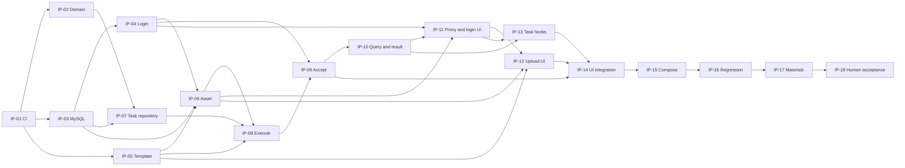

# 任务追踪与 Implementation Plan（Assessment / Track A）

日期：2026-10-30（Asia/Shanghai）。**本轮仅完成实施规划；CI、业务代码、DDL、测试和容器配置均未修改。**
后续由用户明确指定实施任务后再开始；没有自动启动 IP-01。历史编号、结果与未验证事项保留在第 10 节。

## 1. Implementation Overview

### 1.1 基线与范围

依据 [requirements.md](requirements.md) 的 ASMT-R-01～14、48 条 AC 与 VT-01～14，
[domain-model.md](domain-model.md)、[detailed-architecture.md](detailed-architecture.md)、
[api-contract.md](api-contract.md)、[database-design.md](database-design.md)、
[frontend-state-design.md](frontend-state-design.md)、[architecture.md](architecture.md)、
[architecture-decisions.md](architecture-decisions.md) 及根目录/前端 AGENTS。
已检查现有源码、POM、npm scripts、Dockerfile/Compose 和 CI。

按用户指定参考 ddd-skill 2.2.4 的 SKILL.md、Case/Domain/命名指引，并服从 ADR-006 的项目适配：
单 Maven 工程，trigger/api/cases/domain/infrastructure/types；Domain 纯 Java；所有入口经过 Case；
Task 聚合维护规则，Cases 编排事务/跨模块/后台执行，Infrastructure 实现输出契约。
不运行 archetype，不复制技能中的 Redis/MQ、默认密码、跳过测试的部署命令或模式框架。

本轮没有发现需要修改已确认需求的冲突。需求文档保留其分析阶段的“待设计”表述，实施选择以详细设计和 ADR-007～010 为准；
AGENTS 中“具体设计待完成”同样是旧阶段状态，不表示可以绕过现有设计重新选择。

| 当前事实 | 实施安排 / 完成证据要求 |
| --- | --- |
| 代码只有 scaffolding；后端仅 1 个不连接 JDBC 的上下文测试 | 业务、SQL、身份、多任务行为全部仍待实现和验证 |
| 现有 CI 有 push/PR、Maven verify、npm ci/lint/typecheck/build、Compose config | IP-01 优先补强测试入口及失败门禁，沿用现有工作流，不重新生成工程 |
| 前端尚无测试脚本/依赖 | IP-01 配置 Vitest + React Testing Library，锁定与现有栈兼容的版本；IP-12～14 补实际业务测试 |
| 当前无业务表、Mapper、账号/模板种子或上传卷 | IP-03 尽早启用真实 MySQL 验证；IP-04/05/06 分别提供真实初始化与资源 |
| Docker 和远程 CI 只有历史“未运行”记录 | 未来执行时重新检查环境；本轮没有重跑，不能当作当前故障或通过证据 |
| 用户确认预置账号登录/退出，不注册 | 保持 demo-a/demo-b、Cookie/Session/CSRF；不恢复访客选择器或 Bearer 提案 |

### 1.2 当前范围与未来边界

当前覆盖 R-01～R-13 强制要求，并继续采用现有 Compose 方向落实 R-14 推荐交付。
预置账号登录是用户确认的 MVP 方案；“完整身份认证系统”延期不包含这项登录/退出和本人数据隔离。

不排入真实 AI Provider、视频、对象存储、MQ/独立 Worker、Outbox、自动续跑/重试、注册/改密/角色、模板编辑/版本平台、
工作流引擎、独立 Generation/Result/History 模块、结果下载/删除/重新制作、分页或自动发布。
保留 MediaGenerator、AssetStorage、TaskDispatcher 的已选最小边界，不为未来增加空接口/表/字段。

任务编号使用 IP-01～IP-18，避免与历史 S/R/T 及 Assessment 的 R 编号混淆。
Verification 使用 V-01～V-18，细化并对应原 VT；这些都是**待执行验证**，不是测试已通过的声明。

## 2. Development Milestones

| 里程碑 | 任务 | 可观察退出条件 |
| --- | --- | --- |
| M0 工程验证入口 | IP-01 | 既有构建门禁保留，前端测试能真实运行并在断言失败时使 CI 失败；远程结果单列 |
| M1 规则与数据基础 | IP-02～05、IP-07 | 状态机受约束；真实 MySQL schema/条件写可验证；登录和只读目录可用 |
| M2 核心后台纵切 | IP-06、IP-08～10 | 合法素材受理后异步完成三阶段；三个失败点均中断；个人持久记录与图片可读 |
| M3 浏览器多任务闭环 | IP-11～14 | 登录、上传、连续制作、独立跟踪、异常恢复、刷新及 A/B 隔离有实际 UI 和行为测试 |
| M4 可复现交付 | IP-15～18 | 容器初始化/业务闭环及材料可复核，用户最终验收；未验证与已接受限制单列 |

M1 不要求先做完整界面；核心异步模型在 IP-02 开始、真实执行在 IP-08 落地。
各任务同步写测试；IP-16 是联合复核，不是把核心测试拖到最后。

## 3. Vertical Slices

| 纵切 | 端到端行为与组成任务 | 验收观察 |
| --- | --- | --- |
| VS-01 登录与只读浏览 | IP-03/04/05/11，加 IP-12 的目录页面 | Java 数据和合法图片可浏览；A 登录/退出后 B 登录；无注册入口 |
| VS-02 制作与成功结果 | IP-02/03/05/06/07/08/09/10，再 IP-11～14 接入浏览器 | 上传 → 202 ID → 三阶段 → MySQL 成功记录 → 可预览图片；不依赖页面持续打开 |
| VS-03 指定失败和请求故障 | IP-08/09/10/13/14 | 三个阶段分别失败且中断；查询断网仅暂停查询，恢复后读真实状态 |
| VS-04 多任务与个人恢复 | IP-04/07/08/10/11/13/14 | 多项独立执行/跟踪，终态停止；刷新恢复；退出/登录及晚到回调不会串用户 |
| VS-05 隔离环境交付 | IP-01/03/15/16/17/18 | 测试门禁、空库初始化、三服务/上传卷、操作说明及最终验收材料一致 |

这些纵切共享必要的工程基础，并非五套平行实现。后端先通过 API/集成测试证明 VS-02，再接入 UI。

## 4. Detailed Task Breakdown

每项仅创建当前实际需要的类/文件；具体 Java 签名从现有契约落实，不在计划中再定义另一套接口。
任务下的范围、验收和 V 项均属于完成条件；所有实施 checklist 当前保持未完成。

### IP-01：优先补强 CI 与测试工程入口

- [ ] IP-01 工程搭建完成并有验证记录。

**依赖**：已完成的 S-02/03/06；无需业务代码。**来源**：R-01、R-12，工程基线。

**范围**：审查并增量完善 .github/workflows/ci.yml、frontend 测试配置/scripts/lockfile、必要测试说明；保留 Java 17/Node 22、现有版本与构建方式。
配置 Vitest + React Testing Library，建立 test:ci 命令；以当前实际占位页面的最小可渲染检查验证测试环境，明确这不是 R-12 的业务测试。
不创建假业务模块或为满足测试数量写空断言。后端沿用已有 JUnit/Spring 测试入口。

**验收 / V-01**：

- push/PR 工作流包含 Maven verify、npm ci、test:ci、lint、typecheck、build、Compose config；任何失败均非零退出，没有 continue-on-error 或空测试通过开关。
- 本地与 CI 命令一致；临时制造一条测试失败，确认测试命令及工作流步骤不会吞掉错误，随后恢复，不提交故意失败的测试。
- 实际运行现有后端测试和至少一个前端测试，产出可定位的测试报告；不能仅检查 YAML 或声称 runner 已通过。
- 若有权限且已有授权的远程运行可记录其 run/commit；本任务不包含推送或部署授权。远程不可运行时标为未验证，不以本地结果冒充；最终由 IP-17/18复核。
- MySQL CI 门禁明确在 IP-03 引入真实 schema 测试；容器业务门禁在 IP-15 引入。此时不得把尚未存在的业务测试标为完成。

**边界**：不新增业务端点、DDL、认证或任务逻辑；不为了搭建 CI 升级框架、禁用 ESLint 规则或跳过测试。

### IP-02：ProductionTask 领域模型及状态机

- [ ] IP-02 领域行为与测试完成。

**依赖**：IP-01。**范围**：domain.task 内聚合、必要值对象/枚举及纯恢复检查；只按 domain-model.md 建模。

**验收 / V-02**：初始输入/owner 固定；9 种合法组合；正常链、三阶段失败、执行前派发失败；跳步、回退、错误阶段失败、缺结果成功及终态修改均被拒绝。
重复素材位置保持；恢复对象不产生副作用。无公开状态 setter、Spring/MyBatis/HTTP 或其他域仓储依赖。
采用参数化 Domain Unit Tests 检查合法边和非法组合，并对已有真实类补依赖规则检查；无需引入架构框架即可完成时使用现有工具。

### IP-03：初始数据库结构与真实 MySQL 测试门禁

- [ ] IP-03 schema、初始化说明和 MySQL CI 测试完成。

**依赖**：IP-01。**范围**：四表有版本标识的初始 schema、索引/CHECK/聚合内外键、隔离测试库配置、Maven 集成测试入口、CI MySQL 8.4 service。
本任务只准备账号表，实际账号初始化归 IP-04；模板/媒体不进 SQL。不启用启动自动建表，不新增迁移框架。

**验收 / V-03**：全新隔离库可按脚本初始化；实际 JDBC 检查四表、索引、唯一性及 FK；非法状态和 NULL/结果/失败组合被拒绝，UTC/字节边界明确。
使用真实 MySQL，不以 H2/上下文测试替代；以 *IT 和 Maven Failsafe 接入 integration-tests profile：
CI 执行 mvn --batch-mode --no-transfer-progress -Pintegration-tests verify，必须发现并执行真实集成测试，测试库不可用时失败。
普通 Maven verify 保留不要求数据库的快速测试；两种证明范围分开。CI 临时测试凭据不复用用户数据/密码；输出不泄漏凭据。
初始化脚本仅用于初始结构；已有卷显式初始化方式与“首次空卷脚本不会重跑”均说明，不删除用户卷。

### IP-04：预置账号、Java 登录与会话保护

- [ ] IP-04 API-01/02/13/14 与账号初始化完成。

**依赖**：IP-03。**范围**：Identity 本域查询/PasswordVerifier、认证和当前账号 Case、显式账号初始化、安全过滤器/配置及 JSON 错误出口。
使用 Boot 管理的 Security；从 DEMO_A_PASSWORD/DEMO_B_PASSWORD 初始化两个账号，无注册/API 创建/管理员。
公共错误映射在本任务建立最小基础，后续模块只增量补充对应错误。

**验收 / V-04**：真实 MySQL 中仅保存带盐编码；重复初始化不重置密码/account_id；缺失首次密码和不合格字节长度明确失败。
Case 测试与 API Tests 检查统一登录失败、表单字段/编码边界、已登录 409、会话恢复、Session ID 更新、退出失效、空闲/绝对过期及 Cookie 属性。
CSRF 覆盖登录/退出及后续所有 POST；旧 token 不可在新会话写入；401/403/503 为契约 JSON，DB 故障不能当成未登录。
用可控时间验证到期，不真实等待数小时；Domain 不持有 Session/SecurityContext。账号身份稳定，Worker 不依赖登录存续。

### IP-05：只读模板目录与合法示例资源

- [ ] IP-05 API-03～06、模板公开 Case 及规则完成。

**依赖**：IP-01。**范围**：两项打包 JSON 模板、分类、封面和 Mock 图片资源及来源说明；Template 只读能力/Asset 媒体能力，规则值对象。

**验收 / V-05**：Java 返回不同分类及 1/2 张图片要求，5/8 MiB 和 JPEG/PNG 与现有契约一致；未知分类空列表、未知模板/封面 404。
素材要求的数量/大小边界有单元测试，单张上传验证和完整提交验证各有适用语义；种子重复 ID/无效规则/不可读资源使启动明确失败。
API/资源测试确认图片字节可解码、真实 MIME、公开 key 白名单，不能借路径访问私有文件；不建立模板表或管理后台。

### IP-06：上传、素材解析及本地存储

- [ ] IP-06 API-07/08 与 Asset 公开能力完成。

**依赖**：IP-03、IP-04、IP-05。**范围**：AssetStorage 本地实现、元数据仓储/DAO/PO、上传/解析/后台检查/资源 Case 和上传入口。

**验收 / V-06**：实际图片类型/可读性/字节数按模板校验；8 MiB 文件、9 MiB multipart 及模板更小上限正确处理；声明 MIME/文件名不可绕过。
内容稳定保存后才写元数据并返回 ID；文件成功/DB 失败时不返回可用素材、尽力清理，清理失败按既定窗口记录。
用临时目录 + Application Service Tests、真实 MySQL 集成及 multipart API Tests 检查错误状态/结构、本人读取、越权统一 404、路径越界和文件丢失。
解析保持输入顺序及重复位置；后台检查有真实 I/O 边界；无删除/消费语义，无模板永久绑定，Asset 不反向调用 Task。

### IP-07：Task 仓储、查询投影与条件保存

- [ ] IP-07 MyBatis 映射、事务和竞争测试完成。

**依赖**：IP-02、IP-03。**范围**：本域 Repository/查询契约与 adapter.repository.task、dao.task/dao.po.task；根和有序绑定的原子创建/恢复。

**验收 / V-07**：根/绑定任一失败全部回滚；顺序、重复素材位置、UTC、本人历史与查询映射正确；PO 不越界。
每次迁移同时匹配 taskId/revision/旧状态/旧阶段，完整结论和 revision+1 原子写入；owner/input/createdAt 不在更新集合。
真实 MySQL 用两个独立连接/事务和 barrier 控制竞争：仅一个首次抢占成功，旧 revision/旧阶段/终态写影响 0 行，成功/失败竞争不会产生混合结论。
不使用睡眠猜测顺序；检查影响行数。技术并发包络与聚合行为分离，无无条件整行覆盖。

### IP-08：后台执行 Case、Mock 与有界派发器

- [ ] IP-08 核心异步链和失败中断完成。

**依赖**：IP-05、IP-06、IP-07。**范围**：内部 IExecuteProductionTaskCase、MediaGenerator Mock、TaskDispatcher 及有界 executor/装配。
本任务以已创建测试任务进入执行，无公开受理 API；入口仅可信后台回调。

**验收 / V-08**：首次抢占提交后才检查素材，随后 GENERATE、FINALIZE；每次阶段进入先持久化，再在事务外 I/O/延迟。
素材检查、生成、整理是三个可单独观察/失败的边界；只在资源就绪后保存成功，候选不等于结果。
JUnit Case 测试用受控协作者/事件记录与 latch 检查调用顺序、每个失败点后无后续调用、终态重入无生成、各任务模拟设置互不影响。
结合真实 MySQL 验证重复派发仅一个获准执行，状态可在独立连接读取；0 行或 DB/commit 未知后停止，无重试生成。
默认 2 worker/64 队列，可用小容量注入确定性拒绝；不 caller-runs、不静默丢弃；退出/关页不取消执行。
模拟延迟/失败按受理捕获的不可变参数传入，等待在事务外；停机最多等 30 秒的限制如实记录，不增加恢复扫描。

### IP-09：制作受理 Case 与提交 API

- [ ] IP-09 API-09 的受理、派发和异常语义完成。

**依赖**：IP-04、IP-08。**范围**：创建 Case、输入/模拟配置映射、POST tasks、受理错误及明确派发拒绝处理。

**验收 / V-09**：通过 Template/Asset 公开 Case 校验可信输入及归属；根和绑定独立短事务提交成功后才派发，202 含 ID/owner/createdAt/Location，不伪造 PENDING 快照。
以 latch 阻止后台完成来证明提交已返回；输入或事务明确失败不派发、不假称受理。顶层已有事务在副作用前拒绝，生成/等待不占长事务。
每项 simulation 独立冻结；非法/禁用控制、未知/重复 JSON 字段、64 KiB 边界按 API 返回错误，无任务失败卡片语义。
明确 executor 拒绝尽力保存 FAILED/空阶段/DISPATCH_REJECTED，已有记录仍返回 202；拒绝写竞争失败不覆盖新状态。
用事务/派发替身确定性注入 commit 未知和拒绝后写失败，确认不重复创建/派发、保留可追查 ID/真实窗口；不能声称每次断网已确认回滚。

### IP-10：个人任务查询、历史与成功图片

- [ ] IP-10 API-10～12 与本人查询/结果 Case 完成。

**依赖**：IP-09。**范围**：Task 本域只读投影、IQueryProductionTaskCase、IReadTaskResultCase 及 HTTP 映射。

**验收 / V-10**：查询/历史读取同一持久事实，不派发、不推进、不修改 revision；无查询也可执行完。
A/B 各自历史和单任务/结果隔离，跨 owner/不存在统一 404，客户端 ownerId 不能授权；Worker 从 DB 使用原 owner。
所有 TaskView 字段/组合、revision、UTC 时间、失败阶段/原因和排序符合 API；FAILED 记录为 GET 200。
结果先检查归属及 SUCCEEDED，再经 Asset 媒体能力读取；未成功 409、资源故障 503，均不回退任务结论。
API Tests + MySQL/图片集成完成后，已有最小后端纵切：登录→上传→202→三步→个人历史→真实预览；页面关闭期间无查询仍能完成。

### IP-11：Next 同源代理、登录 UI 与身份上下文

- [ ] IP-11 转发、登录/退出及客户端会话上下文完成。

**依赖**：IP-04、IP-06、IP-10。**范围**：Node Route Handler 白名单转发、共用传输/错误识别、AuthProvider、/login 与用户名/退出入口。
先读 frontend/AGENTS 及安装版本 Next 文档；不引入 Next 业务执行或 DB 访问。

**验收 / V-11**：运行时 JAVA_API_ORIGIN；14 项 API 方法/路径按契约转发；Cookie/CSRF/multipart boundary/逐条 Set-Cookie/图片/状态码保真，私有 no-store。
以 Route Handler 集成测试/受控上游检查非法目标/路径拒绝、上游不可用/超时映射、写请求不重放；转发各真实 Java 编码至少一次。
组件测试检查用户名密码登录/退出、认证写串行、401 与 503 区分、403 后核对会话而非自动重放；无注册/访客下拉或浏览器凭证持久化。
身份 epoch、跨标签页不含凭证的通知和 focus 会话复核具备行为测试；旧 token 写入拒绝的真实浏览器情形在 V-16 联验。
默认客户端 30 秒、代理响应头预算 60 秒有可控时间测试；Cookie 属性和多个 Set-Cookie 透传另作实际 HTTP 检查，不能只 mock fetch 后认定浏览器会话已通。

### IP-12：模板列表、详情与上传交互

- [ ] IP-12 模板/素材 UI 与上传竞态测试完成。

**依赖**：IP-05、IP-06、IP-11。**范围**：/templates、详情制作输入区域，按真实规则的上传位/预览/替换/移除，加载/空态/不存在/请求错误。
本任务不实现任务跟踪 controller；为 IP-14 提供已准备好的有序素材输入。

**验收 / V-12**：数据取自 Java；前端数量/类型/大小校验与模板一致；全部就绪才允许制作，上传中/失败有独立反馈。
组件/Hook Tests 用受控 Promise 测替换/移除/模板切换后的旧上传成功、错误及 finally 均不能复活旧素材或覆盖新请求状态。
选择版本/请求序号/上下文共同保护，释放本地 blob；服务端引用与浏览器预览分开，移除不删除已保存素材。
目录、详情和上传位有语义标签、可见焦点、桌面/小屏基本布局；业务反馈不只靠颜色。

### IP-13：每任务状态合并与轮询 controller/hooks

- [ ] IP-13 多任务核心状态和行为测试完成。

**依赖**：IP-10、IP-11。**范围**：任务 reducer/作用域 hooks、history 与单查合并、每任务 timer/请求状态，使用已稳定共用传输契约。
本任务用小型测试宿主验证 hooks 行为，不承担 IP-14 的完整页面组合。

**验收 / V-13**：按 taskId 隔离；每任务 settle 后递归 2 秒查询，同一自动查询不重叠；终态只停自己，空集合/全部结束无自动请求。
用 fake timers、受控 Promise 验证乱序 revision、不相邻快照、同版本矛盾、终态保护，晚到历史不删除新受理占位。
queryError 保留 TaskView、仅暂停该查询、可手动恢复；真实 FAILED 与查询异常分字段/行为；401 失效身份，503 不退出。
离页/切换先失效 epoch，再释放 timer/abort；即使 abort 无效，旧 success/catch/finally/timeout 不污染数据/loading/错误或重启 timer，包括 A→B→A。
React Strict Mode setup/cleanup 不重复发出业务 POST；只读历史/跟踪按新 controller 恢复。自动化覆盖 R-12 的两项前端核心行为。

### IP-14：制作提交、历史与结果页面整合

- [ ] IP-14 浏览器业务闭环与刷新恢复完成。

**依赖**：IP-09、IP-12、IP-13。**范围**：制作按钮/请求 gate、受理占位、任务卡片、/history、媒体加载/回收、刷新恢复及布局整合。

**验收 / V-14**：同表单同步防双击、提交时固定素材、202 后释放提交状态并立即读取真实快照；可继续创建另一任务。
提交结果未知不自动 POST、不伪造 FAILED，可核对 ID/个人记录；上传/提交/查询/执行/图片异常独立表达。
先恢复 Java 会话再读本人历史，仅未结束任务继续跟踪；初始请求失败不是空历史，成功/失败刷新不回退。
私有图片经 Cookie fetch/blob，旧媒体响应不得挂入新身份，替换/离页/退出时 revoke；预览失败不改 SUCCEEDED。
Component/Hook Tests 覆盖受理瞬间已终态、连续多项、刷新恢复、身份切换与媒体清理；人工检查参考布局、键盘、小屏及可实际预览。

### IP-15：Compose 初始化、上传卷与容器业务门禁

- [ ] IP-15 三服务真实运行及容器验证接入 CI。

**依赖**：IP-14。**范围**：复用 Dockerfile/Compose，加入 schema 初始化挂载、账号初始化环境、JAVA_API_ORIGIN、backend 上传卷及实际需要配置；隔离 smoke 脚本和 CI job。

**验收 / V-15**：准备脱敏配置后从空的专用验证卷启动三服务，实际 SQL/账号/模板就绪；通过 frontend 端口完成 CSRF→登录→上传→提交→查询→结果，无测试依赖宿主机应用进程。
镜像构建、服务就绪、初始化和业务 smoke 均单列；私有接口/素材真实可读。Compose down/up 保留数据库/上传内容，重新登录同账号仍有历史/素材；不要求重启续跑未结束任务。
CI 在此接入隔离容器 smoke，失败提供脱敏日志并非零退出，临时资源在结束后清理；只清理专用验证项目/卷，不能删除用户卷。
保留 config --quiet 门禁；已有卷不自动重放 schema/重置密码，文档与实际行为一致；镜像非 root 用户可写上传卷。
本任务补完历史 T-04 的三服务/真实 DB 验证，IP-03 已提前完成 SQL 层集成，不把 DB 风险留到这里才发现。

### IP-16：联合故障、多任务和验收回归

- [ ] IP-16 VT-01～14 的适用运行检查和证据登记完成。

**依赖**：IP-15。**范围**：复用每项已有测试，补剩余跨边界回归与人工验收；不另建一套工作流/大型 E2E 平台。

**验收 / V-16**：容器中执行成功、三个指定失败、耗时控制、多个任务、关页继续、处理/终态刷新、A/B 隔离、查询中断/恢复、旧请求/图片晚到情形。
同浏览器退出/登录及共享 Cookie 跨标签页场景确认旧 token 写入被拒绝，旧读取不污染；不同浏览器可分别演示 A/B。
验证本机队列拒绝、文件/元数据失败、状态写失败的自动化证据与限制说明；硬崩溃/派发窗口不承诺自动续跑。
按真实对象审查层依赖、跨模块契约、事务边界和全部 14 个 API 的覆盖，补缺陷测试并修复后重跑相关项；人工桌面/小屏/键盘检查单列。
结果按 AC 登记通过/失败/未验证及证据，不以整体 build 成功代替业务验收，也不把故障演示中资源不可读标作预览通过。

### IP-17：README、材料与验收版本准备

- [ ] IP-17 可复现交付材料和证据核对完成。

**依赖**：IP-16。**范围**：按实际实现同步 README/相关设计状态、运行测试命令、初始化/资源来源、API/模拟控制/身份/刷新操作、部署回滚基本步骤与证据索引。

**验收 / V-17**：从干净源码副本按说明执行安装/构建/测试及容器启动，源码包不依赖工作区缓存/个人文件；源码/lockfile/schema/初始化/素材/CI/README 齐全，无真实秘密。
成功、三阶段失败、耗时调整、多任务、身份切换与刷新演示命令可复制；登录需密码环境配置，没有通用默认密码。
如实写 AI 工作流及修正实例、复用来源、开发/验证/整理实际投入、未完成与重启限制；投入记录由用户核实，不推算虚构时长。
回滚说明覆盖代码版本与数据库/文件关联数据，不声称 schema 可自动无损降级；不执行生产部署。
本地、MySQL、Compose、远程 CI 各有环境/时间/命令/结果或明确未验证；仓库交付的候选 commit 在实际形成后填入，不虚构编号。

### IP-18：用户最终审查、验收与约定交付

- [ ] IP-18 用户确认最终验收和交付记录。

**依赖**：IP-17。**负责人**：用户；Agent 仅准备清单和材料。

**验收 / V-18**：用户审查核心模型、公共 API、架构边界及实际演示，确认 AC 结果与剩余限制；核对收到任务的沟通渠道、约定日期与最终版本/包。
仅在用户明确授权后执行提交/推送/对外发送；本规划不授权这些动作。不把材料备妥等同已向招聘方交付。
ASMT-R-13-06 的实际交付需要此记录，不能由自动测试或 Agent 自行勾选。

## 5. Task Dependencies

### 5.1 必要依赖表

依赖表示可验证的前置产物，不按需求编号建立串行链；历史任务不作为本表待执行节点。

| 任务 | 必须完成的 IP 前置 |
| --- | --- |
| IP-01 | 无 |
| IP-02 | IP-01 |
| IP-03 | IP-01 |
| IP-04 | IP-03 |
| IP-05 | IP-01 |
| IP-06 | IP-03、IP-04、IP-05 |
| IP-07 | IP-02、IP-03 |
| IP-08 | IP-05、IP-06、IP-07 |
| IP-09 | IP-04、IP-08 |
| IP-10 | IP-09 |
| IP-11 | IP-04、IP-06、IP-10 |
| IP-12 | IP-05、IP-06、IP-11 |
| IP-13 | IP-10、IP-11 |
| IP-14 | IP-09、IP-12、IP-13 |
| IP-15 | IP-14 |
| IP-16 | IP-15 |
| IP-17 | IP-16 |
| IP-18 | IP-17 |

建议默认串行顺序：IP-01 → IP-02 → IP-03 → IP-04 → IP-05 → IP-06 → IP-07 → IP-08 → IP-09 → IP-10 → IP-11 → IP-12 → IP-13 → IP-14 → IP-15 → IP-16 → IP-17 → IP-18。
这是一条便于单 Agent 执行和审查的顺序；表中允许的独立分支不代表必须并行。

结构性关键路径为：IP-01 → IP-03 → IP-04 → IP-06 → IP-08 → IP-09 → IP-10 → IP-11 → {IP-12、IP-13 汇合} → IP-14 → IP-15 → IP-16 → IP-17 → IP-18。
IP-02→IP-07 和 IP-05 也须在 IP-08 前汇合；缺少工时实测，不能声称已经计算出按时长确定的最长路径。

### 5.2 并行开发建议

默认先串行，先完成可运行契约及其测试。以下仅是**未来可选安排**，本轮不启动多个 Agent。

| 可选并行 | 必须满足的条件 | 冲突控制 |
| --- | --- | --- |
| IP-02 / IP-03 / IP-05 | IP-01 完成；领域/数据库/模板契约按已有设计锁定，无待变更的公共语义 | IP-02 仅 task Domain；IP-03 负责 POM/CI/schema；IP-05 负责模板/媒体。全局应用配置或依赖由指定单一任务写入，冲突时改串行 |
| IP-04 / IP-07 | IP-02/03 完成，两模块 Repository/装配边界已核对 | Identity 与 Task DAO/测试分目录；共用错误/配置由 IP-04 单一维护，不各自重写 |
| IP-12 / IP-13 | IP-11 的传输/Auth 契约和 IP-10 TaskView 已稳定且测试通过 | template/asset UI 与 task hooks 分目录；共用 lib、类型和路由组合由 IP-11/IP-14 管理 |

IP-08→09→10 的首次真实异步联调、IP-14 的页面整合、CI/lockfile/Compose 的同一文件修改保持串行。
若实现发现必须改 API/领域含义，先说明原因、兼容性和影响并由用户决定，相关任务恢复串行；不能靠各 Agent 私下修改契约消除冲突。
每个并行任务独立验证，汇合后再验证集成；不得拿单分支通过代替合并结果。

## 6. Requirements Traceability

下表保持 Requirement → 原 AC → 实现任务 → Verification；AC 原文以 requirements.md 为准，不重新定义。
V 的具体方法/预期在任务说明及第 7 节，证据状态均为计划、未执行。
每条 AC 至少有一项实现/交付任务和验证方式；“部分自动化”不等于已经通过。

| Requirement | Acceptance Criteria | Implementation Task | Verification / 关键观察 |
| --- | --- | --- | --- |
| ASMT-R-01 | AC-R-01-01 | IP-01、IP-17 | V-01/17：依赖、入口、版本及构建 |
| ASMT-R-01 | AC-R-01-02 | IP-03、IP-06～10 | V-03/06/07/08/09/10：Java 执行、MySQL 持久读写 |
| ASMT-R-01 | AC-R-01-03 | IP-01、IP-15、IP-17 | V-01/15/17：按 README 构建/启动 |
| ASMT-R-02 | AC-R-02-01 | IP-05、IP-11、IP-12 | V-05/11/12：Java 分类/列表/卡片/详情 |
| ASMT-R-02 | AC-R-02-02 | IP-05、IP-12 | V-05/12：不同分类、1/2 素材数 |
| ASMT-R-02 | AC-R-02-03 | IP-05、IP-15、IP-17 | V-05/15/17：实际合法资源及来源说明 |
| ASMT-R-03 | AC-R-03-01 | IP-05、IP-06、IP-12 | V-05/06/12：详情要求、预览/替换/移除 |
| ASMT-R-03 | AC-R-03-02 | IP-12、IP-14 | V-12/14：上传反馈、未就绪及提交防双击 |
| ASMT-R-03 | AC-R-03-03 | IP-05、IP-06、IP-09、IP-12 | V-05/06/09/12：前后端数量/类型/大小边界 |
| ASMT-R-03 | AC-R-03-04 | IP-06、IP-08、IP-15 | V-06/08/15：后台实际读文件、卷保留 |
| ASMT-R-03 | AC-R-03-05 | IP-05、IP-12 | V-05/12：不存在、加载/空/错误分别表达 |
| ASMT-R-04 | AC-R-04-01 | IP-07、IP-08、IP-09、IP-14 | V-07/08/09/14：提交后异步返回 ID，无伪快照 |
| ASMT-R-04 | AC-R-04-02 | IP-08、IP-10、IP-16 | V-08/10/16：关闭页面仍执行、重新读取 |
| ASMT-R-04 | AC-R-04-03 | IP-08、IP-09、IP-13、IP-14 | V-08/09/13/14：多项独立 ID/设置/记录 |
| ASMT-R-05 | AC-R-05-01 | IP-02、IP-08 | V-02/08：三个真实执行边界和调用顺序 |
| ASMT-R-05 | AC-R-05-02 | IP-03、IP-07、IP-08、IP-10 | V-03/07/08/10：持久状态/阶段/结论 |
| ASMT-R-05 | AC-R-05-03 | IP-02、IP-07、IP-08、IP-10、IP-14 | V-02/07/08/10/14：整理成功才成功，图片可读、终态保护 |
| ASMT-R-05 | AC-R-05-04 | IP-08、IP-10 | V-08/10：零查询完成，重复读无副作用 |
| ASMT-R-06 | AC-R-06-01 | IP-08、IP-09、IP-17 | V-08/09/17：三个指定失败可重现，后续零调用 |
| ASMT-R-06 | AC-R-06-02 | IP-02、IP-07、IP-08、IP-10、IP-14 | V-02/07/08/10/14：失败阶段/原因一致且持久 |
| ASMT-R-06 | AC-R-06-03 | IP-08、IP-09、IP-16、IP-17 | V-08/09/16/17：耗时调整和正常成功路径 |
| ASMT-R-07 | AC-R-07-01 | IP-12、IP-13、IP-14 | V-12/13/14：上传/提交/受理/执行状态分开 |
| ASMT-R-07 | AC-R-07-02 | IP-10、IP-13、IP-14 | V-10/13/14：展示服务端阶段/终态/原因 |
| ASMT-R-07 | AC-R-07-03 | IP-11、IP-13、IP-14、IP-16 | V-11/13/14/16：保留已知信息，手动恢复，无伪 FAILED |
| ASMT-R-08 | AC-R-08-01 | IP-07、IP-08、IP-13、IP-14 | V-07/08/13/14：后台及前端任务独立、乱序隔离 |
| ASMT-R-08 | AC-R-08-02 | IP-13、IP-14 | V-13/14：按任务停止，首次空/全部结束无空转 |
| ASMT-R-08 | AC-R-08-03 | IP-11、IP-12、IP-13、IP-14 | V-11/12/13/14：离页/身份变化清 timer/abort，不重启 |
| ASMT-R-08 | AC-R-08-04 | IP-11、IP-12、IP-13、IP-14、IP-16 | V-11/12/13/14/16：旧 success/error/finally 均失效，A→B→A |
| ASMT-R-09 | AC-R-09-01 | IP-07、IP-10、IP-14 | V-07/10/14：个人记录、时间、真实图片或失败原因 |
| ASMT-R-09 | AC-R-09-02 | IP-04、IP-10、IP-11、IP-13、IP-14、IP-16 | V-04/10/11/13/14/16：会话后读 Java，刷新恢复跟踪 |
| ASMT-R-09 | AC-R-09-03 | IP-07、IP-10、IP-13 | V-07/10/13：同源记录、自洽快照/版本、终态不退 |
| ASMT-R-10 | AC-R-10-01 | IP-04、IP-11、IP-17 | V-04/11/17：账号/会话/owner/记录关联及演示说明 |
| ASMT-R-10 | AC-R-10-02 | IP-04、IP-06、IP-09、IP-10、IP-11、IP-13、IP-14、IP-16 | V-04/06/09/10/11/13/14/16：A/B 服务端隔离及旧 UI 回调隔离 |
| ASMT-R-11 | AC-R-11-01 | IP-12、IP-14、IP-16 | V-12/14/16：列表/详情/历史主要参考布局和反馈 |
| ASMT-R-11 | AC-R-11-02 | IP-12、IP-14、IP-16 | V-12/14/16：桌面、小屏主流程人工操作 |
| ASMT-R-11 | AC-R-11-03 | IP-11、IP-12、IP-14、IP-16 | V-11/12/14/16：语义、标签、键盘与焦点 |
| ASMT-R-12 | AC-R-12-01 | IP-01、IP-03、IP-15、IP-17 | V-01/03/15/17：push/PR、测试/构建、CI 材料，远程结果单列 |
| ASMT-R-12 | AC-R-12-02 | IP-02、IP-08、IP-09 | V-02/08/09：实际顺序及三个失败中断测试进 CI |
| ASMT-R-12 | AC-R-12-03 | IP-01、IP-13、IP-14 | V-01/13/14：实际多任务、查询故障/执行失败测试进 CI |
| ASMT-R-13 | AC-R-13-01 | IP-03、IP-04、IP-05、IP-15、IP-17、IP-18 | V-03/04/05/15/17/18：源码/锁/结构/初始化/资源/CI，最终版本 |
| ASMT-R-13 | AC-R-13-02 | IP-03、IP-04、IP-05、IP-15、IP-17 | V-03/04/05/15/17：版本/连接/配置/初始化可复现 |
| ASMT-R-13 | AC-R-13-03 | IP-08～11、IP-14、IP-16、IP-17 | V-08/09/10/11/14/16/17：API、阶段和所有演示路径 |
| ASMT-R-13 | AC-R-13-04 | IP-15、IP-16、IP-17、IP-18 | V-15/16/17/18：实际限制/投入、部署与回滚说明 |
| ASMT-R-13 | AC-R-13-05 | IP-05、IP-17 | V-05/17：素材/复用来源、AI 工作流及实际修正说明 |
| ASMT-R-13 | AC-R-13-06 | IP-17、IP-18 | V-17/18：用户核对约定日期/渠道并授权交付 |
| ASMT-R-14 | AC-R-14-01 | IP-03、IP-04、IP-05、IP-15、IP-17 | V-03/04/05/15/17：已选推荐 Compose，初始化后实际业务闭环 |
| ASMT-R-14 | AC-R-14-02 | IP-17 | V-17：本项目已选 Compose，此条件分支不适用；仍交付必要启动/配置/初始化说明 |
| ASMT-R-14 | AC-R-14-03 | IP-15、IP-17 | V-15/17：解析/镜像/就绪/初始化/业务证据分列 |

覆盖审查：48 条 AC 均已分配；R-04～10 在 IP-02/06～14 及 V-16 联验，R-12 的行为测试分别由 IP-08 和 IP-13 提前落实；
R-13 的来源、实际投入、交付渠道没有被 build 代替；R-14 保持推荐与条件分支语义。当前没有未分配的强制需求。
IP-01～17 均服务当前 AC 或已确认的工程约束，IP-18 是用户交付关卡；没有 Track B 实施任务。

## 7. Verification Strategy

### 7.1 分层验证与执行入口

| 类型 | 主要任务 / V | 方法与可观察结果 |
| --- | --- | --- |
| Domain Unit Tests | IP-02/05；V-02/05 | JUnit 参数化边/组合/规则边界，不起 Spring；合法迁移成功、非法迁移拒绝 |
| Application Service Tests | IP-04/06/08/09/10；V-04/06/08/09/10 | Case 的受控协作者、latch/barrier、调用记录和事务观察；验证提交/副作用时序及失败后零调用 |
| Repository / MyBatis Integration Tests | IP-03/04/06/07；V-03/04/06/07 | MySQL 8.4 隔离库，真实 Mapper/SQL/事务；回滚、NULL CHECK、owner 和两执行者竞争 |
| API Tests | IP-04～06/09/10/11；V-04～06/09/10/11 | Spring 测试 + 真实 HTTP/受控上游，校验字段、编码、状态/错误、Cookie/CSRF/图片和代理一致性 |
| Frontend Component / Hook Tests | IP-11～14；V-11～14 | Vitest/RTL、fake timers、可控 Promise 和测试宿主；观察 UI/请求/清理行为，不镜像 reducer 实现 |
| Build and Static Analysis | IP-01 起持续；V-01/17 | Maven verify；npm ci、test:ci、lint、typecheck、build；真实类出现后检查层与模块依赖 |
| Docker Integration Verification | IP-15/16；V-15/16 | Compose config、镜像构建、三服务 SQL/HTTP 就绪、初始化及 frontend 入口业务 smoke 分层验证 |
| Manual Acceptance Testing | IP-12/14/16/18；V-12/14/16/18 | 桌面/小屏、键盘、真实图片、关页/刷新、浏览器共享会话、A/B 演示及用户最终验收 |

后端：普通 mvn --batch-mode --no-transfer-progress verify 跑快速测试/构建；IP-03 起另跑带 integration-tests profile 的 verify，
CI MySQL job 必须实际执行 *IT。前端：IP-01 起 npm run test:ci 为单次运行、非 watch，后续业务测试加入同一入口；
配合 npm ci、npm run lint、npm run typecheck、npm run build。根目录沿用 docker compose --env-file .env.example config --quiet，
它只使用脱敏样例验证配置；真正业务运行使用独立验证配置，不用示例密码冒充安全运行配置。

没有指定覆盖率百分比或 E2E 框架门槛。测试工具版本在 IP-01 安装前验证兼容性并精确锁定；不修改已有框架版本来迁就测试工具。
负向测试从外部边界/业务规则出发，不只断言静态文字或 getter；等待使用确定性同步和有限超时，避免长 sleep 导致脆弱测试。

### 7.2 关键风险场景的验收证据

| 场景 | 自动化重点 | 联合/人工确认 |
| --- | --- | --- |
| 状态机、非法转换、终态不回退 | V-02 穷举边/组合；V-07 旧写及成功/失败竞争 | V-16 查询/刷新终态保持 |
| 三阶段顺序、指定失败中断 | V-08 逐阶段调用记录、每个失败点无后续调用；V-09 模拟参数捕获 | V-16/17 实际命令演示及持久结果 |
| 多任务不串扰 | V-07/08 独立记录与本地执行参数；V-13 受控乱序响应 | V-14/16 连续制作不同结果 |
| 用户身份隔离 | V-04/06/09/10 owner/CSRF/API；V-11/13 epoch 和跨页通知 | V-16 真实 Cookie 的退出/登录及跨标签页 |
| 前端轮询生命周期 | V-13 fake timers 检查单项终态/空集合/首次空/无重叠 | V-16 浏览器观察请求数量 |
| 清理和旧响应隔离 | V-12/13/14 分别测试 timer/abort/revoke 和旧 success/error/finally/timeout | V-16 离页、A→B→A、返回焦点 |
| 查询异常与执行失败 | V-10 FAILED=200；V-13 查询503保留快照/暂停/恢复；V-14 图片失败独立 | V-16 暂停查询后后台完成，再恢复 |
| 刷新后任务恢复 | V-10 MySQL 同一历史；V-14 挂载重建从会话/Java 恢复 | V-15/16 容器环境处理中、成功/失败刷新 |
| 提交/文件/状态写故障 | V-06 文件成功DB失败；V-08/09 拒绝/0行/commit未知后不继续 | V-16/17 限制与实际行为一致，不承诺续跑 |

### 7.3 CI 逐步增加实际门禁

1. IP-01 保留既有构建并启用前端测试；该时刻业务测试覆盖仍为零，明确记录。
2. IP-02/05/08/09 的单元/Case 测试自动进入 Maven verify；IP-03 新增真实 MySQL job，以有意义的 schema 测试开始，IP-04/06/07 的 *IT 持续接入。
3. IP-11～14 的组件/Hook/代理测试进入 test:ci；IP-13 合并时必须已有 R-12-03 的实际核心测试。
4. IP-15 加容器业务 smoke；到交付时四类门禁均需有实际执行结果或明确阻塞，不允许新增空 job 作为通过证据。

不设置空测试放行、不用 skip/关闭规则换绿色、不启用自动部署。
远程 CI 未运行与本地命令失败是不同状态；远程权限/网络限制不能被写成业务验证通过。

### 7.4 证据与验收登记格式

每个任务完成报告至少包含：任务/AC/V ID、修改文件、命令与工作目录、环境/时间、实际断言和结果、报告路径、未验证项/风险。
自动化测试源码与报告定位到实际文件/用例；人工步骤记录输入、预期/实际、可复现证据；不在本计划伪造未来测试文件名或通过记录。
后续在任务下补实际记录，并保留下列最终验收登记字段：

| AC | 实现任务/版本 | 自动测试或人工步骤位置 | 实际结果/证据 | 审查人/日期 |
| --- | --- | --- | --- | --- |
| 各 AC（实施时按第 6 节逐条登记） | 未实施 | 第 6 节对应 V，待补实际位置 | 未验证 | 待登记 |

## 8. Definition of Done

### 8.1 单任务 DoD

任务 checklist 仅在以下适用项全部满足后勾选：

- 当前范围实现完整，直接依赖已有可用产物；对应 AC 和任务验收有实际证据，无空壳/假返回代替业务行为。
- 关键/负向行为测试随实现完成并接入指定入口；相关构建、静态和集成检查通过，报告命令/数量/失败/跳过情况。
- 检查真实依赖：Domain 无框架，Trigger 只调 Case，Cases 不跨域访问内部 Repository/DAO，Infrastructure 不拥有状态流程；DTO/PO 不越界。
- 事务、归属和旧写/旧响应约束符合已确认设计；无秘密、无任意路径/身份输入绕过，文档与实际行为一致。
- diff 仅含当前任务必要变化，保留用户工作；API/领域/核心架构变化已说明理由、影响并经过用户决策。
- 提交修改文件、测试/手工结果与剩余风险报告，完成当前需要的代码审查。用户保留架构决定、代码审查和最终验收权。

环境受阻时标为“实现完成，验证受阻/待审查”等具体状态，保留 [ ]，不得说已满足 DoD；修复阻塞后补跑。
文档规划完成不代表业务任务完成；最终验收/对外交付只能由 IP-18 用户确认。

### 8.2 统一 AI Coding 执行流程

1. 阅读当前 IP 任务、前置产物、对应需求/AC、设计及 AGENTS/相关 ddd-skill 指引；前端先读安装版本 Next 指引。
2. 检查相关源码、git 状态和已有测试，明确修改范围与用户已有变化。
3. 给出简短实现计划、可观察完成条件及会影响契约的假设；范围明确则直接推进，重大设计变化交用户决定。
4. 编写/更新必要行为测试；故障修复先重现，避免只照实现写断言。
5. 仅实现当前任务，按已选契约和依赖规则创建真实需要的代码。
6. 运行最小相关验证，再运行该任务要求的构建/集成检查；失败先定位，不隐藏结果。
7. 审查状态机、事务、模块依赖、归属/异步和前端生命周期是否越界，并检查 diff。
8. 报告修改文件、任务/AC/V 关联、命令/结果、未验证事项及剩余风险；材料不能暴露凭据。
9. 满足 DoD 才更新任务和证据状态；当前任务结束后由用户指定后续范围，不一次实现整项目。

禁止未经说明改公共 API/领域模型；禁止删除失败测试、关闭规则、空测试放行或跳过检查来通过；
禁止用未经验证结果宣称完成，或擅自加入新框架/基础设施/未来功能。遇到已确认范围内的普通实现选择可自行落实，
不反复请求已有授权；用户负责评审不等于每次文件编辑都需另行批准。

### 8.3 MVP 交付 DoD

R-01～13 所有强制 AC 逐条有证据，R-14 推荐/不适用分支如实登记；核心行为自动化在 CI 中可执行；
Java/MySQL 和浏览器/代理/文件闭环真实验证，容器证据分层；材料可独立复现，限制/投入/来源真实，用户完成最终验收与约定交付。
缺少远程 CI 运行时明确保留该项未验证，由用户据真实材料决定交付，不能伪造远程通过或自动把任务勾为完成。

## 9. Risks and Blockers

### 9.1 技术风险与处理任务

| 风险 | 处理 / 验证任务 | 当前状态 |
| --- | --- | --- |
| CI 只有构建骨架，可能漏跑实际测试 | IP-01 测试入口/失败门禁；IP-03 MySQL、IP-15 容器逐步加强 | 未实施，不把历史 1 test 当核心覆盖 |
| MySQL NULL CHECK、Mapper 原子性、首次抢占竞争 | IP-03/07 真库负向与竞争，IP-08 资格后副作用 | 待实际验证 |
| 安全过滤器/Session/CSRF/Set-Cookie 跨代理组合 | IP-04/11 自动化 + IP-15/16 真实 HTTP/浏览器 | 方案已选，集成风险较高 |
| 受理提交后派发窗口及 DB 结果未知 | IP-08/09 故障注入并停止后续；IP-17 如实说明 | 接受不自动恢复，不能新增 MQ 掩盖范围 |
| 文件与元数据非原子、非 root 卷权限 | IP-06 失败处理，IP-15 卷/重启实际读取 | 孤立文件可存在，无自动清理 |
| 前端 epoch/requestSeq/revision 各有职责，容易只保护成功分支 | IP-12～14 控制 Promise/timer/收尾回调测试，IP-16 联验 | 关键自动化必须保留 |
| 当前模板只读/素材不删除是校验在事务外的前提 | IP-05/06/09 保持不变；新增编辑/删除前重审 | 不把未来需求加入当前任务 |
| Docker、依赖下载、远程 runner 权限/网络 | IP-01/03/15 执行前检查，分别记录环境阻塞和功能缺口 | 历史 Docker 未运行；本轮未重新探测 |
| 参考图/素材及 README 投入、渠道/日期须真实 | IP-05 记录合法资源，IP-16 参考已读取布局，IP-17/18 用户核实实际材料 | 不复制个人卷面 URL、不猜日期/工时 |

目前没有阻止**实施规划**完成的需求问题。真正执行时，新增依赖/镜像可用性、真实 MySQL/Docker、远程 CI 运行条件需实际验证。
用户首个任务授权尚未给出；这是本轮明确停止实施的范围要求，不是需要反复确认的技术疑问。

### 9.2 Senior Engineering Lead Review

| 审查问题 | 结论、取舍与后续要求 |
| --- | --- |
| 是否完整覆盖 Assessment | 第 6 节 48 条 AC 全覆盖，推荐/条件分支不误升格；IP-18 保留人工交付责任 |
| 粒度是否适合 AI Coding | 每项聚焦单一可验收产物；执行、受理、查询和前端状态分别拆分，避免整个 Task 模块一项做完。IP-04/06 边界较多，应按测试子步骤推进；若仍超出一次审查，可增加子任务但保留父编号/追踪 |
| 是否存在不合理依赖 | 必要依赖表无环；领域/SQL/模板可独立，第一次联调默认串行；不把全 UI 或未来设施设为后台前置 |
| 核心异步是否过晚 | IP-02 立即建状态机，IP-03/07 早做真库与 CAS，IP-08 首次执行、IP-09/10 完成后端闭环；UI 完善在之后 |
| 是否过度设计 | 仅四表、最小 Case/Port、现有单体；无额外事件/领域服务/工作流，验证工具服务真实风险；未强制覆盖率或大型 E2E |
| 自动化是否足够 | 状态机、顺序/失败、真库竞争、owner、前端乱序/清理/故障均有自动化，CI 分阶段接入；浏览器会话和可用性保留人工检查，不能仅靠 mock |
| 尚需警惕 | IP-01 的占位测试不算 R-12 业务覆盖；IP-15 容器门禁不能空跑；远程 CI/最终交付不能由本地构建替代；已接受崩溃窗口需贯穿报告 |

结论：可进入逐任务实施，**第一项应为 IP-01**。本轮不执行它；按用户要求，等待明确指定第一个实施任务。

## 10. Implementation Status

### 10.1 当前阶段与实施 checklist

- [x] T-01：需求分析完成，R-01～R-14 / AC / VT 已整理；业务验收未执行。
- [x] T-02：领域建模、详细架构及用户确认的预置账号登录方案已记录；实现未开始。
- [x] T-03：Implementation Planning 完成；里程碑、纵切、任务依赖、48 条 AC 追踪、测试/DoD/AI 流程已规划。
- [ ] IP-01～IP-17：所有开发与验证任务未开始，逐项 checklist 见第 4 节。
- [ ] IP-18：用户最终审查/验收/交付未开始。
- [ ] T-04：完整容器与 MySQL 集成仍未运行；IP-03 先验证真库，IP-15 完成容器闭环后再更新此历史项。

### 10.2 保留的历史任务：Scaffolding

| ID | 任务 | 依赖 | 验收标准 | 状态 |
| --- | --- | --- | --- | --- |
| S-01 | 检查已有项目并保留用户文件 | 无 | 记录现状，不覆盖已有内容 | 完成 |
| S-02 | 后端入口、依赖、配置和模块边界 | S-01 | Java 17 编译与上下文测试 | 完成；verify 和 JAR HTTP 检查通过 |
| S-03 | 官方 Next.js 空模板与工具链 | S-01 | lint/typecheck/build | 完成；检查与 standalone HTTP 检查通过 |
| S-04 | Dockerfile、Compose、环境样例 | S-02、S-03 | Compose 解析；容器运行单列 | 解析通过，运行未验证 |
| S-05 | 工程文档和 Agent 规范 | S-02、S-03 | 文档与实现一致，标明待定内容 | 完成 |
| S-06 | GitHub Actions 骨架 | S-02、S-03、S-04 | 工作流包含后端、前端、Compose 检查 | 配置已创建，远程未运行 |

### 10.3 保留的历史任务：后端架构重设计（ddd-skill 2.2.4）

下表 R-01～03 是历史任务编号，**不等于 ASMT-R-01～03**。

| ID | 任务 | 依赖 | 验收标准 | 状态 |
| --- | --- | --- | --- | --- |
| R-01 | 对照技能设计分层优先的后端 | S-02、S-05 | Domain 内按业务划分；明确纯领域与基础设施依赖规则 | 完成，见 ADR-006 |
| R-02 | 迁移包说明并同步开发规范 | R-01 | 不遗留平行旧包结构，不添加业务类或依赖 | 完成；包路径和快照改动范围审查通过 |
| R-03 | 验证架构调整后的工程 | R-02 | Java 17 clean verify；只检查有实际对象的边界 | 完成；1 test 通过，JAR 打包成功；业务依赖规则待真实代码验证 |

### 10.4 保留的需求/设计准备任务

| ID | 任务 | 依赖 | 验收标准 | 状态 |
| --- | --- | --- | --- | --- |
| T-01 | 读取完整 Assessment 并逐项整理需求 | Assessment 原文（已取得） | 每项强制要求可追溯，具备 AC、职责依赖及验证计划 | 完成；见 requirements.md，业务验收未执行 |
| T-02 | 确定业务流程、身份隔离、API 与持久化模型 | T-01 | requirements/API/ADR 对齐 | 设计完成，2026-10-30；见详细架构及配套设计文档，实施/验收未开始 |
| T-03 | 切分最小业务纵切并补充测试计划 | T-02 | 任务有依赖、可观察验收标准 | 规划完成，2026-10-30；实施未开始 |
| T-04 | 运行容器并验证 MySQL 集成 | 可用的 Docker daemon | 镜像构建、三个服务启动及真实数据库检查 | 未开始；由 IP-03/15 分阶段承接 |

### 10.5 验证记录与状态解释

历史工程命令、结果与环境限制见 [README.md](../README.md)。它们不代表业务行为或本轮重新验证通过。
本轮只检查规划的 AC/任务/Verification 覆盖、依赖无环、文档链接/表格/空白以及文件改动范围；
不执行业务构建、CI、MySQL 或容器。本轮实际文档检查结果在完成报告中记录，实施时再补对应任务的运行证据。
